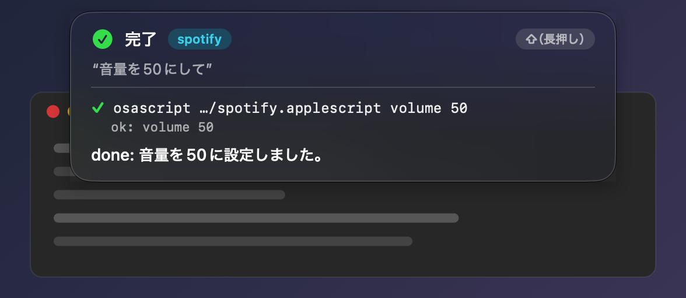
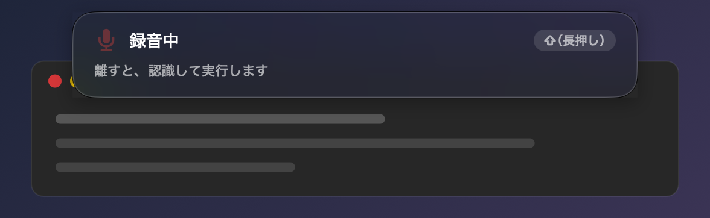
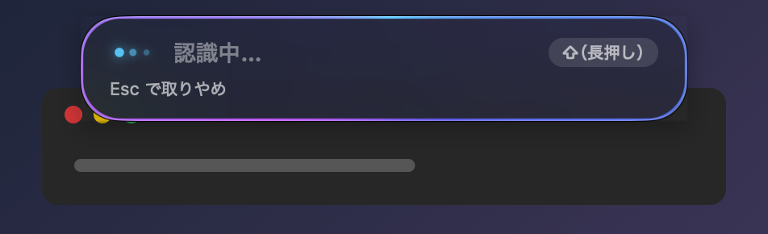
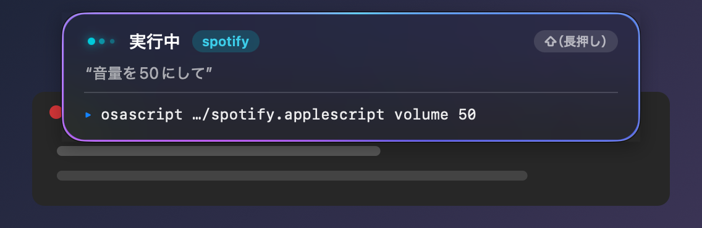
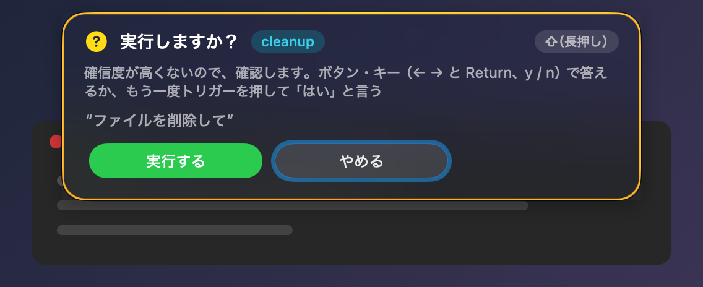
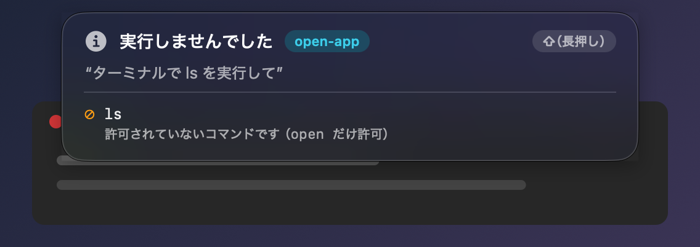
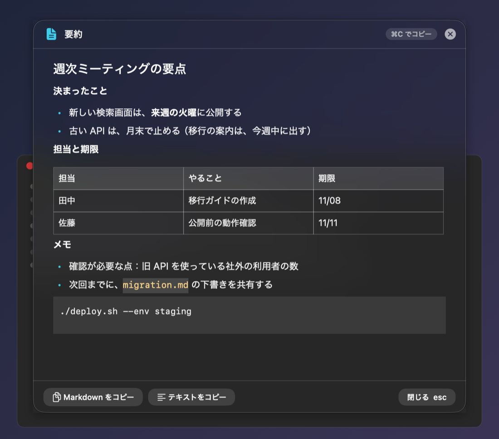
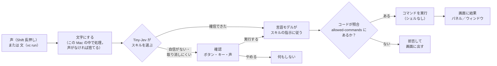
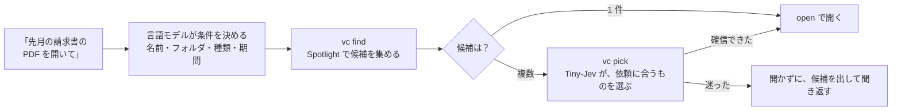
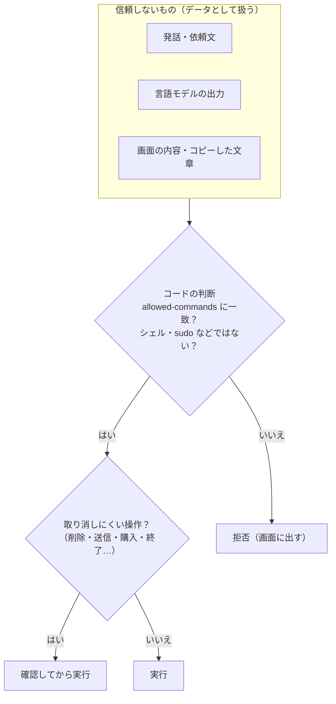

# voice-control

**声や文で頼むだけで、Mac の操作を実行する。** 使うモデルも、音声も、この Mac の中だけで動きます（試作）。

<p align="center">
  
</p>

> **「音量を50にして」** と話す → 合うスキルが選ばれる → 許可されたコマンドだけが実行される → 画面の上に、何をしたかが出る。

**製品ページ（インストール・使い方・注意点）：<https://takemo101.github.io/voice-control/>**

いまは CLI（`vc`）です。どんな使い道が成り立つかを、測定で確かめている段階で、完成した製品ではありません。

---

## 目次

[何ができる？](#何ができる) ・ [画面のイメージ](#画面のイメージ) ・ [仕組み](#仕組み) ・ [はじめる](#はじめる) ・ [使い方](#使い方) ・ [コマンド一覧](#コマンド一覧) ・ [安全のしくみ](#安全のしくみ) ・ [いまの状況](#いまの状況) ・ [詳しい文書](#詳しい文書)

---

## 何ができる？

「やりたいこと」を話すか書くと、合う**スキル**が選ばれて、実行されます。スキルは、`SKILL.md` というテキストファイルです（何をするか・どのコマンドを許すか・どう動くか）。

| こう頼む | 起きること | スキル |
|---|---|---|
| 「次の曲にして」「音量を50にして」「今の曲を読み上げて」 | Spotify を操作する（今の曲を、声で読み上げることもできる） | `spotify` |
| 「コピーした文章を要約して」 | ⌘C でコピーした文章を、整えて、きれいなウィンドウに出す | `clipboard-note` |
| 「ドキュメントの請求書の PDF を開いて」 | ファイルを探し、似た候補があれば選んで、開く | `file-search` |
| 「Safari を開いて」 | アプリを開く | 自分で書く（[例](#自分のスキルを書く)） |
| 上のどれでもない依頼 | 組み込みの `default` スキルが、基本のコマンドで実行する | `default` |

- **音声入力だけ**：Shift を押している間だけ録音し、離すと、文字にして、**いま使っているアプリへ、そのまま入力**します（`vc dictate`。スキルは使いません）。
- **声で頼む**：Shift を押している間だけ録音し、離すと実行します（`vc listen --hotkey`）。Esc で取りやめられます。
- **文で頼む**：`vc run "次の曲にして"`。何をするかだけ見たいときは `--dry-run`。
- **音声認識を替えられる**：既定は Apple のオンデバイスの認識。雑音が軽いとき・英字の語に強い Whisper を、ダウンロードして使えます（`vc model download whisper-large-v3-turbo`、`vc stt set …`）。どちらも、音声は Mac の外へ出ません。
- **モデルを替えられる**：既定は Apple のオンデバイスのモデル。複雑な指示は、この Mac の Ollama・LM Studio などに替えられます（`--engine`。任意）。

## 画面のイメージ

声で頼むと、画面の上に小さなパネルが出ます。**録音 → 実行中 → 結果**の順に変わります。取り消しにくい操作や、自信がないときは、**実行する前に確認**します。

<table>
  <tr>
    <td width="50%" align="center"><br><b>1. 録音中</b><br>Shift を押している間だけ聞く。波形が、声に合わせて動く</td>
    <td width="50%" align="center"><br><b>2. 認識中</b><br>離すと、文字にする。考え中のドットが動く</td>
  </tr>
  <tr>
    <td width="50%" align="center"><br><b>3. 実行中</b><br>聞こえた文・選ばれたスキル・実行中のコマンドが出る</td>
    <td width="50%" align="center"><br><b>4. 確認</b><br>ボタン・キー（← → と Return、y / n）・声の「はい」で答える。先に答えたほうが決まる</td>
  </tr>
  <tr>
    <td width="50%" align="center"><br><b>5. 完了</b><br>実行したコマンドと、結果の一言が出る</td>
    <td width="50%" align="center"><br><b>許可されていないコマンドは、実行しない</b><br>スキルが許したコマンドだけが動く</td>
  </tr>
</table>

**コピーした文章の加工**（`clipboard-note`）の結果は、整形したウィンドウに出ます。選んで ⌘C、または「コピー」ボタンでコピーできます。Esc で閉じます。

<p align="center"></p>

> 上の画像は、`vc hud-preview`・`vc show` が出す**本物の表示**を、見本の文で撮ったものです（背景は、自作の模擬のデスクトップ）。実際の操作の画面ではありません。

## 仕組み

**選ぶのは小さなモデル（Tiny-Jev）、実行するのは言語モデル、許可を決めるのはコード**、という分担です。



1. **スキルを選ぶ**：依頼の文と、各スキルの説明（`description`）を、Tiny-Jev（オンデバイスの小さな選択モデル、約 0.6B）が比べます。確信できなければ、実行せずに確認します。
2. **言語モデルが実行する**：選ばれたスキルの指示に従い、`run_command` という 1 つの道具で、コマンドを実行します。
3. **コードが守る**：実行できるのは、スキルの `allowed-commands` に一致したコマンドだけです。この判断は、プロンプトではなく**コード**が行います。

### ファイルを探して開く（`file-search`）の流れ

Tiny-Jev は、「候補の中から選ぶ」ことにも使えます（`vc pick`）。



## はじめる

3 ステップです。

**1. 必要なものをそろえる**

- macOS 26 以降・Apple silicon の Mac。
- Apple Intelligence を**オン**にしておく（システム設定 > Apple Intelligence と Siri。オンにすると、言語モデルのダウンロードが始まります）。スキルの実行に Ollama などのモデルを使う（`vc engine set`）なら、要りません。
- [agent-desktop](https://github.com/vercel-labs/agent-desktop)（`npm install -g agent-desktop`）。
- アクセシビリティ・マイクの許可（`vc doctor` が、足りないものを教えます）。

**2. インストールする**（ビルドは要りません）

```sh
curl -fsSL https://raw.githubusercontent.com/takemo101/voice-control/main/install.sh | bash
```

最新の [Release](https://github.com/takemo101/voice-control/releases) を取得して SHA-256 を照合し、`vc` を `~/.local/bin` に置き、Tiny-Jev のモデル（約 1.2 GB）を取得して、環境を確かめます。

**3. 試す**

```sh
vc doctor                                        # 必要なものが、そろっているか
vc skills install spotify clipboard-note file-search   # スキルを入れる（名前なしで、一覧）
vc skills install --all                                  # リポジトリの、すべてのスキルを入れる
vc run "次の曲にして" --dry-run                  # 何を実行しようとするか、だけ見る
vc listen --hotkey                               # 声で頼む（Shift を押している間だけ録音）
```

詳しい必要なもの・インストールの別の方法は、下の折りたたみにあります。

<details>
<summary>必要なもの（詳しく）</summary>

- macOS 26 以降・Apple silicon。ソースからビルドするときは、Swift 6.2 以降（Xcode または Command Line Tools）。
- [agent-desktop](https://github.com/vercel-labs/agent-desktop)（`npm install -g agent-desktop`）。アクセシビリティの許可が要る（`agent-desktop permissions`）。
- Apple Intelligence（FoundationModels）が使える Mac。**オンにしておく**：システム設定 > Apple Intelligence と Siri（オンにすると、言語モデルのダウンロードが始まる）。オフ・準備中・非対応のとき、`vc run`・`vc listen` は、理由と手順を示して終わる。
- Tiny-Jev 0.6B のモデル（約 1.2 GB。`vc model download` で `~/.voice-control/models/` に取得）。
- 任意：[just](https://github.com/casey/just)（開発用）・Ollama などのローカルのモデルのサーバー（`--engine` を使うとき）。

</details>

<details>
<summary>インストールの詳細（オプション・手で入れる・ソースから・取り除く）</summary>

**インストールスクリプトがすること**：Release の tar.gz を取得して SHA-256 を照合し、`vc` を `~/.local/bin` へ置き、Tiny-Jev のモデルを取得し、`vc doctor` で環境を確かめる（[install.sh](install.sh)。中身は短いので、実行前に読める）。設定・スキル・許可には触れない。

- オプション：`--no-model`（モデルを取得しない）・`--version <版>`・`--bin-dir <場所>`。例：`curl -fsSL …/install.sh | bash -s -- --no-model`
- `~/.local/bin` が PATH にないときは、そう知らせる。

**手で入れる**（[v0.3.13](https://github.com/takemo101/voice-control/releases/tag/v0.3.13) の例）：

```sh
V=0.3.13
curl -fsSLO https://github.com/takemo101/voice-control/releases/download/v$V/vc-$V-macos-arm64.tar.gz
curl -fsSLO https://github.com/takemo101/voice-control/releases/download/v$V/vc-$V-macos-arm64.tar.gz.sha256
shasum -a 256 -c vc-$V-macos-arm64.tar.gz.sha256      # SHA-256 を照合
tar -xzf vc-$V-macos-arm64.tar.gz
mkdir -p ~/.local/bin && install -m 755 vc-$V-macos-arm64/vc ~/.local/bin/vc   # ~/.local/bin を PATH に入れておく
vc model download     # Tiny-Jev を取得（SHA-256 を検証。途中からの再開ができる）
vc --help
```

署名は ad-hoc（Developer ID の署名・公証なし）。ブラウザでダウンロードして Gatekeeper に止められたら、`xattr -dr com.apple.quarantine ~/.local/bin/vc`。上の `curl` なら、止められない。

**ソースから入れる**（リポジトリを clone して。Swift 6.2 以降が要る）：

```sh
just install          # vc を ~/.local/bin へ入れる（初回は、音声認識の実行環境 transcribe.cpp のビルドで、数分かかる。git・cmake が要る〔cmake がなければ、自動で入れる〕）
vc model download
just test             # 単体テスト
```

配布物の作り方：[開発手順](docs/development.md#リリース)。

**取り除く**：`rm ~/.local/bin/vc`（モデル・設定・スキルは `~/.voice-control` に残る）。

</details>

## 使い方

### 音声入力だけ（`vc dictate`）

しゃべった言葉を、**そのまま文字にして、いま使っているアプリへ入力**します（メモ・メール・ブラウザの入力欄など）。スキルも言語モデルも使わないので、起動が速く、すぐ使えます。

```sh
vc dictate                                    # Shift を押している間だけ録音 → 離すと入力
vc dictate --stt whisper-large-v3-turbo       # 認識を Whisper にする
vc dictate --dry-run                          # 入力せずに、認識した文字を、パネルに出すだけ（確認用）
```

- 入力は、**クリップボードに書いて ⌘V を送り、貼り付け先が文字を読んだのを確かめてから、元のクリップボードへ戻す**方式です。戻す前に、あなたが別のものをコピーしていたら、戻しません（上書きしません）。クリップボードの履歴アプリには、記録されない印をつけます。
- **読まれなかったとき**（入力欄がない・セキュア入力・アプリの不調）は、⌘V を一度だけ送り直し、それでもだめなら、「入力できませんでした」と出して、**文字をクリップボードに残します**（⌘V で、手で貼れます）。成功に見せかけません。
- 録音中は波形が動き、離すと「認識中…」、入力したら「入力しました」と出ます。Esc で取りやめます。
- アクセシビリティの許可（トリガーの検出と ⌘V の送信）とマイクの許可が要ります。
- 入力した文字は、画面の上のパネルにだけ出します（ファイル・ログ・端末には残しません）。声のない録音は、入力しません。
- **つなぎ言葉（「えーと」「あのー」「um」など）を、消せます**（既定は off。辞書にある語を、文字列の一致で消すだけで、言語モデルは使いません）。`vc fillers on`。辞書は、`vc fillers add あのさ`・`vc fillers remove えー` で足し引きします（`vc fillers` で一覧）。**声でも足せます**：`vc skills install filler-add` →「『あのさ』をつなぎ言葉に追加して」。声で頼む依頼文には、かけません。詳しくは [docs/skills.md](docs/skills.md#つなぎ言葉を消す辞書vc-fillers音声でも足すfiller-add)。
  - **既定の辞書（19 語）**：日本語は「えーっと」「ええっと」「えーと」「えっと」「ええと」「あのー」「あのう」「そのー」「うーんと」「うーん」「んー」「えー」、英語は `uh`・`um`・`uhm`・`umm`・`uhh`・`hmm`・`erm`。「あの」「その」「まあ」は、ふつうの語でもあるので、入れていません。
  - 設定に辞書がなければ、この既定を使います。`vc fillers add` で 1 語足すと、**既定の語も含めた辞書の全体**が `settings.json` に保存されます（あとで既定が変わっても、反映されません。`vc fillers reset` で、既定に戻します。足した語は消えます）。

### キーの決め方（右側のキーだけにもできます）

```sh
vc hotkey set rcmd              # 右 Command の長押しだけ（左 Command では、反応しない）
vc hotkey set-dictate rshift    # 右 Shift の長押し＝音声入力
```

| 書き方 | 反応するキー |
|---|---|
| `shift`・`cmd`・`opt`・`ctrl` | 左右どちらでも（長押し） |
| `rshift`・`rcmd`・`ropt`・`rctrl` | **右側のキーだけ**（長押し専用。左のキーを押している間も、反応しない） |
| `ctrl+opt+space`・`f5` など | キーの組み合わせ（左右の区別は、できません） |

- 普段の入力で使わない右側のキーにすると、誤作動が減ります。
- `shift` と `rshift` のように、同じキーに反応しうる 2 つは、声で頼むキーと音声入力のキーに、同時に設定できません（エラーになります）。
- 確かめる：`vc hotkey-check`（押して、離すと、画面に出ます）。

### キーで、声で頼む／音声入力を切り替える

別のキーを決めると、**1 つの `vc listen --hotkey` で、キーによって切り替わります**。

```sh
vc hotkey set-dictate ctrl      # Ctrl の長押し＝音声入力（Shift の長押し＝声で頼む、は、そのまま）
vc listen --hotkey              # 起動したまま、キーで使い分ける
```

| 押すキー | 起きること |
|---|---|
| Shift の長押し（既定。`vc hotkey set` で変更） | 声で頼む：スキルを選んで実行する |
| Ctrl の長押し（`vc hotkey set-dictate` で決める） | 音声入力：文字にして、前面のアプリへ入力する（スキルは使わない） |

- 押しているキーで、パネルの表示も変わります（音声入力は「離すと、文字にして入力します」）。
- 録音中は、もう一方のキーは無視します。確認の返事（「はい」）は、どちらのキーで話しても、返事になります。
- 音声入力のキーを外す：`vc hotkey reset-dictate`。そのときだけ：`vc listen --hotkey --dictate-trigger ctrl`。

### 声で頼む

```sh
vc listen --hotkey
```

- **Shift を押している間だけ**録音します（0.35 秒以上、Shift だけを押し続けたとき。変更：`vc hotkey set ctrl+opt+space`）。離すと、文字にして、実行します。
- **実行中に、新しく話すと、前の処理を中断して、新しい依頼を実行します**（確認の返事を待っている間は、中断せず、返事として扱います）。
- **Esc で取りやめ**：録音中は録音を捨て、認識中・実行中・確認の待ちは、処理を止めます。録音中（Shift を押している間）の Esc には、アクセシビリティの許可が要ります。
- **確認が出たら**、次のどれかで答えます（先に答えたほうが決まります）。
  - ボタンを押す（「実行する」「やめる」）。
  - キー：← → で移り、Return で決める。y＝実行する、n・Esc＝やめる。**最初のフォーカスは「やめる」**です（ほかのアプリで打っている最中の Return で、実行されないように）。
  - 声：もう一度 Shift を押して「はい」と言う。

### 文で頼む

```sh
vc run "Safariを開いて" --dry-run     # 何を実行しようとするかだけ見る
vc run "Safariを開いて"               # 実行
```

実行すると、選ばれたスキル・実行したコマンド・結果が、順に表示されます。

```text
$ vc run テスト
▶ スキルの選択
  Tiny-Jev  echo-test   98.6%（0.1 秒）
  許可      echo

▶ 実行
  $ echo test
    ✓ exit 0
    │ test

▶ 結果
  返事      done: テストされました。
  所要      1.1 秒・実行したコマンド 1 件
```

（`echo` だけを許可した使い捨てのスキルでの、実際の出力。返事の文言・秒数は、実行のたびに変わります。）

### コピーした文章を加工する

文章を **⌘C でコピー**してから、「コピーした文章を整理して」「要約して」「英語に翻訳して」と頼みます。結果は、整形した Markdown のウィンドウに出ます（`clipboard-note`、`vc show`）。

### 音声認識を替える（Whisper）

既定は Apple のオンデバイスの認識です。**Whisper large-v3-turbo**（約 0.9 GB・MIT）をダウンロードして、替えられます。

```sh
vc model list                                  # 取得できるモデル
vc model download whisper-large-v3-turbo       # 取得（SHA-256 を検証。途中から再開できる）
vc stt set whisper-large-v3-turbo              # 常にこれを使う（戻す：vc stt reset）
vc listen --hotkey --stt whisper-large-v3-turbo   # その実行だけ替える
```

- 自作の合成音声 480 件での測定では、Whisper は、**雑音が軽いとき・英字の語**（Safari・PDF）で、Apple より誤りが少なく（全体の文字誤り率 6.9% 対 8.6%）、1 件の認識に 0.5 秒ほどかかります（Apple は 0.06 秒）。**実際の声での比較は、していません**。[検証記録](docs/verification.md)
- どちらの認識でも、**声のない録音（無音・一定の雑音）は、認識に渡しません**（認識が「はい」などの文を作るため）。
- 取得していないモデルを選ぶと、黙って Apple に切り替えず、理由と手順を出して止まります。

### 使うモデルと、録音中の音を、設定する

起動のたびに指定しなくても、**設定に保存して、常にそうする**ことができます（`~/.voice-control/settings.json`）。

| 決めること | 設定 | その実行だけ替える |
|---|---|---|
| 音声入力（音声認識） | `vc stt set whisper-large-v3-turbo`（既定：`apple`） | `--stt` |
| 分析・実行のモデル（言語モデル） | `vc engine set ollama:qwen3.5:4b`（既定：`apple`） | `--engine` |
| 1 つの依頼を、複数のステップに分けるか | `vc plan on`（分ける。既定）／`vc plan off` | `vc run` の `--no-plan` |
| 音声入力で、つなぎ言葉を消すか・辞書 | `vc fillers on`（既定：off）・`vc fillers add <語>` | なし（常に設定） |
| 録音中に、ほかの音を消すか | `vc mute on`（消す。既定）／`vc mute off`（流したまま） | `--mute`・`--no-mute` |

`vc stt`・`vc engine`・`vc plan`・`vc mute`・`vc fillers` だけを実行すると、いまの設定が分かります。`vc listen` の起動時にも、使っているものが表示されます。

### スクリーンショットに声で頼む／文字起こし

```sh
vc hotkey set-shot ctrl+opt+s   # 範囲を選んで撮る（そのあと声で頼む／パネルで文字起こし）
vc listen --hotkey              # この中で、ショートカットが動く
```

`ctrl+opt+s` → 画面が静止して暗くなる → **ドラッグで範囲**（⇧ 正方形・⌥ 中心から）・**ウィンドウをクリック**・↩ 全画面・Z 拡大鏡（色のコピー）。大きさが「1000 × 300」のように出ます。撮れると、画像のパネル（画像・パスのコピー）が出て、「続けて、声で頼んでください」と案内が出ます。**声のトリガー（Shift の長押しなど）を押して**、3 分以内に頼みます（**ちょっと押す**だけなら、話し終わるまで聞きます：手放し）。「**この画像の文字を書き出して**」「これは何？」「**右半分を切り抜いて**」「横幅を 800 に」「JPEG に変換して」。答えは、ウィンドウに出ます（切り抜きなどは、`~/Pictures/voice-control` に保存）。`ctrl+opt+t` は、範囲の文字だけを、そのままウィンドウに出します（macOS の文字認識。言語モデルを通しません）。**画像は、Mac の中のモデルだけ**に渡ります（Apple のモデル、または画像対応の Ollama）。画面収録の許可が要ります（`vc doctor`）。詳しくは [スキル](docs/skills.md#スクリーンショットに声で頼むscreen-askimage-edit任意)。

### ファイルを探して開く

「ドキュメントの請求書の PDF を開いて」「デスクトップの家計簿のエクセル」。`file-search` スキルが、`vc find` で探し、複数なら `vc pick` で選び、`open` で開きます。迷ったときは、開かずに候補を出して、聞き返します（読み取りだけ。削除・移動はしません）。`vc skills install file-search` で入れます。

`vc pick` は汎用です。ファイルに限らず、短い候補の中から、依頼に合うものを選べます。

```sh
ls ~/Documents | vc pick --query 家計簿
```

### 自分のスキルを書く

`~/.voice-control/skills/<名前>/SKILL.md` を作ります。

```sh
mkdir -p ~/.voice-control/skills/open-app
cat > ~/.voice-control/skills/open-app/SKILL.md <<'EOF'
---
name: open-app
description: アプリを開く・起動する・前面に出す
allowed-commands:
  - open
---
Open the application the user named. Run: open -a "<App name>". Then reply done.
EOF

vc skills                                    # [有効] open-app  アプリを開く・起動する・前面に出す
vc run "Safariを開いて" --dry-run
vc skills disable open-app                   # 選択肢から外す（enable で戻す）
```

- 先頭（`---` の間）が、**名前・説明・許可するコマンド**。その下が、言語モデルへの指示です。
- 本文には、記号を書けます：`${SKILL_DIR}`（そのスキルのディレクトリ）・`${USER_REQUEST}`（利用者の依頼。データの囲みに入って差し込まれる）・`${SCREENSHOT}`（いまのスクリーンショットのパス。外のツールへ画像を渡す）。後ろの 2 つは、許可〔`allowed-commands`〕には書けません。
- スキルから、`vc` の機能も使えます：`vc find`（ファイルを探す）・`vc pick`（候補から、Tiny-Jev が選ぶ）・`vc show`（Markdown をウィンドウに出す）。`allowed-commands` に書くと、言語モデルが呼べます（例：`file-search`）。
- 書き方・`allowed-commands` の仕様・表示：[スキル](docs/skills.md)。エージェントに作らせるときは、[スキルを作るスキル](skills/voice-control-skill-author/SKILL.md)。

### 覚えておくこと

- **スキルの置き場所**：グローバル（`~/.voice-control/skills/<name>/SKILL.md`）と、プロジェクト（`<vc を起動した場所>/.voice-control/skills/<name>/SKILL.md`）。同じ名前なら、プロジェクトが上書きします。外から来るリポジトリのスキルは、許可したコマンドを実行できるので、**`vc skills trust` したプロジェクトだけ**読み込みます（既定は未信頼）。[詳細](docs/skills.md#置き場所)
- **既定スキル**：どのスキルにも当てはまらない依頼は、組み込みの `default` スキルが、`agent-desktop` と基本のコマンド（`open`・`say`・`ls`・`pwd`・`date`）で実行します。会話・独り言は実行せず、取り消しにくい依頼（削除・送信・購入など）は確認します。使わないなら `vc skills disable default`。[詳細](docs/skills.md#既定スキルdefault)
- **1 つの依頼で、複数のスキルを順に実行できます**（マルチステップ）：「Claude で Rust の所有権を調べて、そのあと Spotify で次の曲にして」。**言語モデルが、依頼を、実行する順のステップに分け**、ステップごとに、いつもの流れ（Tiny-Jev が選ぶ → 確認 → 実行）で実行します。許可と確認は、ステップごとです。最初の失敗で止まります（済んだ分は、元に戻しません）。前のステップの結果は、**受け取ると宣言したスキル**（`accepts-previous: true`。いまは `web-search`）にだけ、信頼しないデータとして渡します（「今の曲を教えて、それをウィキペディアで検索して」）。止めるには `vc plan off`。[詳しく](docs/skills.md#複数のステップの依頼マルチステップ)
- **結果を Markdown で見せる**：スキルのフロントマターに `result: markdown-window`（整形したウィンドウ）・`result: markdown-note`（ファイル）。[詳細](docs/skills.md#markdown-のウィンドウvc-showresult-markdown-window)
- **モデルを替える**（任意）：`--engine ollama:qwen3.5:4b`（Ollama）・`--engine openai:<モデル>@<ポート>`（LM Studio・llama.cpp など、OpenAI 互換）。通信先は、この Mac の 127.0.0.1 だけで、クラウドのモデルは使えません。許可の照合・上限・確認は、モデルに関わらず同じです。確認：`vc doctor --engine …`。[詳細](docs/skills.md#実行するモデルを替えるローカルのサーバー任意)

## コマンド一覧

ヘルプ：`vc --help`（一覧・共通のオプション・環境変数）、`vc <コマンド> --help`（使い方・オプション・例）。出力は、端末なら色つき（`NO_COLOR=1` で無効）。

**実行する**

| コマンド | 内容 |
|---|---|
| `vc run "<依頼>" [--skill <name>] [--dry-run] [--yes]` | スキルを選び、実行する |
| `vc dictate [--trigger <キー>] [--stt …] [--dry-run]` | **音声入力だけ**：押している間だけ録音し、文字にして、前面のアプリへ入力する（⌘V。クリップボードは、あとで戻す）。スキル・言語モデルは使わない |
| `vc listen [--hotkey] [--trigger <キー>] [--dry-run] [--yes]` | マイクから聞いて、スキルで実行する（既定：Enter で録音。`--hotkey`：押している間だけ録音。[声の入力](docs/skills.md#声の入力vc-listen)） |
| `vc preview <画像>` | 画像を、パネルに表示する（画像・パスのコピー・Finder で表示）。撮ったあと・`image-edit` の結果は、自動で出る |
| `vc shot` | 範囲を選んでスクリーンショットを撮る（画像のパネルが出る。そのあと声で頼むか、パネルの「文字起こし」） |
| `vc show [--file <パス>] [--text <Markdown>] [--title <題名>] [--wait]` | Markdown を整形して、一時的なウィンドウに表示する（`pbpaste \| vc show`）。選択して ⌘C・コピーのボタン・Esc で閉じる |

`vc run`・`vc listen`・`vc doctor` の共通：`--engine <エンジン>`（スキルを実行するモデル。下の「モデルを替える」）。

**スキルを管理する**

| コマンド | 内容 |
|---|---|
| `vc skills [list]` | スキルの一覧（name・置き場所・description・有効／無効） |
| `vc skills show <name>` | 許可するコマンド・確認の要否・置き場所・場所 |
| `vc skills enable <name>` / `disable <name>` | Tiny-Jev の選択肢にするか（既定は有効） |
| `vc find [--name …] [--in …] [--ext …] [--since …]` | ファイルを探す（Spotlight。読み取りだけ）。スキル `file-search` が、`vc pick` と組み合わせて、探して開く |
| `vc pick --query … --option …` | 短い候補の中から、依頼に合うものを、Tiny-Jev で選ぶ（確信できたときだけ選ぶ。標準入力の行も可） |
| `vc skills install [<name>…\|--all] [--force] [--ref <版>]` | GitHub のスキル（`takemo101/voice-control`）を、グローバル（`~/.voice-control/skills`）へ入れる（名前なしは一覧。`--all` は、すべて：発話を外へ送るスキルを入れたら、注意が出る）。リポジトリは、手元になくてよい |
| `vc skills trust` / `untrust` | このプロジェクト（`vc` を起動した場所）の `.voice-control/skills` を、読み込んでよいか |

**設定・診断**

| コマンド | 内容 |
|---|---|
| `vc doctor [--engine …]` | 動かすのに必要なもの（Apple Intelligence・Tiny-Jev・agent-desktop・許可・設定ファイル）が、そろっているかを確かめ、使えないものは直す手順を示す（必須が使えなければ、終了コード 1） |
| `vc model [list\|status\|download\|path\|delete] [<ID>]` | モデルの一覧・確認・取得・削除（`~/.voice-control/models`）。Tiny-Jev（ID を省くと、これ）と、音声認識のモデル（`whisper-large-v3-turbo`） |
| `vc stt [show\|set <apple\|ID>\|reset]` | 使う音声認識の確認・変更（既定：Apple。取得していないモデルは、選べない） |
| `vc engine [show\|set <エンジン>\|reset]` | スキルを実行するモデル（分析・実行の言語モデル）を、常にこれにする（`apple`・`ollama:<モデル>`・`openai:<モデル>@<ポート>`） |
| `vc fillers [show\|on\|off\|add\|remove\|reset]` | 音声入力で消す、つなぎ言葉（えーと・um など）の辞書の確認・足し引き・オン／オフ（既定は off） |
| `vc plan [show\|on\|off\|reset]` | 1 つの依頼を、複数のステップに分けて実行するか（既定 on。分け方は言語モデルが決める） |
| `vc handsfree [show\|on\|off\|reset]` | ちょっと押すと、黙るまで録音する（手放し。既定 on）か、押している間だけか |
| `vc mute [show\|on\|off\|reset]` | 録音中に、ほかの音を消す（on。既定）か、流したままにする（off）か |
| `vc transcribe <音声ファイル> [--stt …]` | 音声ファイルを文字にする（音声認識の確認用） |
| `vc hotkey [show\|set <キー>\|reset]` | 押している間だけ聞くトリガーの確認・変更（既定：Shift の長押し。例：`vc hotkey set ctrl+opt+space`）。`set-dictate`（音声入力）・`set-shot`（範囲を撮る）も同じ形 |

## 安全のしくみ



- 実行は**シェルなし**。コマンドは、スキルの `allowed-commands` に一致したものだけ。シェル・`sudo`・`env` などは、許可できません。
- 言語モデルの出力・画面の内容・依頼文・コピーした文章は、**非信頼のデータ**として扱います。取り消しにくい操作は、確認を挟みます。
- `allowed-commands` は、言語モデルの暴走への歯止めです。許可したコマンドの中身（`rm` を許可すれば `rm` が動く）までは、守りません。
- 発話・画面の内容・入れた文字を、ファイルやログに**残しません**（画面にだけ表示）。**例外：自分で範囲を選んで撮ったスクリーンショット**は、自分だけが読める場所に 1 枚だけ置き、3 分で使えなくなり、終了で消えます（画像は、Mac の中のモデルだけに渡します）。`result: markdown-note` のスキルだけは、結果を一時ディレクトリのファイルに残します（利用者だけが読める。消しません）。
- 通信は、スキルの取得（`vc skills install`）・モデルの取得（`vc model download`）と、この Mac の 127.0.0.1 への通信（`--engine`）**だけ**です。音声・画面の内容を、ネットワークへ出しません。**例外は、あなたが入れたときだけの `ask-agent`・`web-search`**（`web-search` は、検索する言葉が、選んだサイトへ、ブラウザから送られます。`ask-agent` は、「〇〇について調べて」「クロードで〇〇を調べて」を、コーディングエージェントの CLI〔`agy`・`claude`・`codex`・`grok`・`opencode`・`pi`〕に頼む。調べることの文が、選んだエージェントの提供元へ送られます。[詳しく](docs/skills.md#調べものをコーディングエージェントに頼むask-agent任意)）。

## いまの状況

試作です。**確認した範囲と、していない範囲**を、そのまま書きます。

| 機能 | 状態 |
|---|---|
| スキル（`vc skills`・`vc run`） | 自作ウィンドウで確認。**実アプリ・複数スキルの取り違えは未確認** |
| 声の入力（`vc listen`） | 実装済み（ホットキー・Esc・確認のボタンとキー）。確認のボタンのクリックは、利用者の環境で動作を確認（v0.2.4）。**マイクの実録音の網羅的な確認・声の「はい」の確認は未確認** |
| Markdown のウィンドウ（`vc show`・`clipboard-note`） | 実装済み（見た目は自作の内容で確認）。**コピーのボタン・⌘C の実機の操作は未確認** |
| 音声認識の切り替え（`vc stt`・Whisper） | 合成音声での測定と、実マイク（スピーカーの音）での 1 回の確認。**実際の声での比較は未確認** |
| ファイル検索（`vc find`・`vc pick`・`file-search`） | 自作のフォルダで確認（Ollama 9/10・Apple 9/10。同じ場面で調整）。**実際のホームでの検索の質は未確認** |
| スクリーンショットに声で頼む（`vc shot`・`screen-ask`・`image-edit`）・パネルの文字起こし | 自作の画像で確認（Apple と Ollama で答えさせ、切り抜き・サイズ変更・変換を続けて実行。スキルの測定：Apple 90〜94%・Ollama 100%）。**実際の範囲選択・ショートカット・画面収録の許可の流れは未確認** |
| `--engine`（Ollama・OpenAI 互換） | Ollama（`qwen3.5:4b`）で確認。**LM Studio・llama.cpp など、ほかのサーバーは未確認** |

PC 操作は、2026-11-04 に廃止し、既定スキルに一本化しました。詳細な要件と状態は [SPEC](SPEC.md)、測定と未確認は [検証手順と記録](docs/verification.md)。

## 詳しい文書

[docs/README.md](docs/README.md) が索引。

| 文書 | 内容 |
|---|---|
| [SPEC](SPEC.md) | 要件・受け入れ条件・対象外・未決事項（正本） |
| [AGENTS.md](AGENTS.md) | 開発規約・不変条件 |
| [スキル](docs/skills.md) | スキルの書き方・`allowed-commands`・表示・声の入力・Markdown のウィンドウ・モデルの切り替え |
| [開発手順](docs/development.md) | ビルド・テスト・GitButler・PR・リリース |
| [構成説明](docs/architecture.md) | Module・状態・並行・失敗・信頼の境界 |
| [コーディング指針](docs/coding-guidelines.md) | クリーンなコードの規則 |
| [参考にした設計原則](docs/references.md) | 採用・不採用の原則 |
| [リファクタリングの観点](docs/refactoring.md) | 見直しの観点と進め方 |
| [検証手順と記録](docs/verification.md) | 測定・確認した範囲・未確認 |

## 出典とライセンス

- `Sources/VCDecision/Decision/` の Tiny-Jev の実行（`BPETokenizer.swift`・`Safetensors.swift`・`QwenDecision.swift`・`OptionMarkerPrompt.swift`・`DecisionError.swift`）は、同じ作者の meeting-analyzer の複製（変更なし）。
- モデル：[lostargon/Tiny-Jev](https://huggingface.co/lostargon/Tiny-Jev)（版 `62449fb`）。**ライセンスの条件は未確認**。リポジトリには含めない。
- agent-desktop は、スキルが許可したコマンドとして、言語モデルが子プロセスで呼ぶだけ（Swift のコードは、直接は呼ばない。Apache-2.0）。
- このリポジトリのライセンスは **MIT**（[LICENSE](LICENSE)）。
