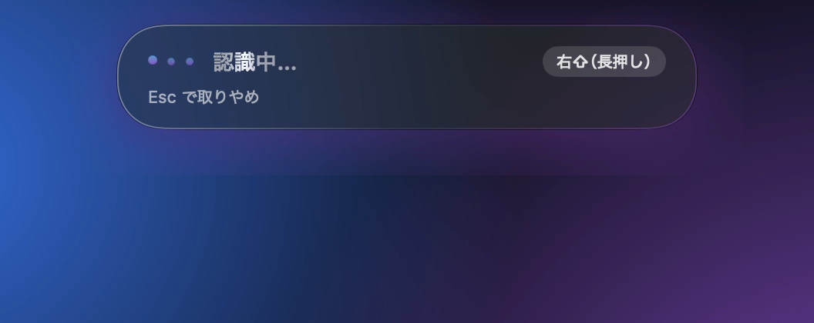
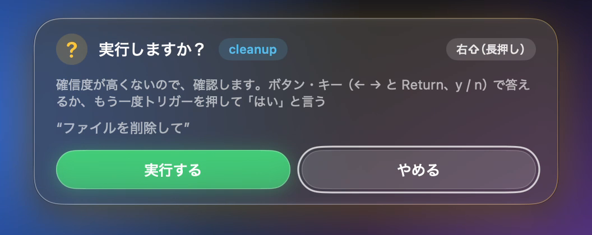
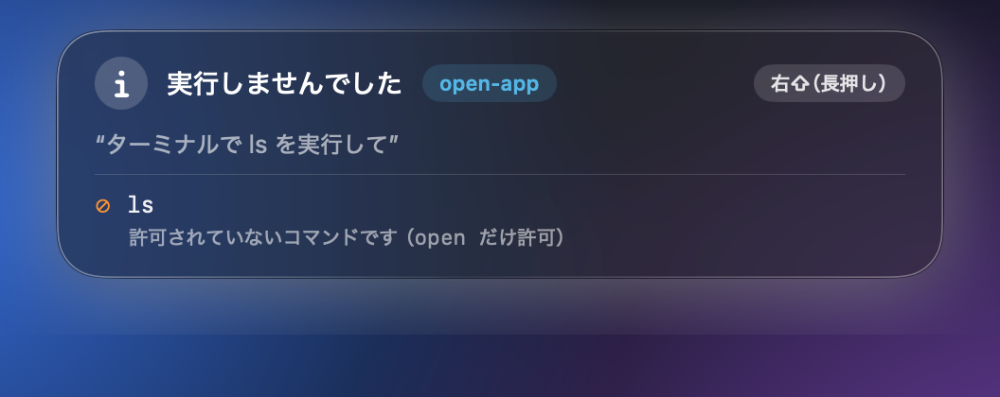
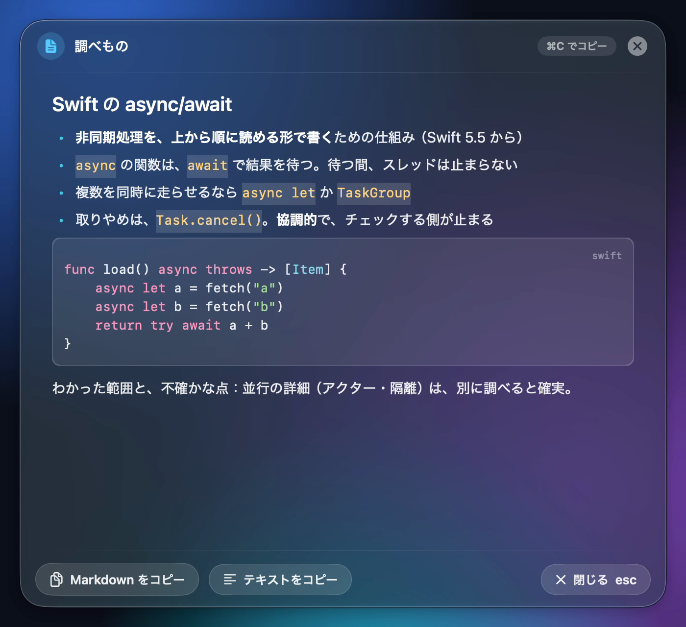
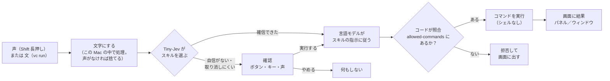
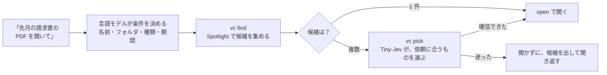
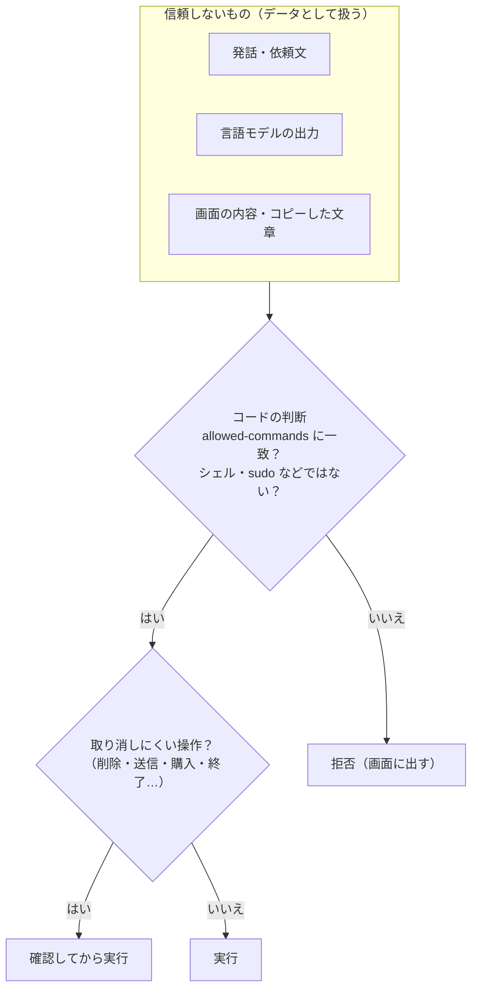

# voice-control

**声や文で頼むだけで、Mac の操作を実行する。** 使うモデルも、音声も、この Mac の中だけで動きます（試作）。

<p align="center">
  
</p>

> **「音量を50にして」** と話す → 合うスキルが選ばれる → 許可されたコマンドだけが実行される → 画面の上に、何をしたかが出る。

**製品ページ（インストール・使い方・注意点）：<https://takemo101.github.io/voice-control/>**

いまは CLI（`vc`）です。どんな使い道が成り立つかを、測定で確かめている段階で、完成した製品ではありません。

---

## 目次

[何ができる？](#何ができる) ・ [画面のイメージ](#画面のイメージ) ・ [仕組み](#仕組み) ・ [はじめる](#はじめる) ・ [使い方](#使い方) ・ [コマンド一覧](#コマンド一覧) ・ [安全のしくみ](#安全のしくみ) ・ [機能の層](#機能の層) ・ [いまの状況](#いまの状況) ・ [詳しい文書](#詳しい文書)

---

## 何ができる？

「やりたいこと」を話すか書くと、合う**スキル**が選ばれて、実行されます。スキルは、`SKILL.md` というテキストファイルです（何をするか・どのコマンドを許すか・どう動くか）。

| こう頼む | 起きること | スキル |
|---|---|---|
| 「次の曲にして」「音量を50にして」「今の曲を読み上げて」 | Spotify を操作する（今の曲を、声で読み上げることもできる） | `spotify` |
| 「コピーした文章を要約して」 | ⌘C でコピーした文章を、整えて、きれいなウィンドウに出す | `clipboard-note` |
| 「ドキュメントの請求書の PDF を開いて」 | ファイルを探し、似た候補があれば選んで、開く | `file-search` |
| 「Safari を開いて」 | アプリを開く | 自分で書く（[例](#自分のスキルを書く)） |
| 上のどれでもない依頼 | 組み込みの `default` スキルが、基本のコマンドで実行する | `default` |

- **音声入力だけ**：Shift を押している間だけ録音し、離すと、文字にして、**いま使っているアプリへ、そのまま入力**します（スキルは使いません）。
- **声で頼む**：Shift を押している間だけ録音し、離すと実行します。Esc で取りやめられます。
- **文で頼む**：`vc run "次の曲にして"`。何をするかだけ見たいときは `--dry-run`。
- **音声認識を替えられる**：既定は Apple のオンデバイスの認識。雑音が軽いとき・英字の語に強い Whisper を、ダウンロードして使えます（設定 > モデル）。どちらも、音声は Mac の外へ出ません。
- **モデルを替えられる**：既定は Apple のオンデバイスのモデル。複雑な指示は、この Mac の Ollama・LM Studio などに替えられます（設定 > モデル > エンジン。`--engine`。任意）。

## 画面のイメージ

声で頼むと、画面の上に小さなパネルが出ます。**録音 → 実行中 → 結果**の順に変わります。取り消しにくい操作や、自信がないときは、**実行する前に確認**します。

<table>
  <tr>
    <td width="50%" align="center"><br><b>1. 録音中</b><br>Shift を押している間だけ聞く。波形が、声に合わせて動く</td>
    <td width="50%" align="center"><br><b>2. 認識中</b><br>離すと、文字にする。考え中のドットが動く</td>
  </tr>
  <tr>
    <td width="50%" align="center"><br><b>3. 実行中</b><br>聞こえた文・選ばれたスキル・実行中のコマンドが出る</td>
    <td width="50%" align="center"><br><b>4. 確認</b><br>ボタン・キー（← → と Return、y / n）・声の「はい」で答える。先に答えたほうが決まる</td>
  </tr>
  <tr>
    <td width="50%" align="center"><br><b>5. 完了</b><br>実行したコマンドと、結果の一言が出る</td>
    <td width="50%" align="center"><br><b>許可されていないコマンドは、実行しない</b><br>スキルが許したコマンドだけが動く</td>
  </tr>
</table>

**コピーした文章の加工**（`clipboard-note`）の結果は、整形したウィンドウに出ます。選んで ⌘C、または「コピー」ボタンでコピーできます。Esc で閉じます。

<p align="center"></p>

> 上の画像は、`vc hud-preview`・`vc show` が出す**本物の表示**を、見本の文で撮ったものです（背景は、自作の模擬のデスクトップ）。実際の操作の画面ではありません。

## 仕組み

**選ぶのは小さなモデル（Tiny-Jev）、実行するのは言語モデル、許可を決めるのはコード**、という分担です。



1. **スキルを選ぶ**：依頼の文と、各スキルの説明（`description`）を、Tiny-Jev（オンデバイスの小さな選択モデル、約 0.6B）が比べます。確信できなければ、実行せずに確認します。
2. **言語モデルが実行する**：選ばれたスキルの指示に従い、`run_command` という 1 つの道具で、コマンドを実行します。
3. **コードが守る**：実行できるのは、スキルの `allowed-commands` に一致したコマンドだけです。この判断は、プロンプトではなく**コード**が行います。

### ファイルを探して開く（`file-search`）の流れ

Tiny-Jev は、「候補の中から選ぶ」ことにも使えます（`vc pick`）。



## はじめる

3 ステップです。

**1. 必要なものをそろえる**

- macOS 26 以降・Apple silicon の Mac。
- Apple Intelligence を**オン**にしておく（システム設定 > Apple Intelligence と Siri。オンにすると、言語モデルのダウンロードが始まります）。スキルの実行に Ollama などのモデルを使うなら、要りません（設定ウィンドウ > モデル > エンジン）。
- [agent-desktop](https://github.com/vercel-labs/agent-desktop)（`npm install -g agent-desktop`）。

**2. アプリを入れる**（ビルドは要りません）

1. 最新の [Release](https://github.com/takemo101/voice-control/releases) の **dmg** を開いて、`VoiceControl.app` を「アプリケーション」へドラッグします。
2. 署名は ad-hoc（Developer ID の署名・公証なし）です。ブラウザでダウンロードして Gatekeeper に止められたら、`xattr -dr com.apple.quarantine /Applications/VoiceControl.app`。
3. `VoiceControl.app` を開くと、**メニューバーにマイクのアイコン**が出ます（Dock には出ません）。初回は、**設定… > モデル** で Tiny-Jev（約 1.2 GB。SHA-256 を検証）を取得します。
4. **マイク・アクセシビリティの許可は、アプリ自身（voice-control）に付きます**。ターミナルアプリには、よりません（CLI の `vc` だと、動かしている端末アプリの許可が要り、別の端末・ヘルパー経由では下りないことがありました）。

**3. 試す**

メニューバーのアイコン > **設定…** で、キー・音声・モデル・スキルを決めます（変えた設定は、すぐ保存され、声の入力へ、**再起動なしで、すぐ反映されます**）。**Shift を単独で 0.35 秒以上押し続けている間だけ**録音し、離すと、実行します。

**スキルは、設定 > スキル > 「スキルをインストール」からも入れられます**（一覧に、許可するコマンドと、外へ送るかが出ます。入れ済みは「更新」）。

ターミナルから `vc`（スキルが使うコマンド）を使うなら、設定 > 一般 の「コマンド vc」を**インストール**します（`/usr/local/bin/vc` → アプリの実行ファイル。管理者のパスワードを求められることがあります）。

```sh
vc doctor                                        # 必要なものが、そろっているか（アプリ自身の許可の状態は、メニューの「診断を見る」）
vc skills install spotify clipboard-note file-search   # スキルを入れる（名前なしで、一覧）
vc skills install --all                                  # リポジトリの、すべてのスキルを入れる
vc run "次の曲にして" --dry-run                  # 何を実行しようとするか、だけ見る
```

<details>
<summary>必要なもの（詳しく）</summary>

- macOS 26 以降・Apple silicon。ソースからビルドするときは、Swift 6.2 以降（Xcode または Command Line Tools）。
- [agent-desktop](https://github.com/vercel-labs/agent-desktop)（`npm install -g agent-desktop`）。アクセシビリティの許可が要る（アプリ自身に付く）。
- Apple Intelligence（FoundationModels）が使える Mac。**オンにしておく**：システム設定 > Apple Intelligence と Siri（オンにすると、言語モデルのダウンロードが始まる）。オフ・準備中・非対応のとき、アプリは、理由と手順をダイアログで出します（`vc doctor` でも確かめられます）。
- Tiny-Jev 0.6B のモデル（約 1.2 GB。設定 > モデル で `~/.voice-control/models/` に取得）。
- 任意：[just](https://github.com/casey/just)（開発用）・Ollama などのローカルのモデルのサーバー（設定 > モデル > エンジンで使うとき）。

</details>

<details>
<summary>インストールの詳細（ソースから・取り除く・許可のやり直し）</summary>

**ソースから入れる**（リポジトリを clone して。Swift 6.2 以降が要る）：

```sh
just install          # アプリを ~/Applications へ入れて、起動する（コマンド vc は ~/.local/bin へリンク。初回は、音声認識の実行環境 transcribe.cpp のビルドで、数分かかる。git・cmake が要る〔cmake がなければ、自動で入れる〕）
just test             # 単体テスト
just dmg              # 配布用の dmg を dist/ に作って、検査する
```

配布物の作り方：[開発手順](docs/development.md#リリース)。

**取り除く**：`just uninstall`（アプリ・コマンドのリンク・許可を取り除く。モデル・設定・スキルは `~/.voice-control` に残る）。手で入れたなら、`VoiceControl.app` を捨てる。メニュー・設定でコマンド vc を入れていたら、先に外す。

**許可が効かないとき**：設定ではオンなのに「許可されていません」と出るなら、`just reset-permissions`（このアプリの許可だけを取り消す。次の起動で、確認が出る）。**以前の tar.gz 版を入れていた**なら、`~/.local/bin/vc`（リンクではない古い実行ファイル）を消してください（PATH で先に当たると、古いものが動きます）。

</details>

## 使い方

### 音声入力だけ

しゃべった言葉を、**そのまま文字にして、いま使っているアプリへ入力**します（メモ・メール・ブラウザの入力欄など）。スキルも言語モデルも使わないので、起動が速く、すぐ使えます。

設定 > キー の「音声入力」に、キー（例：`rshift`）を決めると、**そのキーを押している間だけ録音 → 離すと入力**します（Shift の長押し＝声で頼む、は、そのまま。キーによって切り替わります）。認識の替え方・「入力せずに確認」は、設定 > モデル > 音声認識。

- 入力は、**クリップボードに書いて ⌘V を送り、貼り付け先が文字を読んだのを確かめてから、元のクリップボードへ戻す**方式です。戻す前に、あなたが別のものをコピーしていたら、戻しません（上書きしません）。クリップボードの履歴アプリには、記録されない印をつけます。
- **読まれなかったとき**（入力欄がない・セキュア入力・アプリの不調）は、⌘V を一度だけ送り直し、それでもだめなら、「入力できませんでした」と出して、**文字をクリップボードに残します**（⌘V で、手で貼れます）。成功に見せかけません。
- 録音中は波形が動き、離すと「認識中…」、入力したら「入力しました」と出ます。Esc で取りやめます。
- アクセシビリティの許可（トリガーの検出と ⌘V の送信）とマイクの許可が要ります。
- 入力した文字は、画面の上のパネルにだけ出します（ファイル・ログ・端末には残しません）。声のない録音は、入力しません。
- **つなぎ言葉（「えーと」「あのー」「um」など）を、消せます**（既定は off。辞書にある語を、文字列の一致で消すだけで、言語モデルは使いません）。設定 > 音声 の「つなぎ言葉を消す」。辞書は、設定 > 音声 で足し引きします（設定ウィンドウ > 音声 で一覧）。**声でも足せます**：`vc skills install filler-add` →「『あのさ』をつなぎ言葉に追加して」。声で頼む依頼文には、かけません。詳しくは [docs/skills.md](docs/skills.md#つなぎ言葉を消す辞書vc-fillers音声でも足すfiller-add)。
  - **既定の辞書（19 語）**：日本語は「えーっと」「ええっと」「えーと」「えっと」「ええと」「あのー」「あのう」「そのー」「うーんと」「うーん」「んー」「えー」、英語は `uh`・`um`・`uhm`・`umm`・`uhh`・`hmm`・`erm`。「あの」「その」「まあ」は、ふつうの語でもあるので、入れていません。
  - 設定に辞書がなければ、この既定を使います。設定 > 音声 の辞書を編集して保存すると、**その全体**が `settings.json` に保存されます（あとで既定が変わっても、反映されません。設定ウィンドウ > 音声 で、既定に戻します。足した語は消えます）。

### キーの決め方（右側のキーだけにもできます）

設定ウィンドウ > キー で、4 つのキー（声で頼む・音声入力・会話・画面撮影）を決めます。入力欄に書いて「適用」（Enter）か、「候補」から選びます。書き方と重なりは、その場で検査されます。

| 書き方 | 反応するキー |
|---|---|
| `shift`・`cmd`・`opt`・`ctrl` | 左右どちらでも（長押し） |
| `rshift`・`rcmd`・`ropt`・`rctrl` | **右側のキーだけ**（長押し専用。左のキーを押している間も、反応しない） |
| `ctrl+opt+space`・`f5` など | キーの組み合わせ（左右の区別は、できません） |

- 普段の入力で使わない右側のキーにすると、誤作動が減ります。
- `shift` と `rshift` のように、同じキーに反応しうる 2 つは、声で頼むキーと音声入力のキーに、同時に設定できません（エラーになります）。
- 確かめる：`vc hotkey-check`（開発用。押して、離すと、画面に出ます）。

### キーで、声で頼む／音声入力を切り替える

別のキーを決めると、**1 つのアプリで、キーによって切り替わります**。

| 押すキー | 起きること |
|---|---|
| Shift の長押し（既定。設定 > キー で変更） | 声で頼む：スキルを選んで実行する |
| Ctrl の長押し（設定 > キー の「音声入力」で決める） | 音声入力：文字にして、前面のアプリへ入力する（スキルは使わない） |

- 押しているキーで、パネルの表示も変わります（音声入力は「離すと、文字にして入力します」）。
- 録音中は、もう一方のキーは無視します。確認の返事（「はい」）は、どちらのキーで話しても、返事になります。
- 音声入力のキーを外す：設定 > キー の「音声入力」を空にして適用。

### 声で頼む

アプリを起動すると、すぐ使えます（メニューバーのマイクのアイコンが「聞いています」）。

- **Shift を押している間だけ**録音します（0.35 秒以上、Shift だけを押し続けたとき。変更：設定 > キー）。離すと、文字にして、実行します。
- **実行中に、新しく話すと、前の処理を中断して、新しい依頼を実行します**（確認の返事を待っている間は、中断せず、返事として扱います）。
- **Esc で取りやめ**：録音中は録音を捨て、認識中・実行中・確認の待ちは、処理を止めます。録音中（Shift を押している間）の Esc には、アクセシビリティの許可が要ります。
- **確認が出たら**、次のどれかで答えます（先に答えたほうが決まります）。
  - ボタンを押す（「実行する」「やめる」）。
  - キー：← → で移り、Return で決める。y＝実行する、n・Esc＝やめる。**最初のフォーカスは「やめる」**です（ほかのアプリで打っている最中の Return で、実行されないように）。
  - 声：もう一度 Shift を押して「はい」と言う。

### 文で頼む

```sh
vc run "Safariを開いて" --dry-run     # 何を実行しようとするかだけ見る
vc run "Safariを開いて"               # 実行
```

実行すると、選ばれたスキル・実行したコマンド・結果が、順に表示されます。

```text
$ vc run テスト
▶ スキルの選択
  Tiny-Jev  echo-test   98.6%（0.1 秒）
  許可      echo

▶ 実行
  $ echo test
    ✓ exit 0
    │ test

▶ 結果
  返事      done: テストされました。
  所要      1.1 秒・実行したコマンド 1 件
```

（`echo` だけを許可した使い捨てのスキルでの、実際の出力。返事の文言・秒数は、実行のたびに変わります。）

### コピーした文章を加工する

文章を **⌘C でコピー**してから、「コピーした文章を整理して」「要約して」と頼みます。結果は、整形した Markdown のウィンドウに出ます（`clipboard-note`、`vc show`）。

### 音声認識を替える（Whisper）

既定は Apple のオンデバイスの認識です。**Whisper large-v3-turbo**（約 0.9 GB・MIT）をダウンロードして、替えられます。設定 > モデル の「モデルの取得」で「取得」（SHA-256 を検証。途中から再開できる）→ 「使う音声認識」で選びます。

- 自作の合成音声 480 件での測定では、Whisper は、**雑音が軽いとき・英字の語**（Safari・PDF）で、Apple より誤りが少なく（全体の文字誤り率 6.9% 対 8.6%）、1 件の認識に 0.5 秒ほどかかります（Apple は 0.06 秒）。**実際の声での比較は、していません**。[検証記録](docs/verification.md)
- どちらの認識でも、**声のない録音（無音・一定の雑音）は、認識に渡しません**（認識が「はい」などの文を作るため）。
- 取得していないモデルを選ぶと、黙って Apple に切り替えず、理由と手順を出して止まります。

### 使うモデルと、録音中の音を、設定する

**設定ウィンドウ**（メニューバーのアイコン > 設定…。`~/.voice-control/settings.json` を読み書きします）で、常にそうする設定ができます。

| 決めること | 場所 |
|---|---|
| キー（声で頼む・音声入力・会話・画面撮影）・手放し（ダブルタップ） | キー |
| 録音中に、ほかの音を消すか・録音中の文字・聞き取りの確認・読み上げと声・つなぎ言葉の辞書 | 音声 |
| 分析・実行のモデル（Apple・Ollama・OpenAI 互換）・複数ステップ・会話のエージェント・音声認識・モデルの取得 | モデル |
| スキルの有効・無効 | スキル |
| 許可の状態・ログイン時に起動・コマンド vc・診断 | 一般 |

その実行だけ替えるなら、`vc run` の `--engine`・`--stt`・`--no-plan`。
**変えた設定は、再起動なしで、すぐ反映されます**（声の流れを作り直します。録音中・認識中・実行中なら、終わってから。反映できなかったときだけ、「もう一度」「再起動」が出ます）。

### スクリーンショットに声で頼む／文字起こし

設定 > キー の「画面撮影」に、`ctrl+opt+s` のような組み合わせを決めます（範囲を選んで撮る。そのあと声で頼む／パネルで文字起こし）。

`ctrl+opt+s` → 画面が静止して暗くなる → **ドラッグで範囲**（⇧ 正方形・⌥ 中心から）・**ウィンドウをクリック**・↩ 全画面・Z 拡大鏡（色のコピー）。大きさが「1000 × 300」のように出ます。撮れると、画像のパネル（画像・パスのコピー）が出て、「続けて、声で頼んでください」と案内が出ます。**声のトリガー（Shift の長押しなど）を押して**、3 分以内に頼みます（**ダブルタップ**なら、話し終わるまで聞きます：手放し）。「**この画像の文字を書き出して**」「これは何？」「**右半分を切り抜いて**」「横幅を 800 に」「JPEG に変換して」。答えは、ウィンドウに出ます（切り抜きなどは、`~/Pictures/voice-control` に保存）。`ctrl+opt+t` は、範囲の文字だけを、そのままウィンドウに出します（macOS の文字認識。言語モデルを通しません）。**画像は、Mac の中のモデルだけ**に渡ります（Apple のモデル、または画像対応の Ollama）。画面収録の許可が要ります（`vc doctor`）。詳しくは [スキル](docs/skills.md#画像に声で頼むimage-askimage-edit任意)。

### ファイルを探して開く

「ドキュメントの請求書の PDF を開いて」「デスクトップの家計簿のエクセル」。`file-search` スキルが、`vc find` で探し、複数なら `vc pick` で選び、`open` で開きます。迷ったときは、開かずに候補を出して、聞き返します（読み取りだけ。削除・移動はしません）。`vc skills install file-search` で入れます。

`vc pick` は汎用です。ファイルに限らず、短い候補の中から、依頼に合うものを選べます。

```sh
ls ~/Documents | vc pick --query 家計簿
```

### 自分のスキルを書く

`~/.voice-control/skills/<名前>/SKILL.md` を作ります。

```sh
mkdir -p ~/.voice-control/skills/open-app
cat > ~/.voice-control/skills/open-app/SKILL.md <<'EOF'
---
name: open-app
description: アプリを開く・起動する・前面に出す
allowed-commands:
  - open
---
Open the application the user named. Run: open -a "<App name>". Then reply done.
EOF

vc skills                                    # [有効] open-app  アプリを開く・起動する・前面に出す
vc run "Safariを開いて" --dry-run
vc skills disable open-app                   # 選択肢から外す（enable で戻す）
```

- 先頭（`---` の間）が、**名前・説明・許可するコマンド**。その下が、言語モデルへの指示です。
- 本文には、記号を書けます：`${SKILL_DIR}`（そのスキルのディレクトリ）・`${USER_REQUEST}`（利用者の依頼。データの囲みに入って差し込まれる）・`${SCREENSHOT}`（いまのスクリーンショットのパス。外のツールへ画像を渡す）。後ろの 2 つは、許可〔`allowed-commands`〕には書けません。
- スキルから、`vc` の機能も使えます：`vc find`（ファイルを探す）・`vc pick`（候補から、Tiny-Jev が選ぶ）・`vc show`（Markdown をウィンドウに出す）。`allowed-commands` に書くと、言語モデルが呼べます（例：`file-search`）。
- 書き方・`allowed-commands` の仕様・表示：[スキル](docs/skills.md)。エージェントに作らせるときは、[スキルを作るスキル](skills/voice-control-skill-author/SKILL.md)。

### 覚えておくこと

- **スキルの置き場所**：グローバル（`~/.voice-control/skills/<name>/SKILL.md`）と、プロジェクト（`<vc を起動した場所>/.voice-control/skills/<name>/SKILL.md`）。同じ名前なら、プロジェクトが上書きします。外から来るリポジトリのスキルは、許可したコマンドを実行できるので、**`vc skills trust` したプロジェクトだけ**読み込みます（既定は未信頼）。[詳細](docs/skills.md#置き場所)
- **既定スキル**：どのスキルにも当てはまらない依頼は、組み込みの `default` スキルが、`agent-desktop` と基本のコマンド（`open`・`say`・`ls`・`pwd`・`date`）で実行します。会話・独り言は実行せず、取り消しにくい依頼（削除・送信・購入など）は確認します。使わないなら `vc skills disable default`。[詳細](docs/skills.md#既定スキルdefault)
- **1 つの依頼で、複数のスキルを順に実行できます**（マルチステップ）：「Claude で Rust の所有権を調べて、そのあと Spotify で次の曲にして」。**言語モデルが、依頼を、実行する順のステップに分け**、ステップごとに、いつもの流れ（Tiny-Jev が選ぶ → 確認 → 実行）で実行します。許可と確認は、ステップごとです。最初の失敗で止まります（済んだ分は、元に戻しません）。前のステップの結果は、**受け取ると宣言したスキル**（`accepts-previous: true`。いまは `web-search`）にだけ、信頼しないデータとして渡します（「今の曲を教えて、それをウィキペディアで検索して」）。止めるには 設定 > モデル の「複数のステップ」をオフ。[詳しく](docs/skills.md#複数のステップの依頼マルチステップ)
- **結果を Markdown で見せる**：スキルのフロントマターに `result: markdown-window`（整形したウィンドウ）・`result: markdown-note`（ファイル）。[詳細](docs/skills.md#markdown-のウィンドウvc-showresult-markdown-window)
- **モデルを替える**（任意）：`--engine ollama:qwen3.5:4b`（Ollama）・`--engine openai:<モデル>@<ポート>`（LM Studio・llama.cpp など、OpenAI 互換）。通信先は、この Mac の 127.0.0.1 だけで、クラウドのモデルは使えません。許可の照合・上限・確認は、モデルに関わらず同じです。確認：`vc doctor --engine …`。[詳細](docs/skills.md#実行するモデルを替えるローカルのサーバー任意)

## コマンド一覧

ヘルプ：`vc --help`（一覧・共通のオプション・環境変数）、`vc <コマンド> --help`（使い方・オプション・例）。出力は、端末なら色つき（`NO_COLOR=1` で無効）。

**vc（CLI）は、スキルが使うコマンドと診断だけです**。**声の入力・設定は、メニューバーのアプリ**（`VoiceControl.app`）にあります。アプリの中の実行ファイルが `vc` と同じものなので、アプリを入れると、コマンドも使えます（設定 > 一般 の「コマンド vc」）。引数なしで `vc` を動かすと、アプリを起動します。

| コマンド | 内容 |
|---|---|
| `vc run "<依頼>" [--skill <name>] [--dry-run] [--yes]` | スキルを選び、実行する |
| `vc show [--file <パス>] [--text <Markdown>] [--title <題名>] [--wait]` | Markdown を整形して、一時的なウィンドウに表示する（コピーもできる）。スキルのスクリプトが使う |
| `vc preview <画像>` | 画像を、パネルに表示する（画像・パスのコピー・Finder で表示） |
| `vc find [--name …] [--in …] [--ext …] [--since …]` | ファイルを探す（Spotlight。読み取りだけ） |
| `vc pick --query … --option …` | 短い候補の中から、依頼に合うものを、Tiny-Jev で選ぶ（確信できたときだけ） |
| `vc skills [list]` / `show <name>` / `enable` / `disable` / `install` / `trust` / `untrust` | スキルの一覧・詳細・有効／無効・GitHub のスキル（`takemo101/voice-control`）のインストール・プロジェクトのスキルの信頼 |
| `vc doctor [--engine …]` | 動かすのに必要なもの（Apple Intelligence・Tiny-Jev・agent-desktop・許可・設定ファイル）が、そろっているかを確かめる |

`vc run`・`vc doctor` の共通：`--engine <エンジン>`（スキルを実行するモデル。下の「モデルを替える」）・`--stt <音声認識>`（`vc transcribe`）。

**開発用**（評価・検証）：`vc transcribe`（音声ファイルを文字に）・`vc hotkey-check`（キーが届くか）・`vc hud-preview`・`vc settings-preview`（見た目を PNG に）・`vc eval-gate`・`vc eval-plan`（当たり率）・`vc chat`（会話の試験用の REPL）。

## 安全のしくみ



- 実行は**シェルなし**。コマンドは、スキルの `allowed-commands` に一致したものだけ。シェル・`sudo`・`env` などは、許可できません。
- 言語モデルの出力・画面の内容・依頼文・コピーした文章は、**非信頼のデータ**として扱います。取り消しにくい操作は、確認を挟みます。
- `allowed-commands` は、言語モデルの暴走への歯止めです。許可したコマンドの中身（`rm` を許可すれば `rm` が動く）までは、守りません。
- 発話・画面の内容・入れた文字を、ファイルやログに**残しません**（画面にだけ表示）。**例外：自分で範囲を選んで撮ったスクリーンショット**は、自分だけが読める場所に 1 枚だけ置き、3 分で使えなくなり、終了で消えます（画像は、Mac の中のモデルだけに渡します）。`result: markdown-note` のスキルだけは、結果を一時ディレクトリのファイルに残します（利用者だけが読める。消しません）。
- **Apple の会話にも、道具を開けられます**（設定 > モデル > 会話 > 道具。既定は、なし）：**Web**（日時・検索・ページの取得）・**＋読む**（作業フォルダのファイルを読む）・**すべて**（作業フォルダの中への書き込みと、コマンドの実行。**既存ファイルの上書きと、読むだけでないコマンドは、毎回、確認します**。シェル・インタプリタ・通信のコマンドは、実行できません）。外へ出るのは、**モデルが作った検索語と、開いたページの URL だけ**です（発話・画面・ファイルの中身は、送りません）。小さなモデルは、道具を呼ばずに作り話をすることがあるので、検索・ファイルの依頼で道具が呼ばれなければ、答えを出さずに、失敗として知らせます。
- **会話の外のエージェント**（設定 > モデル > 会話。既定は、この Mac の Apple のモデル）：選ぶと、発話が、その提供元へ送られます。**道具の段階**は、なし（既定）・Web・＋ファイルを読む・**すべて**（ファイルの書き込み・コマンドの実行も）。**「すべて」は、聞き間違いや、検索したページの命令で、意図しない操作が起きえます**（オンにするとき、確認します。作業フォルダは、選べます）。実行した操作は、答えの下に出ます（`claude`・`codex`・`grok`）。
- 通信は、スキルの取得（`vc skills install`）・モデルの取得（設定 > モデル）と、この Mac の 127.0.0.1 への通信（`--engine`）**だけ**です。音声・画面の内容を、ネットワークへ出しません。**例外は、あなたが入れたときだけの `ask-agent`・`web-search`・`ask-agent-image`**（`ask-agent-image` は、撮った画面の画像を、選んだエージェントへ送ります。**実行のたびに確認します**）（`web-search` は、検索する言葉が、選んだサイトへ、ブラウザから送られます。`ask-agent` は、「〇〇について調べて」「クロードで〇〇を調べて」を、コーディングエージェントの CLI〔`agy`・`claude`・`codex`・`grok`・`opencode`・`pi`〕に頼む。調べることの文が、選んだエージェントの提供元へ送られます。[詳しく](docs/skills.md#調べものをコーディングエージェントに頼むask-agent任意)）。

## 機能の層

機能が広がったので、**層**で分けています（詳細は [SPEC](SPEC.md#機能の層2026-11-09-の判断)）。

| 層 | 含むもの |
|---|---|
| **中核** | スキルの選択と実行・許可と確認の判断・`vc run`・声で頼む・スキルの管理 |
| **任意** | 音声入力・スクリーンショットと画像のスキル・結果のウィンドウ・ファイル検索・スキルのインストール |
| **実験**（予告なく変わります） | 外へ送るスキル（`ask-agent`・`ask-agent-image`・`web-search`）・手放し（ダブルタップ）・複数ステップの依頼・ローカルのサーバーのモデル（`--engine`）・画像の背景除去（「背景を消して」）・聞き取りの確認・結果の読み上げ・録音中の文字の表示・会話（会話のキー）・メニューバーのアプリ（dmg）と設定ウィンドウ |

## いまの状況

試作です。**確認した範囲と、していない範囲**を、そのまま書きます。

| 機能 | 状態 |
|---|---|
| スキル（`vc skills`・`vc run`） | 自作ウィンドウで確認。**実アプリ・複数スキルの取り違えは未確認** |
| 声の入力（メニューバーのアプリ） | 実装済み（ホットキー・Esc・確認のボタンとキー）。確認のボタンのクリックは、利用者の環境で動作を確認（v0.2.4）。**マイクの実録音の網羅的な確認・声の「はい」の確認は未確認** |
| Markdown のウィンドウ（`vc show`・`clipboard-note`） | 実装済み（見た目は自作の内容で確認）。**コピーのボタン・⌘C の実機の操作は未確認** |
| 音声認識の切り替え（設定 > モデル・Whisper） | 合成音声での測定と、実マイク（スピーカーの音）での 1 回の確認。**実際の声での比較は未確認** |
| ファイル検索（`vc find`・`vc pick`・`file-search`） | 自作のフォルダで確認（Ollama 9/10・Apple 9/10。同じ場面で調整）。**実際のホームでの検索の質は未確認** |
| スクリーンショット・コピーした画像に声で頼む（画面撮影のショートカット・`image-ask`・`image-edit`）・パネルの文字起こし | 自作の画像で確認（Apple と Ollama で答えさせ、切り抜き・サイズ変更・変換を続けて実行。スキルの測定：Apple 90〜94%・Ollama 100%）。**実際の範囲選択・ショートカット・画面収録の許可の流れは未確認** |
| `--engine`（Ollama・OpenAI 互換） | Ollama（`qwen3.5:4b`）で確認。**LM Studio・llama.cpp など、ほかのサーバーは未確認** |

PC 操作は、2026-11-04 に廃止し、既定スキルに一本化しました。詳細な要件と状態は [SPEC](SPEC.md)、測定と未確認は [検証手順と記録](docs/verification.md)。

## 詳しい文書

[docs/README.md](docs/README.md) が索引。

| 文書 | 内容 |
|---|---|
| [SPEC](SPEC.md) | 要件・受け入れ条件・対象外・未決事項（正本） |
| [AGENTS.md](AGENTS.md) | 開発規約・不変条件 |
| [スキル](docs/skills.md) | スキルの書き方・`allowed-commands`・表示・声の入力・Markdown のウィンドウ・モデルの切り替え |
| [開発手順](docs/development.md) | ビルド・テスト・GitButler・PR・リリース |
| [構成説明](docs/architecture.md) | Module・状態・並行・失敗・信頼の境界 |
| [コーディング指針](docs/coding-guidelines.md) | クリーンなコードの規則 |
| [参考にした設計原則](docs/references.md) | 採用・不採用の原則 |
| [リファクタリングの観点](docs/refactoring.md) | 見直しの観点と進め方 |
| [検証手順と記録](docs/verification.md) | 測定・確認した範囲・未確認 |

## 出典とライセンス

- `Sources/VCDecision/Decision/` の Tiny-Jev の実行（`BPETokenizer.swift`・`Safetensors.swift`・`QwenDecision.swift`・`OptionMarkerPrompt.swift`・`DecisionError.swift`）は、同じ作者の meeting-analyzer の複製（変更なし）。
- モデル：[lostargon/Tiny-Jev](https://huggingface.co/lostargon/Tiny-Jev)（版 `62449fb`）。**ライセンスの条件は未確認**。リポジトリには含めない。
- agent-desktop は、スキルが許可したコマンドとして、言語モデルが子プロセスで呼ぶだけ（Swift のコードは、直接は呼ばない。Apache-2.0）。
- このリポジトリのライセンスは **MIT**（[LICENSE](LICENSE)）。
