# voice-control

**押しながら話すと、Mac が動く。** 声や文で頼むだけで、Mac の操作を実行し、聞きたいことには、会話で答える、**メニューバーのアプリ**です。使うモデルも、音声認識も、既定では、この Mac の中だけで動きます（試作）。

<p align="center">
  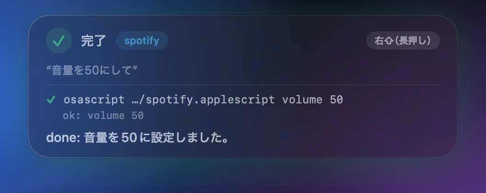
  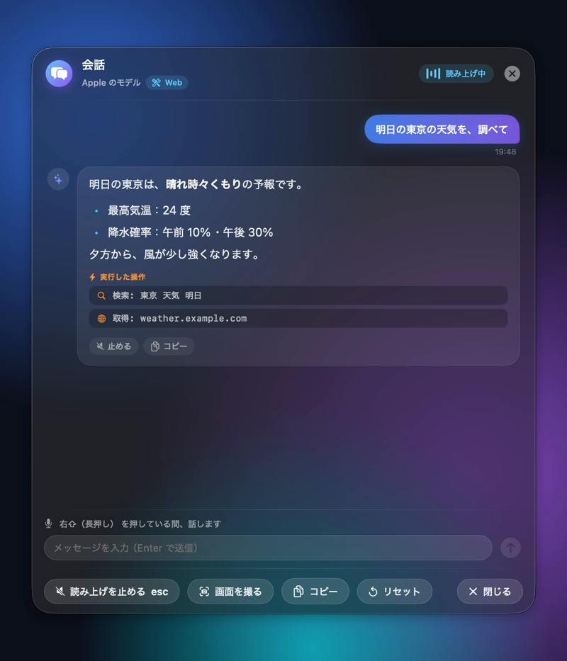
</p>

> **「音量を50にして」** と話す → 合うスキルが選ばれる → 許可されたコマンドだけが実行される → 画面の上に、何をしたかが出る。
> **「明日の天気を調べて」** と会話する → 道具（Web・ファイル）を使って答える → ウィンドウに、答えと、した操作が出る。

**[最新の dmg をダウンロード](https://github.com/takemo101/voice-control/releases/latest)**（macOS 26 以降・Apple silicon）・ **製品ページ（インストール・使い方・注意点）：<https://takemo101.github.io/voice-control/>**

どんな使い道が成り立つかを、測定で確かめている段階で、完成した製品ではありません。

---

## 目次

*English summary: [README.en.md](README.en.md)*

[何ができる？](#何ができる) ・ [画面のイメージ](#画面のイメージ) ・ [仕組み](#仕組み) ・ [はじめる](#はじめる) ・ [使い方](#使い方) ・ [会話する](#会話する) ・ [設定](#設定ウィンドウ) ・ [コマンド一覧](#コマンド一覧) ・ [安全のしくみ](#安全のしくみ) ・ [機能の層](#機能の層) ・ [いまの状況](#いまの状況) ・ [詳しい文書](#詳しい文書)

---

## 何ができる？

**3 つの使い方**があります。押すキーで、切り替わります（設定ウィンドウ > キー）。

| 使い方 | 操作 | 起きること |
|---|---|---|
| **声で頼む** | Shift を押している間だけ話す（既定） | 合う**スキル**が選ばれて、**許可されたコマンドだけ**が実行される |
| **声で文字を入力** | 決めたキーを押している間だけ話す | 話した言葉が、**いま使っているアプリへ、そのまま入力**される |
| **会話** | 決めたキーを押している間だけ話す、または、会話のウィンドウに文字で | 質問に答える。**道具**（Web 検索・ファイルを読む…）を使って調べ、**撮った画面の画像**を見て答え、**続けて質問**できる。答える側は、Apple のモデル（この Mac の中）か、手元の**コーディングエージェント**（claude・codex など） |

**声で頼む**では、「やりたいこと」を話すか書くと、合うスキルが選ばれて、実行されます。スキルは、`SKILL.md` というテキストファイルです（何をするか・どのコマンドを許すか・どう動くか）。

| こう頼む | 起きること | スキル |
|---|---|---|
| 「次の曲にして」「音量を50にして」「今の曲を読み上げて」 | Spotify を操作する（今の曲を、声で読み上げることもできる） | `spotify` |
| 「コピーした文章を要約して」 | ⌘C でコピーした文章を、整えて、きれいなウィンドウに出す | `clipboard-note` |
| 「ドキュメントの請求書の PDF を開いて」 | ファイルを探し、似た候補があれば選んで、開く | `file-search` |
| 「Safari を開いて」 | アプリを開く | 自分で書く（[例](#自分のスキルを書く)） |
| 上のどれでもない依頼 | 組み込みの `default` スキルが、基本のコマンドで実行する | `default` |

- **文でも頼める**：`vc run "次の曲にして"`。何をするかだけ見たいときは `--dry-run`。
- **音声認識を替えられる**：既定は Apple のオンデバイスの認識。雑音が軽いとき・英字の語に強い Whisper を、ダウンロードして使えます（設定 > モデル）。どちらも、音声は Mac の外へ出ません。
- **モデルを替えられる**：既定は Apple のオンデバイスのモデル。複雑な指示は、この Mac の Ollama・LM Studio などに替えられます（設定 > モデル > エンジン。`--engine`。任意）。

## 画面のイメージ

声で頼むと、画面の上に小さなパネルが出ます。**録音 → 実行中 → 結果**の順に変わります。取り消しにくい操作や、自信がないときは、**実行する前に確認**します。

<table>
  <tr>
    <td width="50%" align="center">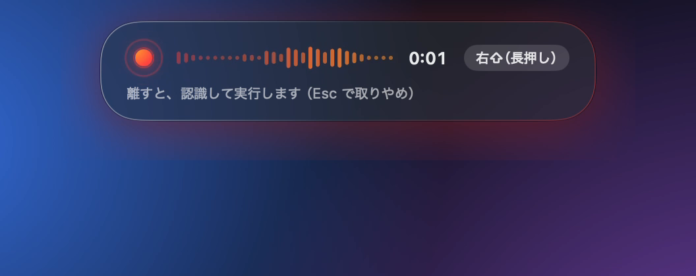<br><b>1. 録音中</b><br>Shift を押している間だけ聞く。波形が、声に合わせて動く</td>
    <td width="50%" align="center">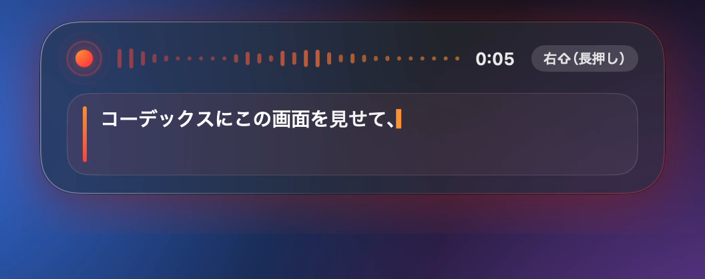<br><b>録音中の文字</b><br>聞こえている文字が、少しずつ出る（確定前は薄い。設定で切れる）</td>
  </tr>
  <tr>
    <td width="50%" align="center"><br><b>2. 認識中</b><br>離すと、文字にする。考え中のドットが動く</td>
    <td width="50%" align="center">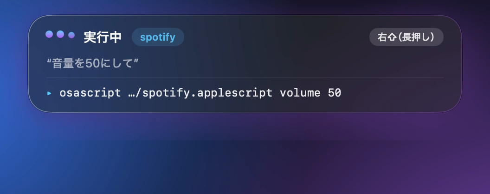<br><b>3. 実行中</b><br>聞こえた文・選ばれたスキル・実行中のコマンドが出る</td>
  </tr>
  <tr>
    <td width="50%" align="center"><br><b>4. 確認</b><br>ボタン・キー（← → と Return、y / n）・声の「はい」で答える。先に答えたほうが決まる</td>
    <td width="50%" align="center"><br><b>5. 完了</b><br>実行したコマンドと、結果の一言が出る</td>
  </tr>
  <tr>
    <td colspan="2" align="center"><br><b>許可されていないコマンドは、実行しない</b><br>スキルが許したコマンドだけが動く</td>
  </tr>
</table>

**コピーした文章の加工**（`clipboard-note`）の結果は、整形したウィンドウに出ます。選んで ⌘C、または「コピー」ボタンでコピーできます。Esc で閉じます。

<p align="center"></p>

### 会話のウィンドウ

会話のキーを押して話す（またはウィンドウに文字を入れる）と、**1 つのウィンドウに、質問と答えが続きます**。調べている間は、いまの操作が出て、答えの下に、**実行した操作**が残ります。

<table>
  <tr>
    <td width="25%" align="center">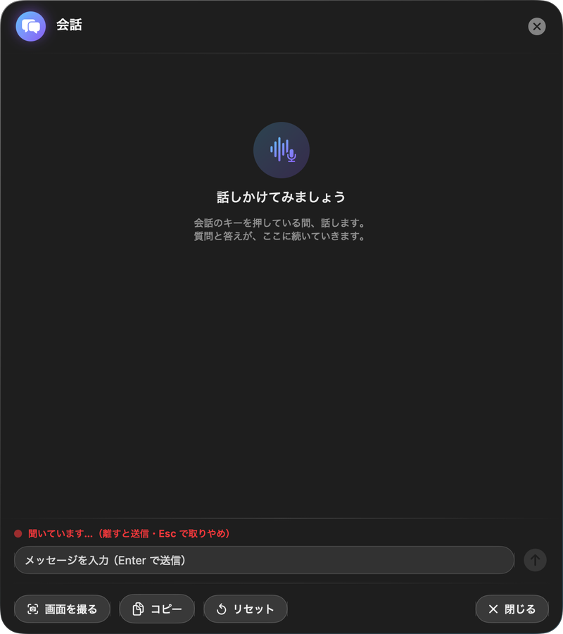<br><b>聞いている</b><br>キーを押している間、聞く</td>
    <td width="25%" align="center"><br><b>調べて答える</b><br>実行した操作と、読み上げ（止められる）</td>
    <td width="25%" align="center">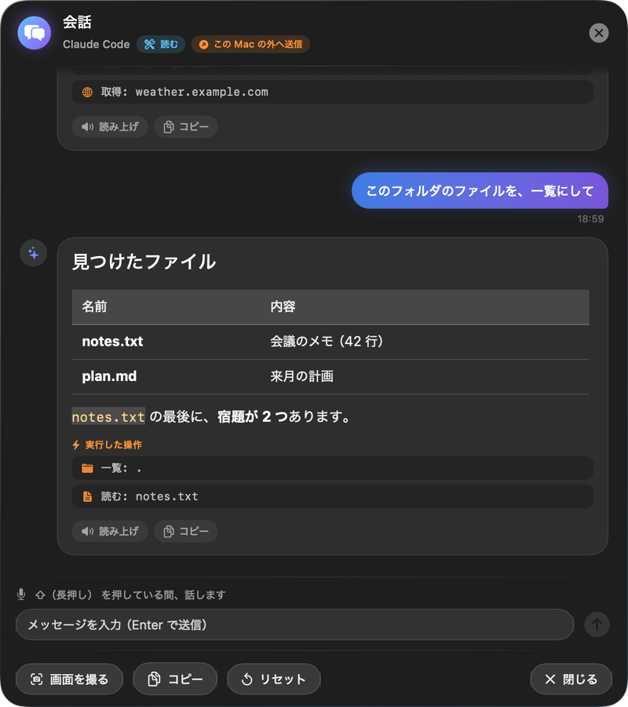<br><b>エージェントで</b><br>外へ送る印が出る。表も読める</td>
    <td width="25%" align="center">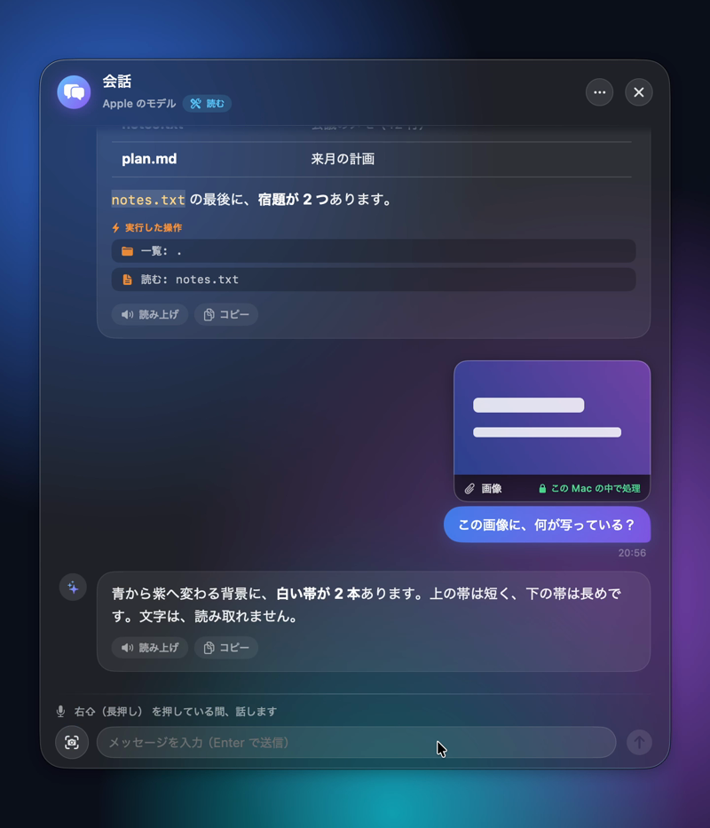<br><b>画像を見せる</b><br>この Mac の中で処理した印</td>
  </tr>
</table>

考えている間に続けて質問すると、**順番待ち**の吹き出し（点線の縁）に並びます。いまの答えが終わったら、送られます。「今すぐ送る」（いまの質問を止めて、この 1 件を先に）・「取り下げ」・停止ボタンがあります。

<p align="center">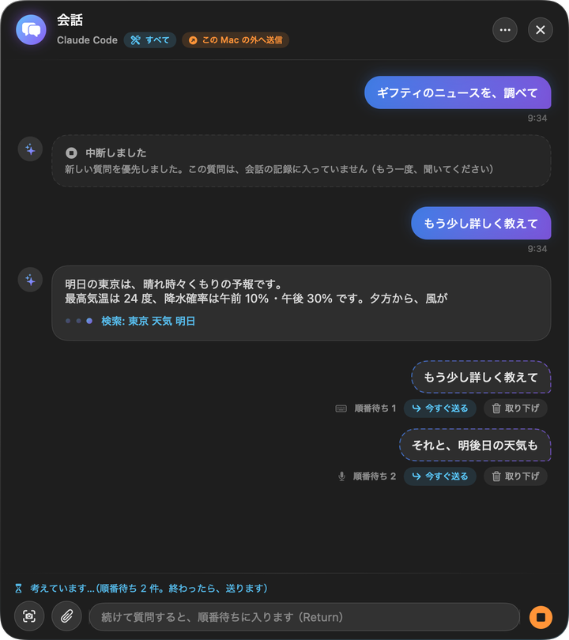</p>

### 設定ウィンドウ

メニューバーのアイコン > **設定…**。変えた設定は、すぐ保存され、再起動なしで、反映されます。

<table>
  <tr>
    <td width="50%" align="center">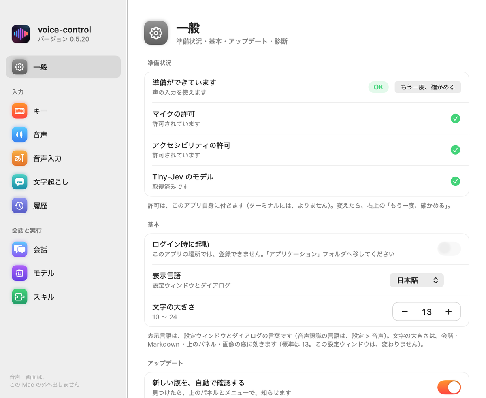 一般（準備状況・許可・ログイン時に起動・言語・コマンド vc・診断）"><br><b>一般</b><br>準備状況（許可・モデル）・起動・表示言語・コマンド vc・診断</td>
    <td width="50%" align="center">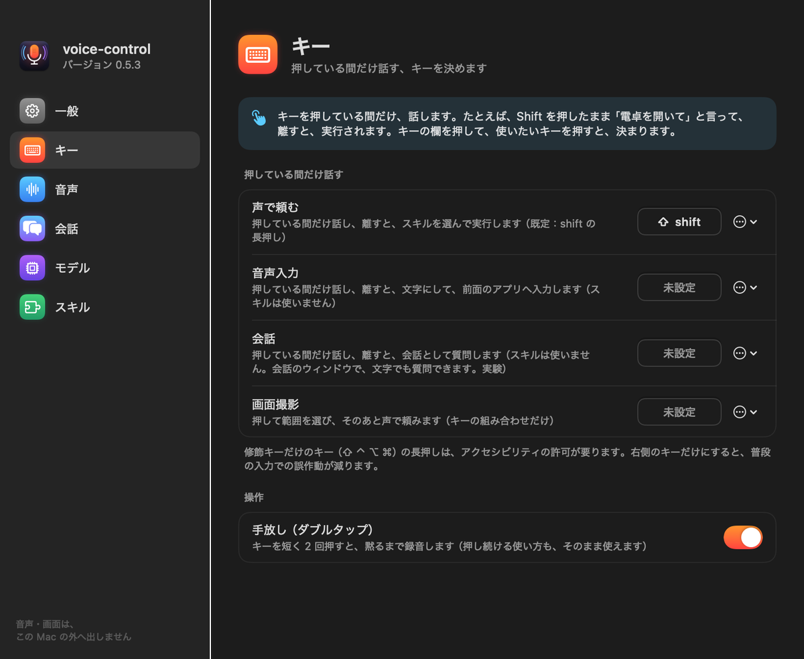 キー（声で頼む・音声入力・会話・画面撮影・手放し・貼り直し）"><br><b>キー</b><br>声で頼む・音声入力・会話・画面撮影・手放し・直前の入力の貼り直し</td>
  </tr>
  <tr>
    <td width="50%" align="center">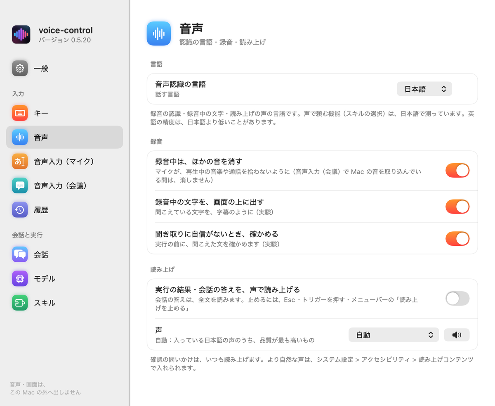 音声（言語・録音・読み上げ）"><br><b>音声</b><br>認識の言語（日本語・English・自動）・録音中の音・文字の表示・読み上げと声</td>
    <td width="50%" align="center">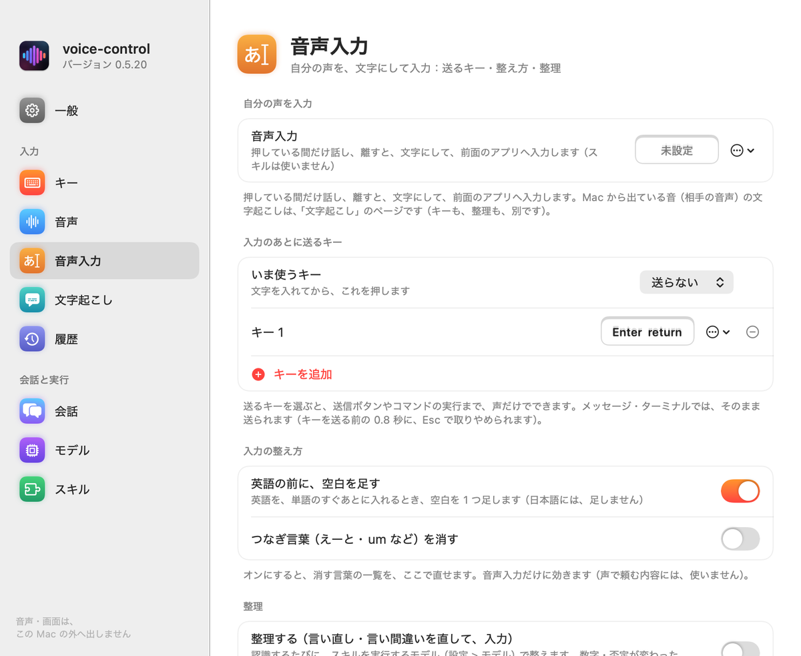 音声入力（入力のあとに送るキー・入力の整え方・整理）"><br><b>音声入力</b><br>入力のあとに送るキー（複数登録して切り替え）・つなぎ言葉・英語の空白・履歴</td>
  </tr>
  <tr>
    <td width="50%" align="center">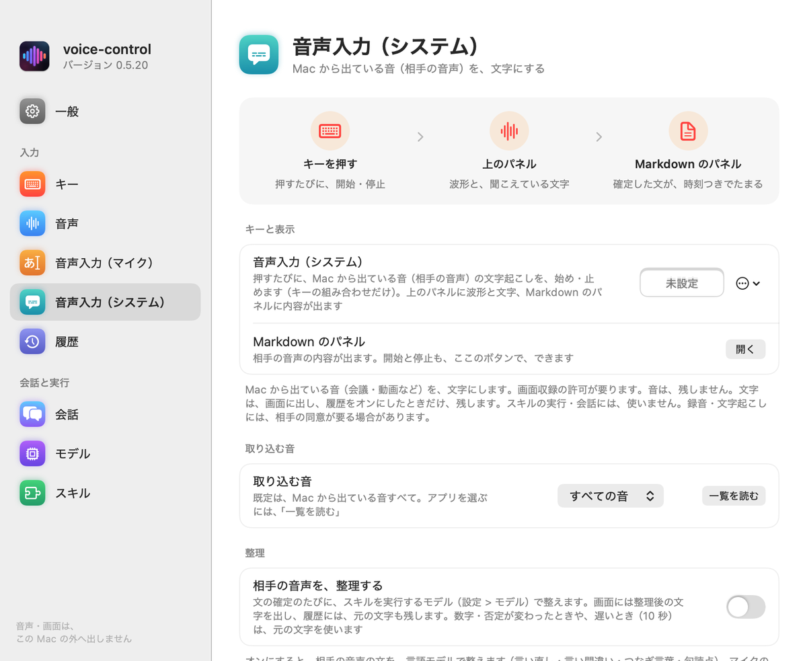 文字起こし（取り込む音・ショートカット・自分のマイク）"><br><b>文字起こし</b><br>Mac から出ている音を文字に（専用のショートカット・取り込むアプリ）</td>
    <td width="50%" align="center">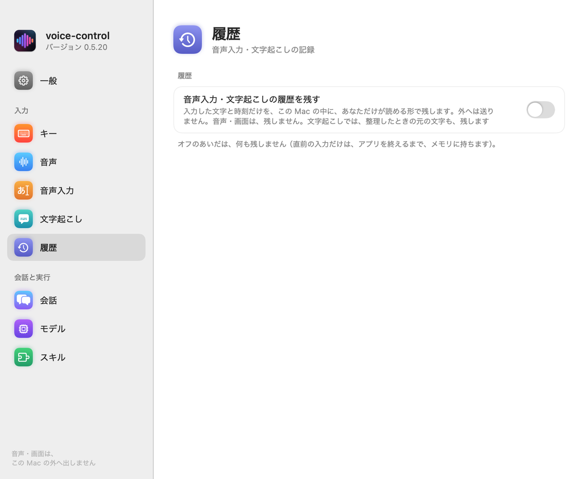 履歴（音声入力・文字起こしの記録）"><br><b>履歴</b><br>音声入力・文字起こしの記録（種類で絞る・探す・消す）</td>
  </tr>
  <tr>
    <td width="50%" align="center">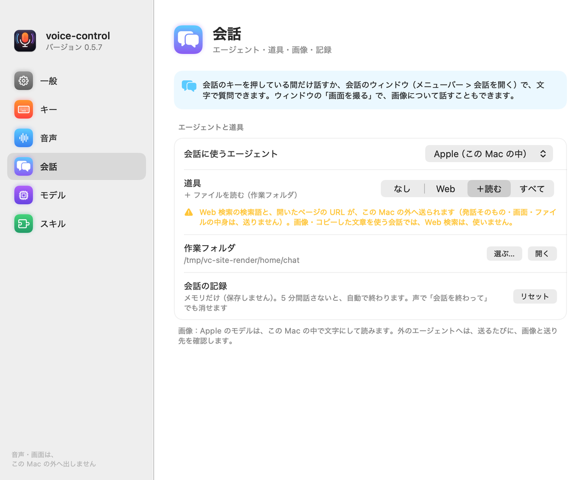 会話（エージェント・道具・作業フォルダ・記録）"><br><b>会話</b><br>エージェント・道具・作業フォルダ</td>
    <td width="50%" align="center">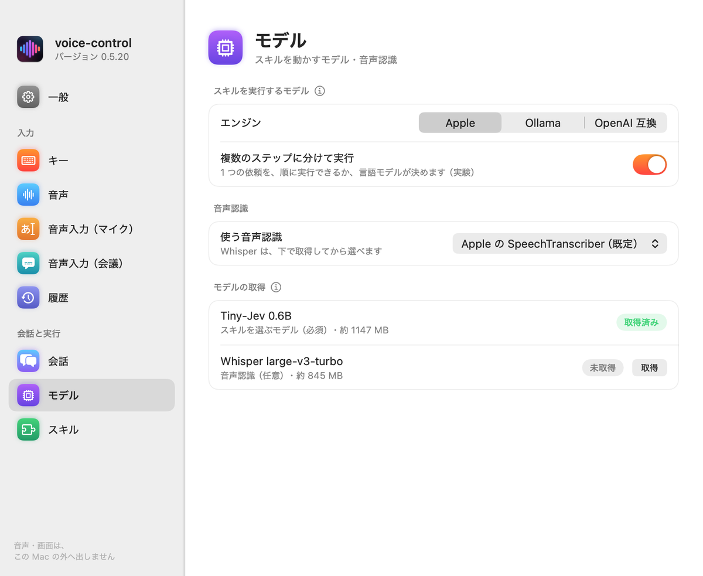 モデル（エンジン・音声認識・モデルの取得）"><br><b>モデル</b><br>実行するモデル・音声認識・モデルの取得</td>
  </tr>
  <tr>
    <td colspan="2" align="center">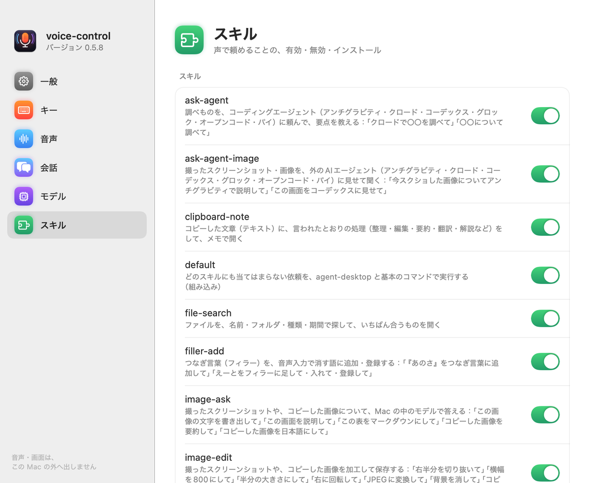 スキル（有効・無効・インストール）" width="50%"><br><b>スキル</b><br>有効・無効・インストール</td>
  </tr>
</table>

> 上の画像は、**本物の表示**を、見本の内容で撮ったものです（実際の操作・実際の発話の画面ではありません）。パネル・Markdown のウィンドウ・会話のウィンドウは、`vc hud-preview`・`vc show`・`vc chat-preview` を、**自作の模擬のデスクトップの上で、画面収録**したもの（`scripts/site/capture.sh`・`encode.sh`）。設定は、`vc settings-preview` が**画面の外で描いた**もの（`scripts/site/render.sh`）で、「一般」の許可の状態は、描いたプロセスのもの（許可の前の、初めての状態）です。

## 仕組み

**選ぶのは小さなモデル（Tiny-Jev）、実行するのは言語モデル、許可を決めるのはコード**、という分担です。

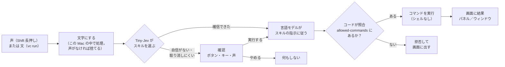

1. **スキルを選ぶ**：依頼の文と、各スキルの説明（`description`）を、Tiny-Jev（オンデバイスの小さな選択モデル、約 0.6B）が比べます。確信できなければ、実行せずに確認します。
2. **言語モデルが実行する**：選ばれたスキルの指示に従い、`run_command` という 1 つの道具で、コマンドを実行します。
3. **コードが守る**：実行できるのは、スキルの `allowed-commands` に一致したコマンドだけです。この判断は、プロンプトではなく**コード**が行います。

### ファイルを探して開く（`file-search`）の流れ

Tiny-Jev は、「候補の中から選ぶ」ことにも使えます（`vc pick`）。

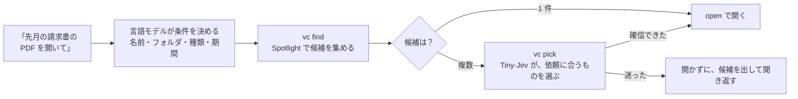

## はじめる

3 ステップです。

**1. 必要なものをそろえる**

- macOS 26 以降・Apple silicon の Mac。
- Apple Intelligence を**オン**にしておく（システム設定 > Apple Intelligence と Siri。オンにすると、言語モデルのダウンロードが始まります）。スキルの実行に Ollama などのモデルを使うなら、要りません（設定ウィンドウ > モデル > エンジン）。
- [agent-desktop](https://github.com/vercel-labs/agent-desktop)（`npm install -g agent-desktop`）。

**2. アプリを入れる**（ビルドは要りません）

1. 最新の [Release](https://github.com/takemo101/voice-control/releases) の **dmg** を開いて、`VoiceControl.app` を「アプリケーション」へドラッグします。
2. 署名は ad-hoc（Developer ID の署名・公証なし）です。ブラウザでダウンロードして Gatekeeper に止められたら、`xattr -dr com.apple.quarantine /Applications/VoiceControl.app`。
3. `VoiceControl.app` を開くと、**メニューバーにマイクのアイコン**が出ます（Dock には出ません）。初回は、**設定… > モデル** で Tiny-Jev（約 1.2 GB。SHA-256 を検証）を取得します。
4. **マイク・アクセシビリティの許可は、アプリ自身（voice-control）に付きます**。ターミナルアプリには、よりません（CLI の `vc` だと、動かしている端末アプリの許可が要り、別の端末・ヘルパー経由では下りないことがありました）。
5. **2 回目からは、アプリの中で更新できます**：新しい版が出ると、上のパネルとメニューバー（「新しいバージョン … に更新…」）で知らせます（設定 > 一般 > アップデートで、確認を切れます）。選ぶと、アプリが、dmg を取得し、SHA-256 と署名を確かめて、入れ替えて、開き直します。**アプリが取得するので、Gatekeeper の警告（`xattr` の操作）は、出ません**。確認で送るのは、GitHub の公開情報の取得だけです（あなたのデータは、送りません）。**「アプリケーション」へ入れたアプリだけ**が、更新できます。
   - **許可が無効になることがあります**：このアプリは、Apple の開発者の署名を、まだ使っていないので、更新のあとで、アクセシビリティの許可が「オンなのに効かない」ことがあります。設定 > 一般 の「準備状況」で、「オンなのに効かない」を押すと、このアプリの許可だけをリセットして、システム設定を開きます（オンにし直してください）。

**3. 試す**

メニューバーのアイコン > **設定…** で、キー・音声・モデル・スキルを決めます（変えた設定は、すぐ保存され、声の入力へ、**再起動なしで、すぐ反映されます**）。**Shift を単独で 0.35 秒以上押し続けている間だけ**録音し、離すと、実行します。

**会話を使うなら**、設定 > キー の「会話」にキー（例：`ropt`＝右 ⌥）を決めるか、メニューバーのアイコン > **会話を開く** で、文字で質問します（[会話する](#会話する)）。

**スキルは、設定 > スキル > 「スキルをインストール」からも入れられます**（一覧に、許可するコマンドと、外へ送るかが出ます。入れ済みは「更新」）。

ターミナルから `vc`（スキルが使うコマンド）を使うなら、設定 > 一般 の「コマンド vc」を**インストール**します（`/usr/local/bin/vc` → アプリの実行ファイル。管理者のパスワードを求められることがあります）。

```sh
vc doctor                                        # 必要なものが、そろっているか（アプリ自身の許可の状態は、メニューの「診断を見る」）
vc skills install spotify clipboard-note file-search   # スキルを入れる（名前なしで、一覧）
vc skills install --all                                  # リポジトリの、すべてのスキルを入れる
vc run "次の曲にして" --dry-run                  # 何を実行しようとするか、だけ見る
```

<details>
<summary>必要なもの（詳しく）</summary>

- macOS 26 以降・Apple silicon。ソースからビルドするときは、Swift 6.2 以降（Xcode または Command Line Tools）。
- [agent-desktop](https://github.com/vercel-labs/agent-desktop)（`npm install -g agent-desktop`）。アクセシビリティの許可が要る（アプリ自身に付く）。
- Apple Intelligence（FoundationModels）が使える Mac。**オンにしておく**：システム設定 > Apple Intelligence と Siri（オンにすると、言語モデルのダウンロードが始まる）。オフ・準備中・非対応のとき、アプリは、理由と手順をダイアログで出します（`vc doctor` でも確かめられます）。
- Tiny-Jev 0.6B のモデル（約 1.2 GB。設定 > モデル で `~/.voice-control/models/` に取得）。
- 任意：[just](https://github.com/casey/just)（開発用）・Ollama などのローカルのモデルのサーバー（設定 > モデル > エンジンで使うとき）。

</details>

<details>
<summary>インストールの詳細（ソースから・取り除く・許可のやり直し）</summary>

**ソースから入れる**（リポジトリを clone して。Swift 6.2 以降が要る）：

```sh
just install          # アプリを ~/Applications へ入れて、起動する（コマンド vc は ~/.local/bin へリンク。初回は、音声認識の実行環境 transcribe.cpp のビルドで、数分かかる。git・cmake が要る〔cmake がなければ、自動で入れる〕）
just test             # 単体テスト
just dmg              # 配布用の dmg を dist/ に作って、検査する
```

配布物の作り方：[開発手順](docs/development.md#リリース)。

**取り除く**：`just uninstall`（アプリ・コマンドのリンク・許可を取り除く。モデル・設定・スキルは `~/.voice-control` に残る）。手で入れたなら、`VoiceControl.app` を捨てる。メニュー・設定でコマンド vc を入れていたら、先に外す。

**許可が効かないとき**：設定ではオンなのに「許可されていません」と出るなら、`just reset-permissions`（このアプリの許可だけを取り消す。次の起動で、確認が出る）。**以前の tar.gz 版を入れていた**なら、`~/.local/bin/vc`（リンクではない古い実行ファイル）を消してください（PATH で先に当たると、古いものが動きます）。

</details>

## 使い方

### 声で頼む

アプリを起動すると、すぐ使えます（メニューバーのマイクのアイコンが「聞いています」）。

- **Shift を押している間だけ**録音します（0.35 秒以上、Shift だけを押し続けたとき。変更：設定 > キー）。離すと、文字にして、実行します。
- **実行中に、新しく話すと、前の処理を中断して、新しい依頼を実行します**（確認の返事を待っている間は、中断せず、返事として扱います）。**会話は、例外です**：考えている間に、続けて質問すると（文字でも声でも）、順番待ちに入り、いまの答えのあとに送られます（[会話する](#会話する)）。
- **Esc で取りやめ**：録音中は録音を捨て、認識中・実行中・確認の待ちは、処理を止めます。録音中（Shift を押している間）の Esc には、アクセシビリティの許可が要ります。
- **確認が出たら**、次のどれかで答えます（先に答えたほうが決まります）。
  - ボタンを押す（「実行する」「やめる」）。
  - キー：← → で移り、Return で決める。y＝実行する、n・Esc＝やめる。**最初のフォーカスは「やめる」**です（ほかのアプリで打っている最中の Return で、実行されないように）。
  - 声：もう一度 Shift を押して「はい」と言う。

### 声で文字を入力する

しゃべった言葉を、**そのまま文字にして、いま使っているアプリへ入力**します（メモ・メール・ブラウザの入力欄など）。スキルも言語モデルも使わないので、起動が速く、すぐ使えます。

設定 > キー の「音声入力」に、キー（例：`rshift`）を決めると、**そのキーを押している間だけ録音 → 離すと入力**します（Shift の長押し＝声で頼む、は、そのまま。キーによって切り替わります）。認識の替え方・「入力せずに確認」は、設定 > モデル > 音声認識。

- 入力は、**クリップボードに書いて ⌘V を送り、貼り付け先が文字を読んだのを確かめてから、元のクリップボードへ戻す**方式です。戻す前に、あなたが別のものをコピーしていたら、戻しません（上書きしません）。クリップボードの履歴アプリには、記録されない印をつけます。
- **読まれなかったとき**（入力欄がない・セキュア入力・アプリの不調）は、⌘V を一度だけ送り直し、それでもだめなら、「入力できませんでした」と出して、**文字をクリップボードに残します**（⌘V で、手で貼れます）。成功に見せかけません。
- 録音中は波形が動き、離すと「認識中…」、入力したら「入力しました」と出ます。Esc で取りやめます。
- アクセシビリティの許可（トリガーの検出と ⌘V の送信）とマイクの許可が要ります。
- **入力したあとに、キーを送れます**（設定 > 音声入力 の「入力のあとに送るキー」。既定は「送らない」。**送るキーは選べます**：既定の候補は Enter、⌘Enter・⇧Enter・⌥Enter・⌃Enter・Tab は候補から、ほかのキーは「記録」して〔押したキーが、そのまま設定になります〕。「キーを追加」で、複数登録できます）：チャットの送信・ターミナルのコマンドの実行まで、声だけでできます。**入力できなかったときは、送りません**。キーを送る前に 0.8 秒の間があり、**Esc で取りやめられます**（メッセージ・ターミナルでは、そのまま送られるので、オンにするときは注意してください）。
- 入力した文字は、画面の上のパネルにだけ出します（ファイル・ログ・端末には残しません）。声のない録音は、入力しません。
- **整理モード**（既定は off。設定 > 音声入力 > 整理。**自分の声〔音声入力〕と、システム音声〔相手の音声〕を、別々にオン・オフ**）：認識した文字を、**スキルを実行するモデル**（Apple・Ollama・OpenAI 互換）で整えてから入力します（言い直し・言い間違い・つなぎ言葉・句読点）。**整え方の指示は、編集できます**（固定の約束――文字は、データ・内容を足さない・数字と否定を変えない――の下に、足されます）。数字・否定・長さの検査に通らないとき・10 秒かかったときは、**元の文字**を入れます。試すのは `vc tidy "えーと明日の会議は3時、いや4時からです"`。声で頼む内容には、使いません。
- **システム音声（相手の音声）の文字起こし**（メニューバー > 文字起こし（相手の音声）か、**専用のショートカット**〔設定 > キー〕。設定 > 文字起こし）：Mac から出ている音（会議・動画など。全体か、選んだアプリ）を、ウィンドウに、時系列で文字にします（**文字起こし専用：スキル・会話・コマンドには回しません**）。画面収録の許可が要ります。音は残さず、文字は、**履歴（設定 > 音声入力 > 履歴）をオンにしたときだけ**、同じ保存期間で残します（整理モードがオンなら、整理後の文字と元の文字）。**自分の声は、音声入力**（別のキー・別の整理）：文字起こしは、相手の音声だけです。文字起こしの開始・停止のショートカットは、音声入力のキーとは別です。取り込んでいる間は、録音中の「ほかの音を消す」を、しません（消すと、取り込む音も消えるため）。録音・文字起こしには、相手の同意が要る場合があります。
- **つなぎ言葉（「えーと」「あのー」「um」など）を、消せます**（既定は off。辞書にある語を、文字列の一致で消すだけで、言語モデルは使いません）。設定 > 音声入力 の「つなぎ言葉（えーと・um など）を消す」。辞書は、設定 > 音声入力 で足し引きします（オンにすると、一覧が出ます）。**声でも足せます**：`vc skills install filler-add` →「『あのさ』をつなぎ言葉に追加して」。声で頼む依頼文には、かけません。詳しくは [docs/skills.md](docs/skills.md#つなぎ言葉を消す辞書設定ウィンドウ--音声音声でも足すfiller-add)。
  - **既定の辞書（19 語）**：日本語は「えーっと」「ええっと」「えーと」「えっと」「ええと」「あのー」「あのう」「そのー」「うーんと」「うーん」「んー」「えー」、英語は `uh`・`um`・`uhm`・`umm`・`uhh`・`hmm`・`erm`。「あの」「その」「まあ」は、ふつうの語でもあるので、入れていません。
  - 設定に辞書がなければ、この既定を使います。設定 > 音声入力 の辞書を編集して保存すると、**その全体**が `settings.json` に保存されます（あとで既定が変わっても、反映されません。設定 > 音声入力 の「既定に戻す」で、戻します。足した語は消えます）。

### キーの決め方（右側のキーだけにもできます）

設定ウィンドウ > キー で、4 つのキー（声で頼む・音声入力・会話・画面撮影）を決めます（既定は、声で頼む＝Shift だけ。ほかは、未設定です）。入力欄に書いて「適用」（Enter）か、「候補」から選びます。書き方と重なりは、その場で検査されます。

| 書き方 | 反応するキー |
|---|---|
| `shift`・`cmd`・`opt`・`ctrl` | 左右どちらでも（長押し） |
| `rshift`・`rcmd`・`ropt`・`rctrl` | **右側のキーだけ**（長押し専用。左のキーを押している間も、反応しない） |
| `ctrl+opt+space`・`f5` など | キーの組み合わせ（左右の区別は、できません） |

- 普段の入力で使わない右側のキーにすると、誤作動が減ります。
- `shift` と `rshift` のように、同じキーに反応しうる 2 つは、声で頼むキーと音声入力のキーに、同時に設定できません（エラーになります）。
- 確かめる：`vc hotkey-check`（開発用。押して、離すと、画面に出ます）。

### キーで、声で頼む／音声入力／会話を切り替える

別のキーを決めると、**1 つのアプリで、キーによって切り替わります**。

| 押すキー | 起きること |
|---|---|
| Shift の長押し（既定。設定 > キー で変更） | 声で頼む：スキルを選んで実行する |
| Ctrl の長押し（設定 > キー の「音声入力」で決める） | 音声入力：文字にして、前面のアプリへ入力する（スキルは使わない） |
| 右 ⌥ の長押しなど（設定 > キー の「会話」で決める） | 会話：スキルを選ばず、会話として質問する（[会話する](#会話する)） |

- 押しているキーで、パネルの表示も変わります（音声入力は「離すと、文字にして入力します」）。
- 録音中は、もう一方のキーは無視します。確認の返事（「はい」）は、どちらのキーで話しても、返事になります。
- 音声入力のキーを外す：設定 > キー の「音声入力」を空にして適用。

#### 音声入力を、使いやすくする（実験）

- **入力のあとに送るキーを、切り替える**：設定 > 音声入力 の「入力のあとに送るキー」で、「キーを追加」を押して、キー（Enter・⌘Enter など。最大 8 つ）を足すと、候補は「送らない」＋そのキーになります。**ショートカット**（同じ欄の「送るキーを切り替える」）・メニューバーのメニュー・同じ欄の「いま使うキー」で、順に切り替えられます（再起動は要りません。切り替えると、画面の上に、いまの候補が出ます）。
- **直前の入力を貼り直す・最近の入力をコピー**：ショートカット（設定 > キー の「操作」）か、メニューバーのメニュー。直近 5 件は、メモリだけに持ちます（アプリを終えると消えます）。
- **履歴**（設定 > 履歴。**既定はオフ**。音声入力と文字起こしの記録。種類で絞れます）：オンにすると、入力した文字と時刻だけを、自分だけが読めるファイル（`~/.voice-control/history.jsonl`）に、残す日数（既定 7 日）だけ残します。探す・コピー・1 件の削除・すべて消すができます。外へは送りません。
- **言語の「自動」・英語の空白**：設定 > 音声 の言語に「自動」（ダウンロードしたモデルを選んでいるとき。話した音声から判定します。Apple の認識は、この Mac の言語になります）。英語を単語のすぐあとに入れるときは、空白を 1 つ足します（日本語には足しません。設定 > 音声入力 の「英語の前に、空白を足す」でオフにできます）。

### 文で頼む

```sh
vc run "Safariを開いて" --dry-run     # 何を実行しようとするかだけ見る
vc run "Safariを開いて"               # 実行
```

実行すると、選ばれたスキル・実行したコマンド・結果が、順に表示されます。

```text
$ vc run テスト
▶ スキルの選択
  Tiny-Jev  echo-test   98.6%（0.1 秒）
  許可      echo

▶ 実行
  $ echo test
    ✓ exit 0
    │ test

▶ 結果
  返事      done: テストされました。
  所要      1.1 秒・実行したコマンド 1 件
```

（`echo` だけを許可した使い捨てのスキルでの、実際の出力。返事の文言・秒数は、実行のたびに変わります。）

### コピーした文章を加工する

文章を **⌘C でコピー**してから、「コピーした文章を整理して」「要約して」と頼みます。結果は、整形した Markdown のウィンドウに出ます（`clipboard-note`、`vc show`）。

### 音声認識を替える（Whisper）

既定は Apple のオンデバイスの認識です。**Whisper large-v3-turbo**（約 0.9 GB・MIT）をダウンロードして、替えられます。設定 > モデル の「モデルの取得」で「取得」（SHA-256 を検証。途中から再開できる）→ 「使う音声認識」で選びます。

- 自作の合成音声 480 件での測定では、Whisper は、**雑音が軽いとき・英字の語**（Safari・PDF）で、Apple より誤りが少なく（全体の文字誤り率 6.9% 対 8.6%）、1 件の認識に 0.5 秒ほどかかります（Apple は 0.06 秒）。**実際の声での比較は、していません**。[検証記録](docs/verification.md)
- どちらの認識でも、**声のない録音（無音・一定の雑音）は、認識に渡しません**（認識が「はい」などの文を作るため）。
- 取得していないモデルを選ぶと、黙って Apple に切り替えず、理由と手順を出して止まります。

### 言語（日本語・English・自動）

設定ウィンドウで、**2 つの言語**を、別々に選べます（どちらも、既定は日本語）。

- **表示言語**（設定 > 一般 > Language / 言語）：**画面の言葉**（設定ウィンドウ・ダイアログ・メニュー・画面の上のパネル・スクリーンショット・会話・Markdown のウィンドウ・端末の `vc`）を、日本語か English にします。スキルの名前と説明・エージェントの答えは、そのままです。許可のダイアログ（マイクなど）の説明は、Mac の言語に合わせます。
- **音声認識の言語**（設定 > 音声 > 言語）：話す言語です。録音の認識・録音中の文字・読み上げの声・声の確認の「はい」（`yes`・`go ahead`）・**答えの言語**（会話・スキルの結果の文）が、English になります。**声で頼む機能（スキルの選択）は、日本語で作って測っています**。英語の発話でも、同じ文の訳で測ると働きましたが（操作の依頼かの判定：19/20・会話を止める 20/20）、確信度は低めで、確認が増えることがあります。会話の「止めて」（`stop`・`cancel`・`never mind` など）は、日本語・English の両方で働きます。会話を終わる言い方（「会話を終わって」など）は、日本語だけです。English の説明：[README.en.md](README.en.md)。
- **言語「自動」**（設定 > 音声 > 言語。ダウンロードした Whisper のモデルを選んでいるときだけ出ます）：話した音声から、言語を判定します（短い言葉では、外れることがあります）。Apple の認識は、言語を決めて始めるので、**この Mac の言語**になります。読み上げの声は、読む文字の言語（日本語・English）に合わせます。
- **言語は、増やせる作りです**（開発者向け）：言語ごとのデータ（名前・声の「はい」・つなぎ言葉・「止めて」の言い方など）は 1 か所にまとめ、翻訳の表は言語ごとに分け、訳のない文は、英語で出ます。足し方は、[開発手順](docs/development.md#言語を足す)。**足せるのは、画面・音声認識・読み上げの言語まで**で、声で頼む機能の精度は、日本語と English しか測っていません。

### 使うモデルと、録音中の音を、設定する

**設定ウィンドウ**（メニューバーのアイコン > 設定…。`~/.voice-control/settings.json` を読み書きします）で、常にそうする設定ができます。

| 決めること | 場所 |
|---|---|
| キー（声で頼む・音声入力・会話・画面撮影）・手放し（ダブルタップ） | キー |
| 録音中に、ほかの音を消すか・録音中の文字・聞き取りの確認・読み上げと声・**音声入力のあとの Enter**・つなぎ言葉の辞書 | 音声 |
| 会話のエージェント・道具（なし・Web・＋読む・すべて）・作業フォルダ・会話のリセット | 会話 |
| 分析・実行のモデル（Apple・Ollama・OpenAI 互換）・複数ステップ・音声認識・モデルの取得 | モデル |
| スキルの有効・無効・インストール | スキル |
| 許可の状態・ログイン時に起動・コマンド vc・診断 | 一般 |

その実行だけ替えるなら、`vc run` の `--engine`・`--stt`・`--no-plan`。
**変えた設定は、再起動なしで、すぐ反映されます**（声の流れを作り直します。録音中・認識中・実行中なら、終わってから。反映できなかったときだけ、「もう一度」「再起動」が出ます）。

### スクリーンショットに声で頼む／文字起こし

設定 > キー の「画面撮影」に、`ctrl+opt+s` のような組み合わせを決めます（範囲を選んで撮る。そのあと声で頼む／パネルで文字起こし）。

`ctrl+opt+s` → 画面が静止して暗くなる → **ドラッグで範囲**（⇧ 正方形・⌥ 中心から）・**ウィンドウをクリック**・↩ 全画面・Z 拡大鏡（色のコピー）。大きさが「1000 × 300」のように出ます。撮れると、画像のパネル（画像・パスのコピー）が出て、「続けて、声で頼んでください」と案内が出ます。**声のトリガー（Shift の長押しなど）を押して**、3 分以内に頼みます（**ダブルタップ**なら、話し終わるまで聞きます：手放し）。「**この画像の文字を書き出して**」「これは何？」「**右半分を切り抜いて**」「横幅を 800 に」「JPEG に変換して」。答えは、ウィンドウに出ます（切り抜きなどは、`~/Pictures/voice-control` に保存）。`ctrl+opt+t` は、範囲の文字だけを、そのままウィンドウに出します（macOS の文字認識。言語モデルを通しません）。**画像は、Mac の中のモデルだけ**に渡ります（Apple のモデル、または画像対応の Ollama）。画面収録の許可が要ります（`vc doctor`）。詳しくは [スキル](docs/skills.md#画像撮ったスクリーンショットコピーした画像に声で頼むimage-askimage-edit任意)。

### ファイルを探して開く

「ドキュメントの請求書の PDF を開いて」「デスクトップの家計簿のエクセル」。`file-search` スキルが、`vc find` で探し、複数なら `vc pick` で選び、`open` で開きます。迷ったときは、開かずに候補を出して、聞き返します（読み取りだけ。削除・移動はしません）。`vc skills install file-search` で入れます。

`vc pick` は汎用です。ファイルに限らず、短い候補の中から、依頼に合うものを選べます。

```sh
ls ~/Documents | vc pick --query 家計簿
```

### 今日の Todo（時間になったら読み上げ）

`vc skills install todo-remind`。「**15時にレポート提出のTodo追加して**」「午後3時に歯医者へ行くのでTodoに入れて」と言うと、今日の Todo を追加して、一覧のパネルを出します。**時刻になると、「レポート提出を実施する時間です」と読み上げ、パネルを出します**（パネルは、一覧が 20 秒・知らせが 60 秒で、黙って閉じます）。「今日のTodoを見せて」「レポートのTodoを消して」「Todoを全部削除して」も言えます。

- **時刻に、スキルを実行する予約**もできます（実験）：「**10時に音楽をかけるよう予約して**」「8時になったら音量を下げて」のように、**時刻と予約の言い方**を入れて言います。**特定のスキルに当たる依頼だけ**受け、時刻に **10 秒の予告**（読み上げ＋パネル。**閉じると取りやめ**）を出してから、確認なしで動かせる範囲だけ実行します（確認が要る操作は、実行されません）。「19時にレストランを予約して」のような、ふつうの予約は、対象外です。
- **「5分後」「1時間半後」のように、いまからの長さでも言えます**（「30分後にレポートを見直すのでTodoに入れて」のように、**「Todo」と言ってください**。「5分後に音楽をかけて」だけだと、Spotify が、すぐ実行します。上限 24 時間・日をまたぐと断ります）。
- **今日だけ**です。Mac を再起動・ログアウトすると、Todo は消えます（ファイルには、何も残しません）。
- 時刻の言い方（15時・午後3時半・夜の8時）は、コードが読みます。読めないとき・過ぎた時刻は、断ります。
- 詳しくは [スキルの文書](docs/skills.md#今日の-todo-と時間の読み上げtodo-remind任意)。

### 自分のスキルを書く

`~/.voice-control/skills/<名前>/SKILL.md` を作ります。

```sh
mkdir -p ~/.voice-control/skills/open-app
cat > ~/.voice-control/skills/open-app/SKILL.md <<'EOF'
---
name: open-app
description: アプリを開く・起動する・前面に出す
allowed-commands:
  - open
---
Open the application the user named. Run: open -a "<App name>". Then reply done.
EOF

vc skills                                    # [有効] open-app  アプリを開く・起動する・前面に出す
vc run "Safariを開いて" --dry-run
vc skills disable open-app                   # 選択肢から外す（enable で戻す）
```

- 先頭（`---` の間）が、**名前・説明・許可するコマンド**。その下が、言語モデルへの指示です。
- 本文には、記号を書けます：`${SKILL_DIR}`（そのスキルのディレクトリ）・`${USER_REQUEST}`（利用者の依頼。データの囲みに入って差し込まれる）・`${SCREENSHOT}`（いまのスクリーンショットのパス。外のツールへ画像を渡す）。後ろの 2 つは、許可〔`allowed-commands`〕には書けません。
- スキルから、`vc` の機能も使えます：`vc find`（ファイルを探す）・`vc pick`（候補から、Tiny-Jev が選ぶ）・`vc show`（Markdown をウィンドウに出す）。`allowed-commands` に書くと、言語モデルが呼べます（例：`file-search`）。
- 書き方・`allowed-commands` の仕様・表示：[スキル](docs/skills.md)。エージェントに作らせるときは、[スキルを作るスキル](skills/voice-control-skill-author/SKILL.md)。

### 覚えておくこと

- **スキルの置き場所**：グローバル（`~/.voice-control/skills/<name>/SKILL.md`）と、プロジェクト（`<vc を起動した場所>/.voice-control/skills/<name>/SKILL.md`）。同じ名前なら、プロジェクトが上書きします。外から来るリポジトリのスキルは、許可したコマンドを実行できるので、**`vc skills trust` したプロジェクトだけ**読み込みます（既定は未信頼）。[詳細](docs/skills.md#置き場所)
- **既定スキル**：どのスキルにも当てはまらない依頼は、組み込みの `default` スキルが、`agent-desktop` と基本のコマンド（`open`・`say`・`ls`・`pwd`・`date`）で実行します。会話・独り言は実行せず、取り消しにくい依頼（削除・送信・購入など）は確認します。使わないなら `vc skills disable default`。[詳細](docs/skills.md#既定スキルdefault)
- **1 つの依頼で、複数のスキルを順に実行できます**（マルチステップ）：「Claude で Rust の所有権を調べて、そのあと Spotify で次の曲にして」。**言語モデルが、依頼を、実行する順のステップに分け**、ステップごとに、いつもの流れ（Tiny-Jev が選ぶ → 確認 → 実行）で実行します。許可と確認は、ステップごとです。最初の失敗で止まります（済んだ分は、元に戻しません）。前のステップの結果は、**受け取ると宣言したスキル**（`accepts-previous: true`。いまは `web-search`）にだけ、信頼しないデータとして渡します（「今の曲を教えて、それをウィキペディアで検索して」）。止めるには 設定 > モデル の「複数のステップ」をオフ。[詳しく](docs/skills.md#複数のステップの依頼マルチステップ)
- **結果を Markdown で見せる**：スキルのフロントマターに `result: markdown-window`（整形したウィンドウ）・`result: markdown-note`（ファイル）。[詳細](docs/skills.md#markdown-のウィンドウvc-showresult-markdown-window)
- **モデルを替える**（任意）：`--engine ollama:qwen3.5:4b`（Ollama）・`--engine openai:<モデル>@<ポート>`（LM Studio・llama.cpp など、OpenAI 互換）。通信先は、この Mac の 127.0.0.1 です（Ollama は、省くと 11434）。**場所（エンドポイント）を設定**すれば、**同じ LAN のサーバー**（`--engine openai:<モデル>@192.168.1.5:8080`・`ollama:<モデル>@192.168.1.5:11434`・`〜.local` の名前）にも向けられます。API の経路（`/v1`・`/v2` など）も書けます（`http://192.168.1.5:8080/v2`。プロトコルは `http://` だけで、`https://` は未対応です）。設定 > モデル の「一覧」「確かめる」で、モデルと接続を確かめられます（設定 > モデル で、その場所ごとに許可。通信は暗号化されません）。**APIキー**が要るサーバー（oMLX など）は、同じ画面で保存します（自分だけが読めるファイルに置き、画面には出しません）。クラウドのモデルは使えません。許可の照合・上限・確認は、モデルに関わらず同じです。確認：`vc doctor --engine …`。[詳細](docs/skills.md#実行するモデルを替えるローカルのサーバー任意)

## 会話する

スキルを選ばず、**質問を重ねる**使い方です（実行はしません。操作の依頼は、声で頼むキーで）。**会話のキー**（設定 > キー の「会話」。例：`ropt`＝右 ⌥）を押している間だけ話すか、メニューバーのアイコン > **会話を開く** で、ウィンドウに**文字で**質問します。

<p align="center"><a href="site/assets/video/demo-chat.mp4"></a><br><sub>画像をクリックすると、会話の動画（34 秒）が開きます（画面収録。見本の内容）</sub></p>

- **1 つのウィンドウ**に、質問と答え（吹き出し）が続きます。ボタンは、**よく使うものだけ**（入力欄の左の「画面を撮る」・右上の「…」〔会話全体のコピー・新しい会話〕と「閉じる」）で、下の操作の列は、ありません。新しく開き直しません。考えている間は、いまの操作（「検索：…」「読む：…」）が出て、答えの下に、**実行した操作**が残ります。中断・失敗した質問も、理由つきで残ります。
- **実行した操作の結果が見えます**：答えの下の「実行した操作」で、コマンドの**出力**・ファイルの**差分**（追加は緑・削除は赤）は、その行を押して開けます（画面に出すだけで、記録には残しません。読んだファイル・検索の結果は、出しません）。
- **図・画像は、押して拡大できます**：拡大の窓で、ピンチ・ダブルクリック・⌘（または ⌥）＋スクロール・「＋」「−」（`+` `-` キー）で拡大縮小し、ドラッグで動かします。画像の下に浮かぶ小さな操作盤に、倍率・「＋」「−」・「**元に戻す**」（`0`：全体が見える大きさ）があり、倍率を押すと 100%（`1`）です。見出しの右に「**画像をコピー**」（⌘C）と閉じる。ボタンは、アイコンだけ（触れると説明が出ます）。
- **文字の大きさを変えられます**（設定 > 一般 > 表示の「文字の大きさ」：「−  13  ＋」。標準は 13・10〜24）：会話・Markdown のウィンドウ・上のパネル・画像の窓・拡大の窓の文字が、変わります（開いている画面も、すぐ）。設定ウィンドウ自身は、変わりません。**ショートカット**：会話・Markdown・画像のウィンドウで、**⌘＋**（⌘= も）で大きく・**⌘−** で小さく・**⌘0** で標準へ（設定に保存されます）。
- **続けて質問**できます。長くなったら、古いやり取りを要約して、続けます。**記録は、メモリだけ**です（ファイルにも、ログにも残りません）。「会話を終わって」と言う・ウィンドウ右上の「…」>「新しい会話を始める」・5 分間話さない・アプリを終える、で消えます。
- **考えている間に続けて質問すると、順番待ちに入ります**（文字でも、会話のキーの声でも。Zed や Codync と同じ考え方）：会話の流れの中に、点線の縁の吹き出しで並び、いまの答えが終わってから、送られます。待っている**文字**は、まとめて 1 回の質問にします（声は、1 件ずつ）。各件の「**今すぐ送る**」は、いまの質問を止めて、その 1 件を先に始めます。「**取り下げ**」で戻せます（文字は、入力欄が空なら、入力欄へ）。入力欄が空のとき、送信ボタンは「**停止**」になり、いまの質問を止めて、待っていた質問も送りません（記録には、残ります）。※「いまの答えに、差し込む」（Zed の Steer など）は、していません。
- **声の「止めて」**（会話のキーだけ）：発話の**全体が**「止めて」「ストップ」「やめて」「キャンセル」「待って」・`stop`・`cancel` などと同じときだけ、読み上げと考えている質問を止め、順番待ちを捨てます。**質問としては、送りません**。「音楽を止めて」のような長い文は、止めずに、普通の質問です。言語モデルは使わず、文字の一致だけで決めます。言い方は、いまは、固定です（設定では、変えられません）。声で頼むキーの「止めて」は、スキルへの依頼のままです。
- **答えが、少しずつ届くとき、表示と読み上げを、早く始めます**（ACP のエージェントで、答えを少しずつ返すもの）：届いた文字を、考えている間にカードへ出し、読み上げが on なら、**文の区切りごと**に読み始めます（コードは読みません）。**エージェントによって、効き方が違います**：opencode は少しずつ届くので、効きます。agy は、答えを作り終えてから、ほぼ一度に送ってくる（実測）ので、あまり変わりません。Apple のモデルと、一度に返すエージェントは、従来どおり、答えが決まってから、全文を読みます。
- **上へ戻って読んでいるとき**（いちばん下から離れたとき）、記録の下に「**最新へ**」のボタンが出ます。押すと、いちばん新しい会話へ戻ります。
- **入力欄は、複数行**です：**Return で送信・⇧Return（⌥Return）で改行**。1 行から 6 行まで、文字に合わせて高くなります。
- **ファイルを添えられます**（外のエージェントの会話）：会話ウィンドウへ**ドロップ**・入力欄の左の**クリップ**で選ぶ・Finder でコピーして **⌘V**。入力欄の上の札で外せて、**次の質問だけ**に付きます。**送るたびに、ファイル名・大きさ・送り先を、確認します**。小さい文字のファイル（100 KB まで）は、内容を、そのまま渡します。それ以外は、道具が「＋ファイルを読む」以上のときだけ、作業フォルダへ一時的にコピーして渡します（終わったら消します）。鍵・`.env`・`~/.ssh`・このアプリのデータなどは、断ります（名前と場所で見ます。完全な保証ではなく、確認が最後の歯止めです）。Apple のモデルの会話では、使えません。
- **答えは、全文を読み上げられます**（設定 > 音声 の「実行の結果・会話の答えを、声で読み上げる」。Esc・ウィンドウ右上の「読み上げを止める」・メニュー・会話のキーで止まります）。コードなどは、読み上げず、「コードは、画面に出しています」と言います。
- **画像を見せられます**：入力欄の左の「**画面を撮る**」（カメラのボタン）で範囲を選ぶと、画像が添えられます（添えた画像は、いつも使います）。**ショートカットで撮ったスクリーンショット**があるときは、**質問が画像についてか、Tiny-Jev が判定して**、そうなら使います（「これ、何が書いてある？」は使い、「日本の首都は？」は使わず、使わなかったときは、そう断ります。同じスクリーンショットは、1 度使ったら、次の質問では、使いません。**スクリーンショットと、コピーした画像が両方あるとき**は、依頼に合うほうを、Tiny-Jev が選びます。見ずに作った 30 文で、画像について 9/14 を使い、画像なしの 14/16 を使いませんでした。**外れることがあります**：使うべきときに使わなければ、「画面を撮る」で添えてください）。Apple のモデルは、**この Mac の中で**画像を読みます。外のエージェントへは、**送るたびに、画像と送り先を見せて、確認します**（断ると、送りません。送った画像は、作業フォルダに残りません）。「コピーした文章」と言えば、コピーした文章も添えます（Apple のモデルだけ）。

### 答える側（エージェント）

設定 > **会話** で選びます。

| 答える側 | 内容 |
|---|---|
| **Apple のモデル**（既定） | この Mac の中だけで動く。外へ何も出ない |
| **ローカルのサーバー**（実験） | 設定 > モデル で選んだ **Ollama・OpenAI 互換**（この Mac、または許可した同じ LAN のサーバー）で、**道具なしの会話**（画像は、画像に対応したモデルなら、そのまま渡します）。同じ LAN のときは、ウィンドウに「同じ LAN のサーバーへ送信」と出ます。サーバーを選んでいないときは、Apple のモデルで答えます（`vc chat --agent server`） |
| **`claude`・`codex`・`grok`・`agy`・`opencode`・`pi`** | 手元の**コーディングエージェントの CLI** に、1 回ずつ頼む。**発話が、そのエージェントの提供元へ送られる**（ヘッダーに「この Mac の外へ送信」と出る） |

- **モデルを選べます**（ACP で話すエージェント：設定 > 会話 の「モデル」を押す→**検索つきの一覧**（あいまい検索：「son 5」→ Sonnet 5.5。順に含まれていればよく、空白で区切った語は、すべて含むもの。Return で、いちばん上を選ぶ）。ターミナルでは、`vc chat-models <エージェント> [絞り込みの語]` で一覧・`vc chat --agent-model <値>`）：**一覧は、エージェント自身が返します**（Claude・Codex・agy・opencode で確認：件数は、契約・設定で変わります）。「一覧を取る」は、そのエージェントを一時的に起動して聞くだけで、**質問は送りません**（モデルは呼ばれません）。選ぶと、次の会話から使います。
- **自動モード**（設定 > 会話。道具が「すべて」・ACP・OS の制限つきのとき。既定は **オフ**。オンにするとき、確認のダイアログが出ます）：**作業フォルダの中**の、ファイルの書き込みと、**基本のコマンド**（`ls`・`cat`・`grep`・`echo`・`mkdir`・`cp`・`git status` など）を、**確認なしで**行います。`python3 -c`・`make`・`npm test` など、**それ以外のコマンドは、この Mac の中の Tiny-Jev が、「無害か」を判定**し、無害と判定したときだけ、確認なしです（判定できない・長い・届かないときは、確認）。**確認のままのもの**：消す・移す／`curl`・`scp`・`ssh`・`git push` など、外へ送る／`kill`・`open`・`osascript` など、システムを動かす／インストール／権限の変更／**フォルダの外・鍵・環境変数などに触れる書き方**。**断るもの**：作業フォルダの外への書き込み・取り返しのつかないコマンド。**限界**：Python などのコードの中の操作は、規則では見抜けず、Jev も見落としうるので、書き込みの範囲は、OS の制限が、作業フォルダに限ります。聞き間違いや、Web のページの命令でも、作業フォルダの中のファイルは、確認なしで書き換わりえます。ターミナルでは `vc chat --auto`。
- **`agy`・`opencode`・`grok`・`pi`・`claude`・`codex` は、常駐の接続で話します**（`pi` は ACP ではなく、**pi 自身の RPC モード**で話します。pi には許可の要求の仕組みがないので、このアプリが書く小さな拡張〔`~/.voice-control/pi/vc-gate.ts`〕が、**読む組み込み（read・grep・find・ls）以外のすべての道具**（あなたの拡張・MCP が足したものも）の前に確認を求めます。ほかのエージェントと同じく、あなたの pi の拡張・MCP・スキルは、そのまま使えます。道具の段階では、さらに、組み込みの道具そのものを無くします。第三者のアダプターは使いません。フォルダの `.pi` は読みません）（`grok` は、道具が「なし」のときだけ従来の方式です。ACP では、Web 検索を止められないため）（`claude`・`codex` は、**ACP アダプター**が要ります：設定 > 会話 の「ACP アダプター」の「**入れる…**」〔またはターミナルで `vc adapter install claude|codex`〕。**押して、確認したときだけ**、`~/.voice-control/adapters/` へ、版を固定して入れます〔約 25〜80 MB。npm の公式のレジストリだけ・すべての部品を SHA-512 で照合・インストール時のスクリプトは動かさない・あなたの `claude`・`codex` の本体を使います。Node.js が要ります〕。「消す」もあります。自分で `npm i -g` したものがあれば、そちらを使います。入っていなければ、従来の方式です。Claude は、確認のモード `default`・Codex は `read-only` に切り替えて使います：実測で、ほかのモード〔`auto`・`agent`〕は、確認なしで書き込むため）。設定 > 会話 の「常駐の接続（ACP）で話す」。既定 on）：質問ごとに起動しないので、**速く**（実測：1 質問 約 10 秒 → 約 4 秒）、会話を向こうが覚えます。**書き込み・コマンドは、操作の前に、毎回、確認します**（従来は、「すべて」で確認なしでした）。使えないときは、自動で、従来の方式に戻ります。ほかのエージェント（`pi`・`grok`）は、従来の方式です（確認を、聞く仕組みが、まだ使えません）。`opencode` は、何もしないと、書き込み・コマンドも確認なしで行うので、起動のとき、全部を「聞く」設定にして、こちらの確認の経路に載せています。**取り返しのつかないコマンド（`rm -rf ~` など）は、確認なしで断り**、`ls` のような見るだけのコマンドは、確認なしで通します。**OS の制限（macOS の Seatbelt）つきで動かす**ので（設定 > 会話 の「OS の制限つきで動かす」。既定 on）、確認で「はい」と答えても、作業フォルダの外へは書けません（コマンドもその中で動くため、キャッシュを書くもの〔`npm install` など〕は動きません。`~/.ssh` などの鍵の置き場は、読めません）。
- **この Mac に入っているエージェントだけ**が、選択肢に出ます（`PATH` と、`~/.local/bin`・`~/.bun/bin`・`/opt/homebrew/bin` などを探します）。
- 選んだエージェントが、**アンインストールなどで見つからなくなったら、設定は変えずに、Apple のモデルで答えます**（会話は続きます。答えに、断りが出ます）。入れ直すと、また使えます。

### 道具

設定 > 会話 の「道具」で、**調べたり、ファイルを読んだり、書いたりできる範囲**を決めます（既定は、なし）。

| 段階 | できること | Apple のモデル | 外のエージェント |
|---|---|---|---|
| **なし**（既定） | 道具なし。会話だけ | ✓ | ✓ |
| **Web** | 日時・Web 検索・ページの取得 | ✓ | ✓ |
| **＋読む** | ＋ 作業フォルダの中のファイルを読む（読むだけ） | ✓ | ✓ |
| **すべて** | ＋ 作業フォルダの中への書き込みと、コマンドの実行 | ✓（**上書きと、読むだけでないコマンドは、毎回、確認**） | ✓（**確認なし**。許可は、そのエージェント自身の仕組み） |

- **作業フォルダ**を選べます（既定は `~/.voice-control/chat`）。道具が触れるのは、この中だけです。
- Apple のモデルの道具は、**コードが歯止めをかけます**：フォルダの外・内部の URL へは行けない／シェル・インタプリタ・通信のコマンドは実行できない／読むだけのコマンドだけが、確認なしで動く。小さなモデルは、道具を呼ばずに作り話をすることがあるので、検索・ファイルの依頼で道具が呼ばれなければ、**答えを出さずに、失敗として知らせます**。「最新の情報が要る質問か」は、言葉（「調べて」「天気」…）に加えて、**Tiny-Jev が判定します**（「今日の阪神の試合は？」でも、Web を使います。Tiny-Jev だけが「要る」と判定した質問は、道具を使うよう 1 度促すだけで、失敗にはしません）。
- 外へ出るのは、Apple のモデルの Web 道具では、**モデルが作った検索語と、開いたページの URL だけ**です（発話・画面・ファイルの中身は、送りません）。画像・コピーした文章が会話にあるときは、Web の道具は、使いません。
- 外のエージェントの「**すべて**」は、聞き間違いや、検索したページの命令で、意図しない操作が起きえます。オンにするとき、確認します。

> `vc chat`（開発用の REPL）でも、同じ会話を試せます：`vc chat --agent claude --tools read`。

## コマンド一覧

ヘルプ：`vc --help`（一覧・共通のオプション・環境変数）、`vc <コマンド> --help`（使い方・オプション・例）。出力は、端末なら色つき（`NO_COLOR=1` で無効）。

**vc（CLI）は、スキルが使うコマンドと診断だけです**。**声の入力・設定は、メニューバーのアプリ**（`VoiceControl.app`）にあります。アプリの中の実行ファイルが `vc` と同じものなので、アプリを入れると、コマンドも使えます（設定 > 一般 の「コマンド vc」）。引数なしで `vc` を動かすと、アプリを起動します。

| コマンド | 内容 |
|---|---|
| `vc run "<依頼>" [--skill <name>] [--dry-run] [--yes]` | スキルを選び、実行する |
| `vc show [--file <パス>] [--text <Markdown>] [--title <題名>] [--wait]` | Markdown を整形して、一時的なウィンドウに表示する（コピーもできる）。スキルのスクリプトが使う |
| `vc preview <画像>` | 画像を、パネルに表示する（画像のコピー・文字起こし・「…」からパスのコピー・Finder で表示） |
| `vc find [--name …] [--in …] [--ext …] [--since …]` | ファイルを探す（Spotlight。読み取りだけ） |
| `vc pick --query … --option …` | 短い候補の中から、依頼に合うものを、Tiny-Jev で選ぶ（確信できたときだけ） |
| `vc skills [list]` / `show <name>` / `enable` / `disable` / `install` / `trust` / `untrust` | スキルの一覧・詳細・有効／無効・GitHub のスキル（`takemo101/voice-control`）のインストール・プロジェクトのスキルの信頼 |
| `vc doctor [--engine …]` | 動かすのに必要なもの（Apple Intelligence・Tiny-Jev・agent-desktop・許可・設定ファイル）が、そろっているかを確かめる |

`vc run`・`vc doctor` の共通：`--engine <エンジン>`（スキルを実行するモデル。下の「モデルを替える」）・`--stt <音声認識>`（`vc transcribe`）。

**開発用**（評価・検証）：`vc transcribe`（音声ファイルを文字に）・`vc hotkey-check`（キーが届くか）・`vc hud-preview`・`vc chat-preview`・`vc chat-check`（会話の確認パネルの経路を、実際のエージェントで試す）・`vc settings-preview`（見た目の見本。`chat-preview --frames`・`settings-preview` は、画面に出さず PNG に描く）・`vc eval-gate`・`vc eval-plan`（当たり率）・`vc chat`（会話の試験用の REPL）。

## 安全のしくみ

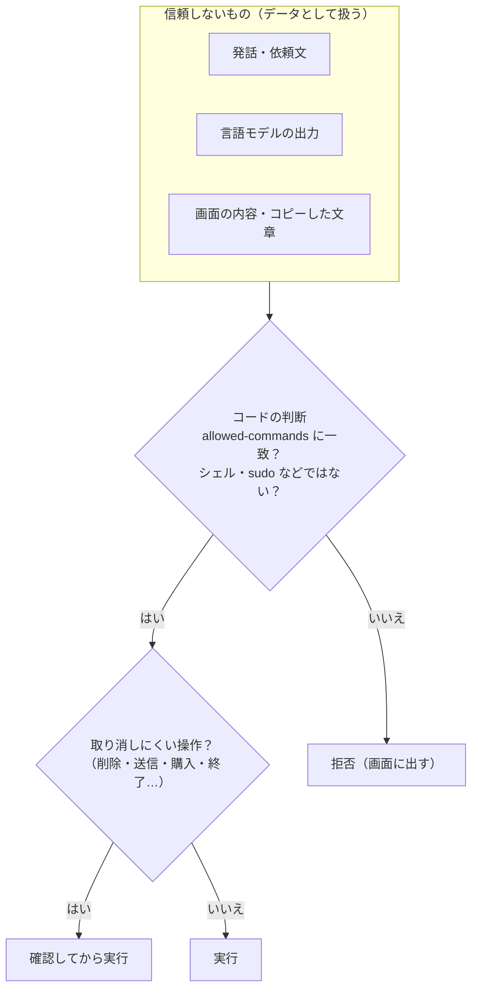

- 実行は**シェルなし**。コマンドは、スキルの `allowed-commands` に一致したものだけ。シェル・`sudo`・`env` などは、許可できません。
- 言語モデルの出力・画面の内容・依頼文・コピーした文章は、**非信頼のデータ**として扱います。取り消しにくい操作は、確認を挟みます。
- `allowed-commands` は、言語モデルの暴走への歯止めです。許可したコマンドの中身（`rm` を許可すれば `rm` が動く）までは、守りません。
- 発話・画面の内容・入れた文字を、ファイルやログに**残しません**（画面にだけ表示）。**例外は 2 つ**：①**音声入力の履歴**（設定 > 音声入力。**既定はオフ**。あなたがオンにしたときだけ、入力した文字と時刻を、自分だけが読めるファイル `~/.voice-control/history.jsonl` に、残す日数〔既定 7 日〕だけ置きます。アプリの名前・画面・音声は、残しません。外へは、送りません。探す・1 件の削除・すべて消すができます）。②**自分で範囲を選んで撮ったスクリーンショット**は、自分だけが読める場所に 1 枚だけ置き、3 分で使えなくなり、終了で消えます（画像は、Mac の中のモデルだけに渡します）。`result: markdown-note` のスキルだけは、結果を一時ディレクトリのファイルに残します（利用者だけが読める。消しません）。
- **Apple の会話にも、道具を開けられます**（設定 > 会話 > 道具。既定は、なし）：**Web**（日時・検索・ページの取得）・**＋読む**（作業フォルダのファイルを読む）・**すべて**（作業フォルダの中への書き込みと、コマンドの実行。**既存ファイルの上書きと、読むだけでないコマンドは、毎回、確認します**。シェル・インタプリタ・通信のコマンドは、実行できません）。外へ出るのは、**モデルが作った検索語と、開いたページの URL だけ**です（発話・画面・ファイルの中身は、送りません）。小さなモデルは、道具を呼ばずに作り話をすることがあるので、検索・ファイルの依頼で道具が呼ばれなければ、答えを出さずに、失敗として知らせます。
- **会話の外のエージェント**（設定 > 会話。既定は、この Mac の Apple のモデル）：選ぶと、**発話が、その提供元へ送られます**（ヘッダーに印が出ます）。選べるのは、この Mac に入っているものだけで、なくなったら、Apple のモデルで答えます。**道具の段階**は、なし（既定）・Web・＋ファイルを読む・**すべて**（ファイルの書き込み・コマンドの実行も）。**「すべて」は、聞き間違いや、検索したページの命令で、意図しない操作が起きえます**（オンにするとき、確認します。作業フォルダは、選べます）。実行した操作は、答えの下に出ます。**画像は、送るたびに、確認します**。
- **止めたとき、起こした子プロセスも止まります**：コマンドの取りやめ・時間切れと、エージェントとの接続を閉じるとき、エージェントが起こした `bash`・`osascript` などの子孫も、止めます（自分のセッションへ外れたものも。実測で、以前は、外れた孫が残りました）。関係のないプロセスは、止めません（起動時刻が同じものだけ）。
- 通信は、スキルの取得（`vc skills install`）・新しい版の確認と取得（GitHub。あなたのデータは送りません）・モデルの取得（設定 > モデル）・**あなたが押したときだけ**の ACP アダプターの取得（npm の公式のレジストリ）と、この Mac の 127.0.0.1 への通信（`--engine`）**だけ**です。音声・画面の内容を、ネットワークへ出しません。**例外は、あなたが入れたときだけの `ask-agent`・`web-search`・`ask-agent-image`**（`ask-agent-image` は、撮った画面の画像を、選んだエージェントへ送ります。**実行のたびに確認します**）（`web-search` は、検索する言葉が、選んだサイトへ、ブラウザから送られます。`ask-agent` は、「〇〇について調べて」「クロードで〇〇を調べて」を、コーディングエージェントの CLI〔`agy`・`claude`・`codex`・`grok`・`opencode`・`pi`〕に頼む。調べることの文が、選んだエージェントの提供元へ送られます。[詳しく](docs/skills.md#調べものをコーディングエージェントに頼むask-agent任意)）。

## 機能の層

機能が広がったので、**層**で分けています（詳細は [SPEC](SPEC.md#機能の層2026-11-09-の判断)）。

| 層 | 含むもの |
|---|---|
| **中核** | スキルの選択と実行・許可と確認の判断・`vc run`・声で頼む・スキルの管理 |
| **任意** | 音声入力・スクリーンショットと画像のスキル・結果のウィンドウ・ファイル検索・スキルのインストール |
| **実験**（予告なく変わります） | 外へ送るスキル（`ask-agent`・`ask-agent-image`・`web-search`）・手放し（ダブルタップ）・複数ステップの依頼・ローカルのサーバーのモデル（`--engine`）・画像の背景除去（「背景を消して」）・聞き取りの確認・結果の読み上げ・録音中の文字の表示・会話（会話のキー・会話のウィンドウ・道具・画像・外のエージェント）・メニューバーのアプリ（dmg）と設定ウィンドウ |

## いまの状況

試作です。**確認した範囲と、していない範囲**を、そのまま書きます。

| 機能 | 状態 |
|---|---|
| スキル（`vc skills`・`vc run`） | 自作ウィンドウで確認。**実アプリ・複数スキルの取り違えは未確認** |
| 声の入力（メニューバーのアプリ） | 実装済み（ホットキー・Esc・確認のボタンとキー）。確認のボタンのクリックは、利用者の環境で動作を確認（v0.2.4）。**マイクの実録音の網羅的な確認・声の「はい」の確認は未確認** |
| Markdown のウィンドウ（`vc show`・`clipboard-note`） | 実装済み（見た目は自作の内容で確認）。**コピーのボタン・⌘C の実機の操作は未確認** |
| 音声認識の切り替え（設定 > モデル・Whisper） | 合成音声での測定と、実マイク（スピーカーの音）での 1 回の確認。**実際の声での比較は未確認** |
| ファイル検索（`vc find`・`vc pick`・`file-search`） | 自作のフォルダで確認（Ollama 9/10・Apple 9/10。同じ場面で調整）。**実際のホームでの検索の質は未確認** |
| スクリーンショット・コピーした画像に声で頼む（画面撮影のショートカット・`image-ask`・`image-edit`）・パネルの文字起こし | 自作の画像で確認（Apple と Ollama で答えさせ、切り抜き・サイズ変更・変換を続けて実行。スキルの測定：Apple 90〜94%・Ollama 100%）。**実際の範囲選択・ショートカット・画面収録の許可の流れは未確認** |
| 会話（会話のキー・会話のウィンドウ・道具・画像・読み上げ） | Apple のモデルと、外のエージェント 6 つで、自作のフォルダ・自作の画像の確認（道具の「すべて」・画像・断る・上書きの確認）。ウィンドウは、画像に描いて確認。**ウィンドウの実際の動き（Space の移動・初めて開く）・実際の声・読み上げ・画像の確認のパネルは、人間の確認待ち** |
| 会話の順番待ち（考えている間に続けて質問・今すぐ送る・停止） | 単体テスト（順番待ちの規則・会話ウィンドウの状態の移り変わり）と、**声の流れと会話ウィンドウをつないだ通しのテスト**（連続の発話・Esc・認識中に続けて話す・今すぐ送る・停止）。この機能の最初の版（0.5.12）は、続けて話すとアプリが落ちる不具合があり、利用者の報告で見つかりました（0.5.13 で修正。順番の入れ替わり・塞がりなど、タイミングの不具合も、あわせて直しました）。**マイクでの実際の連続の発話・実際のエージェントでの通しは、人間の確認待ち** |
| 声の「止めて」・答えの少しずつの表示と読み上げ・「最新へ」・複数行の入力・子プロセスごと止める・ファイルの添付 | 単体テストと、本物のウィンドウでの描画（スクロールの検出を通した「最新へ」・複数行の入力の高さ）。少しずつの届き方は、実際のエージェントで測定（opencode は少しずつ・agy はほぼ一度に。Claude は認証切れ、Codex は答えが出ず、測れていません）。外れた子プロセスが、止まらずに残ること・直したあと止まることは、実測しました。**マイクで「止めて」が認識されるか・実際の読み上げ・日本語の変換中の Return・実際の Claude と Codex の子プロセスは、未確認** |
| 音声入力の周辺（履歴・直前の入力の貼り直し・送るキーの切り替え・言語の「自動」・英語の空白） | 単体テストと、設定ウィンドウの描画（作り物の文）。**入力欄の直前の文字の読み取り（英語の空白の判断）・実アプリへの貼り直し・送るキーの切り替えの実際の動き・履歴の実際の書き込み・Whisper の「自動」判定は、人間の確認待ち** |
| 多言語（表示言語・音声認識の言語） | 英語の画面を、設定・会話・パネルで描いて確認。声で頼む機能（スキルの選択）の精度は、日本語と English で測定（English は、日本語より確信度が低め）。**ほかの言語は、測っていません** |
| `--engine`（Ollama・OpenAI 互換） | Ollama（`qwen3.5:4b`）で確認。**LM Studio・llama.cpp など、ほかのサーバーは未確認** |

PC 操作は、2026-11-04 に廃止し、既定スキルに一本化しました。詳細な要件と状態は [SPEC](SPEC.md)、測定と未確認は [検証手順と記録](docs/verification.md)。

## 詳しい文書

[docs/README.md](docs/README.md) が索引。

| 文書 | 内容 |
|---|---|
| [SPEC](SPEC.md) | 要件・受け入れ条件・対象外・未決事項（正本） |
| [AGENTS.md](AGENTS.md) | 開発規約・不変条件 |
| [スキル](docs/skills.md) | スキルの書き方・`allowed-commands`・表示・声の入力・Markdown のウィンドウ・モデルの切り替え |
| [開発手順](docs/development.md) | ビルド・テスト・GitButler・PR・リリース |
| [構成説明](docs/architecture.md) | Module・状態・並行・失敗・信頼の境界 |
| [コーディング指針](docs/coding-guidelines.md) | クリーンなコードの規則 |
| [参考にした設計原則](docs/references.md) | 採用・不採用の原則 |
| [リファクタリングの観点](docs/refactoring.md) | 見直しの観点と進め方 |
| [検証手順と記録](docs/verification.md) | 測定・確認した範囲・未確認 |

## 出典とライセンス

- `Sources/VCDecision/Decision/` の Tiny-Jev の実行（`BPETokenizer.swift`・`Safetensors.swift`・`QwenDecision.swift`・`OptionMarkerPrompt.swift`・`DecisionError.swift`）は、同じ作者の meeting-analyzer の複製（変更なし）。
- モデル：[lostargon/Tiny-Jev](https://huggingface.co/lostargon/Tiny-Jev)（版 `62449fb`）。**ライセンスの条件は未確認**。リポジトリには含めない。
- agent-desktop は、スキルが許可したコマンドとして、言語モデルが子プロセスで呼ぶだけ（Swift のコードは、直接は呼ばない。Apache-2.0）。
- このリポジトリのライセンスは **MIT**（[LICENSE](LICENSE)）。
