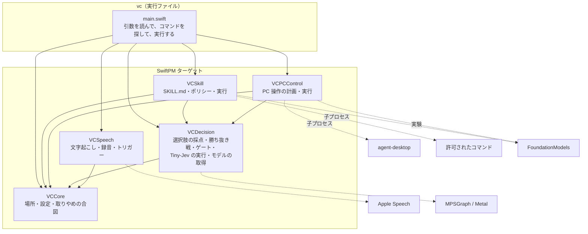

# 構成説明

Module の責務・依存の向き・状態の所有・時間と並行・失敗の扱い。製品要件の正本は [SPEC](../SPEC.md)、設計原則の選択は [参考にした設計原則](references.md)、コードの書き方は [コーディング指針](coding-guidelines.md)。**ここは構造と理由を説明する文書**で、確定 API・動作の保証・測定の結果（[検証手順と記録](verification.md)）は書かない。

## 全体

2 つの流れが、同じ土台（Tiny-Jev による選択）を使う。

| 流れ | 入口 | 状態 | 説明 |
|---|---|---|---|
| **スキル** | `vc skills`・`vc run` | 主 | Tiny-Jev がスキルを選び、Apple の言語モデルがコマンドを実行する。[スキル](skills.md) |
| **PC 操作** | `vc plan`・`act`・`listen`・`eval`… | 試作 | 画面・アプリ・キーの候補から、Tiny-Jev が 1 手を選び、agent-desktop で実行する。[PC 操作の流れ](pc-control.md) |

## Module の責務

依存は**下向きだけ**：`vc` → `VCSkill`・`VCPCControl`・`VCSpeech`（互いには依存しない）。`VCSkill`・`VCPCControl` → `VCDecision`。`VCCore`（場所・設定・取りやめの合図）は、どのターゲットも使ってよい（`VCDecision` も使う。`ModelStore` が `VoiceControlHome` を使う）。向きは `Package.swift` の `dependencies` で宣言し、**コンパイラが強制する**：宣言していないターゲットの `import` は、ビルドが通らない（まっさらなビルドでは（文言はビルドシステムで違う。以下は例）`unable to resolve module dependency`。差分ビルドでは、`--explicit-target-dependency-import-check=error` を付けると `missing a dependency` で失敗する。付けないと警告だけ。`scripts/test.sh`・`scripts/package.sh`・`just build`・リリースのワークフローは付けている）。以前の `scripts/check-deps.sh`（型名の `grep`）は、なくした。

| Module（`Sources/` のターゲット） | 責務 | 持たないもの |
|---|---|---|
| `VCCore` | **どの層も使う小さな部品**：`VoiceControlHome`（`~/.voice-control` の場所）、`Settings`（設定の読み書き。ホットキーは文字列のまま）、`CancelToken`（取りやめの合図） | 層に固有の判断 |
| `VCDecision`（`Decision/`） | Tiny-Jev（Qwen3 の decoder ＋判断の頭）を、MPSGraph で動かす。トークナイザ・重みの読込。`TinyJev`（公開の入口）。**meeting-analyzer からの複製**（`BPETokenizer`・`Safetensors`・`QwenDecision`・`OptionMarkerPrompt`・`DecisionError`。`QwenShape` は抜粋） | 選択肢の作り方・用途 |
| `VCDecision`（`Choice/`） | `OptionScorer`（選択肢に確率を返す口）、`Chooser`（32 個を超える候補の勝ち抜き戦）、`Gate`（確信度・危険度の門：実行・確認・却下） | 選択肢の中身 |
| `VCDecision`（`Model/`） | `ModelStore`（Tiny-Jev のモデルの置き場所・取得・検証） | 選択・実行 |
| `VCSkill` | `SkillStore`・`Skill`・`FrontMatter`（SKILL.md の読込・検証）、`CommandPolicy`（許可の照合）、`CommandRunner`（実行）、`OutputCompactor`・`RefAliases`（出力の整形）、`SkillRouter`・`SkillResolver`・`DefaultSkill`（Tiny-Jev で選ぶ・既定スキル）、`SkillAgent`（言語モデルと `run_command`） | PC 操作の候補作り |
| `VCPCControl` | `Planner`（候補を作り、Tiny-Jev で選び、ゲートを通す）、`Step`（実行する 1 手）、`AgentDesktop`（agent-desktop・`open`・AppleScript の呼び出し）、`SnapshotParser`、`ClauseSplitter`、`TextExtractor`、`History`、`Shortcut`・`SkillCatalog`（キー操作の JSON 定義）、`LLMPlanner`・`LLMDecomposer`（実験） | スキル |
| `VCSpeech` | `FileTranscriber`（Apple の文字起こし）、`MicRecorder`・`RecordingSession`、`HotKey`・`ModifierHold`・`HotKeySpec`（押している間だけ聞く入口と、その書き方）、`EscapeKey`・`VoiceActivity`・`VoiceInputQueue`（Esc での取りやめと、声の流れの状態）、`Settings+HotKey`（設定の書き方の解釈） | 操作の判断 |
| `vc` | 引数の解釈（`Arguments`・`CommonOptions`）、コマンド（`Command`・`Commands.all`・`Commands/`）と、その共有物（`CommandContext`）、流れの組み立て（`main.swift` の `skills`・`run`・`plan`・`act`・`listen`・`eval`、`PlanSupport.swift` の `runClauses`、`SkillSupport.swift` の `runSkillByVoice`、ホットキーの待ち受け）、ヘルプ（`Help.swift`）、表示の整形（`Output.swift`：色・表・見出し・エラー）、終了コード | 規則・判断（各ターゲットに置く） |
| `Fixture` | 検証用の自作ウィンドウ（ボタン・入力欄・スクロール領域・状態を持つ部品）。製品の一部ではない | — |

- `VCDecision` の `Decision/` は、トークナイザ・重みの読込・`QwenDecision`・`OptionMarkerPrompt`（複製の部分）を、ターゲットの外へ出さない（`internal`）。外へ出る（`public`）のは、入口の `TinyJev`・エラーの `DecisionModelError`・`QwenShape` で、`Choice/`・`Model/` の型（`OptionScorer`・`Chooser`・`Gate`・`ModelStore` など）も同じターゲットから `public` で出る。`OptionScorer` が、`TinyJev` と、テストの偽物を、同じ形で受ける。
- `Desktop`（画面・アプリ・実行の口）も、実機（`AgentDesktop`）と、固定の画面（`ReplayDesktop`）・偽物を、同じ形で受ける。**差し替えが実際に要る箇所だけ**を protocol にしている（[参考にした設計原則](references.md)）。`vc` の `Command` は、差し替えではなく、15 のコマンドを同じ形で一覧に持ち、名前で呼ぶための protocol。

### `vc` のコマンドの構造

- **`Arguments`**（値型）：`CommandLine.arguments` の 2 番目以降を、起動のとき 1 回だけ読む。グローバルの状態はない。`option("--x")`（`--x` と次の 1 語を取り除いて、その語を返す）・`flag("--x")`（最初の 1 つを取り除く）は、取り除く形で、取り除いた順番が、残りの語（位置引数 `positionals`。コマンド名を除く）を変える。`--x=値` の形は扱わない。知らないオプションは取り除かず、位置引数になる。細部は、`Arguments` の doc コメントと `Tests/vcTests`。
- **`CommonOptions`**：どのコマンドにも効く共通のオプション（`--model`・`--length`・`--floor`・`--app`・`--execute`・`--yes` など）。起動の最初に、決まった順番で取り除く。`--keys` だけは、コマンド名を決めたあとに取り除く（コマンド名の前に置くと、`--keys` がコマンド名になり、不明なコマンドになる。引数の読み方のテストが、この順番を固定する）。
- **`Command`**：`static let info`（名前・グループ・使い方・説明・オプション・例）と、`run(_:_:)`。`Commands.all`（`Command.swift`）が一覧で、`vc --help`・`vc <コマンド> --help` は、各コマンドの `info` から作る（並びも、この一覧の並び。`help` は、コマンドではなく、`Help` が、コマンドを探す前に処理する）。`Commands/` に、`keys`・`hotkey`・`hotkey-check`・`hud-preview`・`model`・`eval-gate`・`llm`・`decompose`・`eval-context` を置く。`skills`・`run`・`plan`・`act`・`listen`・`eval` は、`main.swift` に残る。
- **`CommandContext`**：1 回の起動で共有するものを、1 つにまとめる。`CommonOptions`・ゲート（`--floor` を反映）・キー操作の定義・`HistoryStore`、モデルの場所（`resolveModelDir`）・Tiny-Jev の読み込み（`loadJev`）・設定の読み取り（`currentSettings`。壊れていれば警告を 1 回だけ）・トリガーの解決（`resolveHotKey`）。`main.swift` が作って、コマンドへ渡す。終了（`fail`＝終了コード 1・`usageError`＝2）は、状態を持たない関数のまま、`Output.swift` に置く。

## 状態の所有

| 状態 | 所有者 | 寿命・保存 |
|---|---|---|
| スキル定義 | グローバル：`~/.voice-control/skills/<name>/SKILL.md`。プロジェクト：`<vc を起動した場所>/.voice-control/skills/<name>/SKILL.md`（利用者・リポジトリのファイル）。`SkillStore.loadAll` が読む（同名はプロジェクトが勝つ） | ファイル。コードは書き換えない |
| スキルの有効・無効・信頼したプロジェクト | `Settings`（`~/.voice-control/settings.json`） | ファイル。`vc skills enable/disable/trust/untrust` だけが書く。有効・無効は既定が有効（無効だけを記録する）。信頼は既定が未信頼（信頼したものだけを記録する。読めないファイルは、信頼なしとして扱う） |
| キー操作の JSON 定義 | `SkillCatalog.load`（`keys/`・`~/.voice-control/keys`） | ファイル |
| Tiny-Jev の重み・GPU のグラフ | `TinyJev`（`QwenDecision`） | プロセスの間。起動のたびに、数秒かけて読む |
| 実行した手の記録 | `HistoryStore`（`CommandContext` が 1 つ持つ） | プロセスの間。**操作の名前だけ**（発話・入れた文字は持たない）。最大 50 件、文脈に使うのは 3 件・180 秒以内 |
| 画面の内容（snapshot） | 1 回の判断の間だけ（`Planner.plan` の引数） | 保存しない |
| 録音 | `RecordingSession` の一時ファイル | 文字起こしのあと、削除 |
| モデルのファイル | `~/.voice-control/models/tiny-jev-0.6b`（`ModelStore`。`vc model download` が置く）。開発用に `./models/` も探す | リポジトリ外・Git 対象外。SHA-256 で検証して取得。取得中は `.part` に書き、一致したものだけを正式な名前にする |
| ホットキーの設定 | `~/.voice-control/settings.json` の `hotkey`（`Settings`）。`--trigger` が、その回だけ優先 | 利用者の設定。`vc hotkey` が書く |
| 録音中・実行の経過・結果の表示 | `HUD`（`NSPanel`。1 つを使い回す）と、中身を持つ `HUDSession`（更新はロックで守る） | プロセスの間だけ。クリックを通し、フォーカスを奪わない。聞こえた文・コマンド・出力の先頭 1 行・返事は、画面に出すだけで、保存しない |

## 時間と並行

- **Tiny-Jev の採点は直列**。`TinyJev` が `NSLock` で守る（1 つの GPU グラフは、同時に 1 つの呼び出しだけ）。1 問 0.1 秒前後、グラフのコンパイルで起動時に数秒。
- **言語モデル（FoundationModels）は `async`**。道具の呼び出し（`run_command`）は、同期の `Process` の実行を、そのまま待つ（1 コマンド 30 秒まで）。
- **ホットキーのイベントは、メインスレッド**（`NSApplication.run()` のイベントループ）。録音の開始・停止だけをそこで行い、文字起こし・計画・実行は、別の `Task` で、1 つずつ順に処理する（`VoiceInputQueue` で受ける）。
- **`NSApplication.run()` の前に、`await` を挟まない**（実際に起きた不具合）。`await` のあとの処理は、メインキューのブロックの中で動き、そこから `run()` を呼ぶと、`DispatchQueue.main` に回した処理（画面の表示・長押しの判定の遅延）が、一切動かない（長押しも、画面の表示も、無反応になる）。そのため、マイクの許可は同期（`MicRecorder.authorize()`）で、`run()` の前に済ませる。トリガーのオブジェクトは、`withExtendedLifetime` で、`run()` が終わるまで手放さない。
- **Esc で取りやめ**（`EscapeKey`・`VoiceActivity`・`CancelToken`）：Esc は、録音中・認識待ち・実行中の**間だけ**受ける（`VoiceActivity.isActive`）。録音中は録音を捨て（`RecordingSession.discard`）、そうでなければ、`CancelToken` と実行中の `Task` を取りやめる。`CancelToken` は、実行中のコマンドを止め（`CommandRunner`）、言語モデルの次のコマンドを止める（`SkillAgent`）。待機中の処理は、列（`VoiceInputQueue`）に `.cancel` を入れて起こす。**修飾キーを押している間に Carbon のホットキーを登録すると、そのあとの Esc が届かない**（実測）。そのため、押している間はグローバルのキー監視（アクセシビリティの許可）で受け、離したあとに、ホットキーを登録し直す。
- **共有する可変状態は、ロックで守る**：`HistoryStore`・`RefAliases`・`SkillAgent` の実行記録・`RecordingSession`。
- 言語モードは Swift 5（`swiftLanguageModes: [.v5]`）。複製した `Decision/` を変えずに使うため。`@unchecked Sendable` を使う型は、すべて、内部をロックで守る（[コーディング指針](coding-guidelines.md#並行)）。

## 失敗の扱い

- **境界で、一度だけ型にする**：SKILL.md → `Skill`（`SkillStore.parse`）、コマンド行 → トークン列と許可（`CommandPolicy`）、agent-desktop の JSON → `Snapshot`（`SnapshotParser`）、設定 → `Settings`。内側では、再検証しない。
- 回復できる失敗は `Result`・`throws` と小さな `enum` で返す。**見せ方（終了コード・メッセージ）を決めるのは、`vc`（境界）だけ**。
- 握りつぶさない。意図して続けるときは、理由と通知を残す：画面（snapshot）を読めなくても、アプリを開く・キー操作は続ける（`Plan.note` に「画面を読めなかった」を出す）。agent-desktop が TIMEOUT するウィンドウ操作は、位置・大きさの変化で成否を判断する。
- 不正なスキルは、読み込まず、理由を返す（他のスキルは使える）。
- **壊れた設定ファイルを、黙って空にしない**：`Settings.load` は、あるのに読めない `settings.json` を `Settings.Unreadable` で返す。読み取りだけのコマンドは、警告を 1 回出して、空の設定（信頼したプロジェクトは、なし＝安全側）で続ける。書き込み（`save`）は、壊れた既存のファイルを**上書きせず**、失敗する（信頼・無効化の設定が、気づかれず消えるのを防ぐ）。
- `try?` は、失敗しても意味が変わらない所（片付け・なくてよいファイル・任意の値）だけ。`Sources/` の全件（`Decision/` の複製を除く）に、理由を 1 行のコメントで残してある（`grep -rn "try?" Sources`）。新しく使うときも、同じ。

## 信頼の境界

| 入力 | 扱い |
|---|---|
| 文字起こし・依頼文 | 非信頼のデータ。Tiny-Jev は選ぶだけ。入れる文字は、話した文字だけを使う |
| 画面の内容（要素の名前など） | 非信頼のデータ。言語モデルの入力に入るため、命令として実行しない前提（`allowed-commands` が、実行の上限） |
| 言語モデルの出力（コマンド） | 非信頼。`CommandPolicy` が、毎回、検査する。シェルを使わない |
| スキルのファイル（グローバル） | 利用者が置いたもの。信頼するが、読み込み時に検証する |
| スキルのファイル（プロジェクト） | **外から来うる**（クローンしたリポジトリなど）。`allowed-commands` が、実行の上限になるので、**`vc skills trust` したプロジェクトだけ**読み込む。信頼したあとの変更は、再確認しない |
| 既定スキル（組み込み） | コードに書いた、許可の控えめなスキル。Tiny-Jev の選択肢には入らない。実行の前に、Tiny-Jev が「操作の依頼か」「取り消しにくいか」を見る。許可を広げるのは、利用者が置く `default` スキル（グローバル・信頼したプロジェクト） |
| システム音声 | 入力にしない（マイクだけ） |

## 外部との接点

| 相手 | 方法 | 注意 |
|---|---|---|
| agent-desktop | 子プロセス（`snapshot`・`click`・`type`・`press`・`scroll`・`maximize` など） | アプリ一覧に壊れた記録があると、`snapshot`・`launch` などが TIMEOUT する（実測）。`launch` は使わない |
| Apple FoundationModels | `LanguageModelSession`＋動的スキーマ（`DynamicGenerationSchema`）。`@Generable` は、マクロのプラグインが Command Line Tools に無く、使えない | 道具の呼び出しは、**英語の指示**のほうが確実（測定） |
| Apple Speech | `SpeechTranscriber`（オンデバイス）。言語のモデルが未取得なら OS が取得（初回、Apple のサーバーから） | |
| AppKit / Carbon | `NSWorkspace`（前面のアプリ）、`RegisterEventHotKey`（修飾キー＋キー）、`NSEvent` のグローバルモニタ（修飾キーだけの長押し。アクセシビリティの許可が要る）、`NSPanel`（画面の上の表示） | 画面の表示には、許可が要らない |
| Tiny-Jev のモデル | Hugging Face（`lostargon/Tiny-Jev`・版を固定）。`vc model download`（`URLSession`）が、SHA-256 を検証して取得する。**これが、取得時の唯一の外部通信** | ライセンスの条件は未確認 |

## 既知の構造上の負債

見直しの候補。優先順位や実施の約束ではない（[リファクタリングの観点](refactoring.md)）。

- `vc/main.swift`（約 570 行）に、`skills`・`run`・`plan`・`act`・`listen`・`eval` の本体が残る（`Commands/` へ移せる）。流れの組み立て（`PlanSupport.swift` の `runClauses`・`SkillSupport.swift` の `runSkillByVoice`・ホットキーの待ち受け・`eval`）は、ライブラリ側のターゲットへ移せる。
- `AgentDesktop.run`（agent-desktop の呼び出し）と `CommandRunner.run`（任意コマンドの実行）が、似た処理を別々に持つ。
- 2 つの流れ（スキル・PC 操作）が同居している。PC 操作の流れは、実測で外れが多く、試作の位置づけ（[SPEC](../SPEC.md)）。
- `VCPCControl/Skills.swift`・`SkillCatalog` は、「キー操作の JSON 定義」で、`VCSkill`（SKILL.md のスキル）と名前が紛らわしい。
- `LLMPlanner`・`LLMDecomposer` は、比較用の実験。製品の流れでは、`--llm-split` だけが使う。
