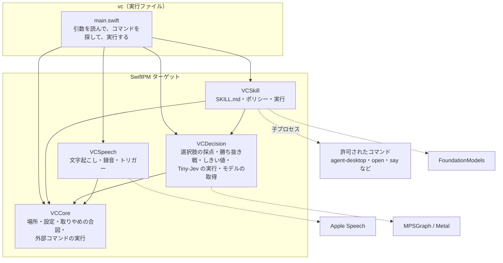
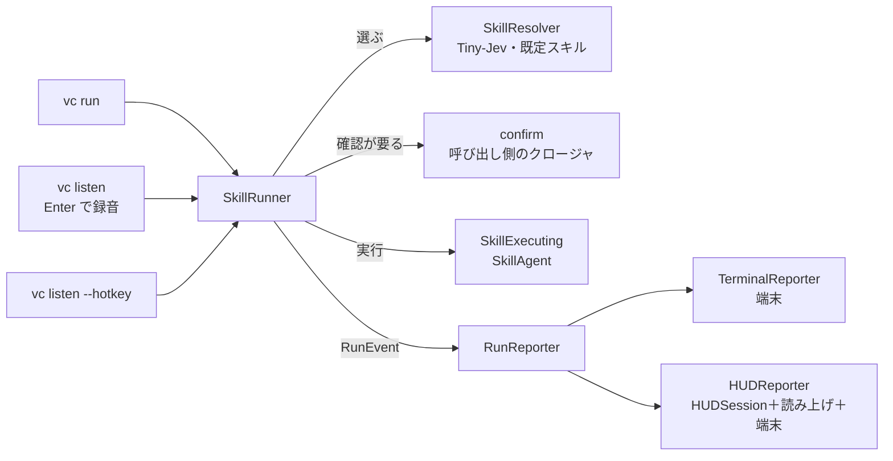

# 構成説明

Module の責務・依存の向き・状態の所有・時間と並行・失敗の扱い。製品要件の正本は [SPEC](../SPEC.md)、設計原則の選択は [参考にした設計原則](references.md)、コードの書き方は [コーディング指針](coding-guidelines.md)。**ここは構造と理由を説明する文書**で、確定 API・動作の保証・測定の結果（[検証手順と記録](verification.md)）は書かない。

## 全体

流れは、スキルの 1 つ：Tiny-Jev がスキルを選び、Apple の言語モデルがコマンドを実行する（入口は `vc skills`・`vc run`・`vc listen`。[スキル](skills.md)）。PC 操作は、2026-11-04 に廃止し、既定スキルに一本化した（[SPEC](../SPEC.md)）。agent-desktop は、Swift のコードからは呼ばず、スキルが許可したコマンドとして、言語モデルが呼ぶ。

## Module の責務

依存は**下向きだけ**：`vc` → `VCSkill`・`VCSpeech`（互いには依存しない）。`VCSkill` → `VCDecision`。`VCCore`（場所・設定・取りやめの合図・外部コマンドの実行）は、どのターゲットも使ってよい（`VCDecision` も使う。`ModelStore` が `VoiceControlHome` を使う）。向きは `Package.swift` の `dependencies` で宣言し、**コンパイラが強制する**：宣言していないターゲットの `import` は、ビルドが通らない（まっさらなビルドでは（文言はビルドシステムで違う。以下は例）`unable to resolve module dependency`。差分ビルドでは、`--explicit-target-dependency-import-check=error` を付けると `missing a dependency` で失敗する。付けないと警告だけ。`scripts/test.sh`・`scripts/package.sh`・`just build`・リリースのワークフローは付けている）。以前の `scripts/check-deps.sh`（型名の `grep`）は、なくした。

| Module（`Sources/` のターゲット） | 責務 | 持たないもの |
|---|---|---|
| `VCCore` | **どの層も使う小さな部品**：`VoiceControlHome`（`~/.voice-control` の場所）、`Settings`（設定の読み書き。ホットキーは文字列のまま）、`CancelToken`（取りやめの合図）、`ProcessRunner`・`ProcessResult`（外部コマンドの実行：シェルなし・出力を読み切ってから待つ・時間の上限・取りやめで止める） | 層に固有の判断 |
| `VCDecision`（`Decision/`） | Tiny-Jev（Qwen3 の decoder ＋判断の頭）を、MPSGraph で動かす。トークナイザ・重みの読込。`TinyJev`（公開の入口）。**meeting-analyzer からの複製**（`BPETokenizer`・`Safetensors`・`QwenDecision`・`OptionMarkerPrompt`・`DecisionError`〔`DecisionError.swift`。型は `DecisionModelError`〕の 5 ファイル。`QwenShape` は抜粋） | 選択肢の作り方・用途 |
| `VCDecision`（`Choice/`） | `OptionScorer`（選択肢に確率を返す口）、`Chooser`（32 個を超える候補の勝ち抜き戦）、`Gate`（確信度のしきい値：選ぶ下限・確認なしで実行してよい下限・取り消しにくさの下限。`SkillResolver` が使う）、`Confirmation`（声の返事が「はい」か。確信度 0.8 以上の「はい」だけ true。スキルの声の流れが使う） | 選択肢の中身 |
| `VCDecision`（`Model/`） | `ModelStore`（Tiny-Jev のモデルの置き場所・取得・検証） | 選択・実行 |
| `VCSkill` | `SkillStore`・`Skill`・`FrontMatter`（SKILL.md の読込・検証）、`CommandPolicy`（許可の照合）、`CommandRunner`（許可済みのコマンドの実行。`ProcessRunner` の上）、`OutputCompactor`・`RefAliases`（出力の整形）、`SkillRouter`・`SkillResolver`・`DefaultSkill`（Tiny-Jev で選ぶ・既定スキル）、`AppleIntelligence`（言語モデルが使えるかと、使えない理由・直す手順）、`SkillRunner`（選ぶ → 確認 → 実行 → 結果の流れと、その判断。経過を `RunEvent` にして `RunReporter` へ送る）、`SkillExecuting`（実行者の口）・`SkillAgent`（その実装：言語モデルと `run_command`） | 表示・終了コード・声の読み上げ |
| `VCSpeech` | `FileTranscriber`（Apple の文字起こし）、`MicRecorder`・`RecordingSession`、`HotKey`・`ModifierHold`・`HotKeySpec`（押している間だけ聞く入口と、その書き方）、`EscapeKey`（Esc の受け付け）、`VoiceLoop`（声の流れの**調整**：トリガー・録音・Esc・認識の待ち行列・発話ごとの `Task`。`VoiceActivity`・`VoiceInputQueue` は、その内部の状態と列）、差し替え口（`Transcribing`・`Recording`・`EscapeSource`）と出来事（`VoiceLoopEvent`）、`Settings+HotKey`（設定の書き方の解釈） | 操作の判断・スキル・画面の表示（`VoiceLoop` は、発話の処理を `UtteranceHandler` として外から受ける） |
| `vc` | 引数の解釈（`Arguments`・`CommonOptions`）、コマンド（`Command`・`Commands.all`・`Commands/`）と、その共有物（`CommandContext`）、流れの組み立て（`Commands/Listen.swift` の `listen`：`--hotkey` では、`VoiceLoop` に、`SkillRunner`＋`HUDReporter` による発話の処理（`UtteranceHandler`）と、出来事の表示を渡す。Enter で録音する通常モードは、録音 → 文字起こし → `SkillRunner`＋`TerminalReporter`。`Commands/Run.swift` の `run`：引数の解釈と表示だけ）、スキルの実行の表示（`TerminalReporter`・`HUDReporter`。`SkillSupport.swift` の `LoadedSkills`：スキルを読み、問題を標準エラーへ出す）、ヘルプ（`Help.swift`）、表示の整形（`Output.swift`：色・表・見出し・エラー）、終了コード | 規則・判断（各ターゲットに置く） |
| `Fixture` | 検証用の自作ウィンドウ（ボタン・入力欄・スクロール領域・状態を持つ部品）。製品の一部ではない | — |
| `TestSupport`（`Tests/TestSupport/`。テスト専用） | 複数のテストターゲットが使う偽物：`OptionScorer` の偽物（`TargetScorer`・`OptionSpy`・`SkillScorer`）、集める道具（`Collected`・`plain`）。`VCDecision` に依存し、公開 API だけで作る。`@testable` が要る偽物は、そのテストターゲットに置く | 本番のターゲット・成果物（`vc`）には入らない。テストターゲットだけが依存する |

- `VCDecision` の `Decision/` は、トークナイザ・重みの読込・`QwenDecision`・`OptionMarkerPrompt`（複製の部分）を、ターゲットの外へ出さない（`internal`）。外へ出る（`public`）のは、入口の `TinyJev`・エラーの `DecisionModelError`・`QwenShape` で、`Choice/`・`Model/` の型（`OptionScorer`・`Chooser`・`Gate`・`ModelStore` など）も同じターゲットから `public` で出る。`OptionScorer` が、`TinyJev` と、テストの偽物を、同じ形で受ける。
- **差し替えが実際に要る箇所だけ**を protocol にしている（[参考にした設計原則](references.md)）：`OptionScorer`（`TinyJev` と、テストの偽物）・`SkillExecuting`（`SkillAgent` と、`SkillRunner` のテストの偽の実行者。`VCSkill` の内側）・`RunReporter`（`vc` の 2 つの表示と、テストの記録）。`vc` の `Command` は、差し替えではなく、9 個のコマンドを同じ形で一覧に持ち、名前で呼ぶための protocol。

### `vc` のコマンドの構造

- **`Arguments`**（値型）：`CommandLine.arguments` の 2 番目以降を、起動のとき 1 回だけ読む。グローバルの状態はない。`option("--x")`（`--x` と次の 1 語を取り除いて、その語を返す）・`flag("--x")`（最初の 1 つを取り除く）は、取り除く形で、取り除いた順番が、残りの語（位置引数 `positionals`。コマンド名を除く）を変える。`--x=値` の形は扱わない。知らないオプションは取り除かず、位置引数になる。細部は、`Arguments` の doc コメントと `Tests/vcTests`。
- **`CommonOptions`**：どのコマンドにも効く共通のオプション（`--model`・`--length`・`--floor`・`--yes`・`--hotkey`・`--trigger`・`--dry-run`）。起動の最初に、決まった順番で取り除く（引数の読み方のテストが、この順番を固定する）。
- **`Command`**：`static let info`（名前・グループ・使い方・説明・オプション・例）と、`run(_:_:)`。`Commands.all`（`Command.swift`）が一覧で、`vc --help`・`vc <コマンド> --help` は、各コマンドの `info` から作る（並びも、この一覧の並び。`help` は、コマンドではなく、`Help` が、コマンドを探す前に処理する）。`Commands/` に、`skills`・`run`・`listen`・`hotkey`・`hotkey-check`・`hud-preview`・`doctor`・`model`・`eval-gate` の 9 つを置く。`main.swift` は、起動の流れだけ。
- **`CommandContext`**：1 回の起動で共有するものを、1 つにまとめる。`CommonOptions`・ゲート（`--floor` を反映）、モデルの場所（`resolveModelDir`）・Tiny-Jev の読み込み（`loadJev`）・設定の読み取り（`currentSettings`。壊れていれば警告を 1 回だけ）・スキルの読み込み（`loadSkills`：読んだスキルと設定。有効なスキル・読めなかった理由の表示）・トリガーの解決（`resolveHotKey`）。`main.swift` が作って、コマンドへ渡す。終了（`fail`＝終了コード 1・`usageError`＝2）は、状態を持たない関数のまま、`Output.swift` に置く。

### スキルの実行の流れ（`SkillRunner`）

「スキルを選ぶ → 確認 → 実行 → 結果」は、`VCSkill` の `SkillRunner` が 1 か所で持つ。`vc run`（端末）・`vc listen`（Enter で録音する通常モード。端末）・声の流れ（`vc listen --hotkey`。画面の上の表示と声の確認）は、同じ `SkillRunner` を呼び、**きっかけと、表示・確認の取り方だけ**が違う。

- **入力**：依頼文、選び方（`Selection.resolve`：有効なスキル・`OptionScorer`・`Gate`／`Selection.forced`：`--skill` の指定）、`dryRun`、`CancelToken`、確認の問い合わせ（`confirm: (理由) async throws -> Bool`）。**出力**：`RunEvent` の列（`RunReporter` へ、起きた順に）と、結果の `RunOutcome`（`completed`・`declined`・`notConfirmed`・`failed`・`cancelled`）。表示・終了コード・声の読み上げは持たない。
- **`RunEvent`**：`forced`・`matched`（選ばれた。確率）・`fellBack`（既定スキルへ回した。操作の依頼の確率・取り消しにくさ）・`declined`（実行しない。理由・既定スキルが使えるか）・`confirmRequired`（確認が要る。理由）・`confirmationDeclined`・`confirmed`・`started`・`command`・`result`・`denied`（拒否）・`reply`（返事・実行したコマンドの数・所要）・`failed`・`cancelled`。かかった時間は、出来事が持つ（表示の書式は、受け手が決める）。
- **投げるものと、出来事にするもの**：実行者の失敗・取りやめは、`failed`・`cancelled` の出来事。スキルを選ぶ段の失敗と、`confirm` の失敗（声の確認の文字起こしの失敗など）は、`run` が投げる（呼び出し側が、従来どおり扱う）。
- **2 つの表示の違いは、受け手の側に置く**（利用者に見える出力を変えないため）：`TerminalReporter` は、`vc run` では見出し（`▶ 実行`・`▶ 結果`）と説明を出し、実行者の失敗は標準エラーへ出す（終了コードは `vc run` が `RunOutcome` で決める。最初の見出し `▶ スキルの選択` は、モデルの読み込みの前に出すので、`Run.swift` が出す）。声の流れ（`--hotkey`）では、見出しなしで、失敗は標準出力へ出す。当てはまるスキルがなく、既定スキルも使えないときも、`→ 実行しない（理由）` を出す（ほかの流れへは回さない）。`HUDReporter` は、声の流れ用の `TerminalReporter` を内に持ち、各出来事で `HUDSession` を更新する（確認が要るときは、先に問いかけを読み上げる。実行しないときは、画面の上に、既定スキルが使えるなら「操作の依頼ではありませんでした」、使えないなら「どのスキルでもありません」を出す）。Enter で録音する通常モードは、`vc run` と同じ表示（`TerminalReporter` の `.command`）を使う。
- **確認の問い合わせは、呼び出し側が持つ**：`vc run`・Enter で録音する `vc listen` は、端末で `[y/N]` を読む（`--yes` なら、聞かない。`askOnTerminal`）。`vc listen --hotkey` は、次の発話を待って、Tiny-Jev で「はい」かを判定する（`Confirmation`）。
- 実行者は `SkillExecuting`（実装は `SkillAgent` の 1 つ。どちらも `VCSkill` の内側の型で、`vc` は `SkillRunner` だけを呼ぶ）。`SkillRunner` のテストは、`@testable` で偽の実行者を渡し、偽の `OptionScorer`（`TestSupport` の `SkillScorer`）と合わせて、判断（一致・既定スキル・会話・確認・dry-run・取りやめ・失敗）を確かめる。表示との対応は、`Tests/vcTests/TerminalReporterTests.swift`・`HUDReporterTests.swift`。

## 状態の所有

| 状態 | 所有者 | 寿命・保存 |
|---|---|---|
| スキル定義 | グローバル：`~/.voice-control/skills/<name>/SKILL.md`。プロジェクト：`<vc を起動した場所>/.voice-control/skills/<name>/SKILL.md`（利用者・リポジトリのファイル）。`SkillStore.loadAll` が読む（同名はプロジェクトが勝つ） | ファイル。コードは書き換えない |
| スキルの有効・無効・信頼したプロジェクト | `Settings`（`~/.voice-control/settings.json`） | ファイル。`vc skills enable/disable/trust/untrust` だけが書く。有効・無効は既定が有効（無効だけを記録する）。信頼は既定が未信頼（信頼したものだけを記録する。読めないファイルは、信頼なしとして扱う） |
| Tiny-Jev の重み・GPU のグラフ | `TinyJev`（`QwenDecision`） | プロセスの間。起動のたびに、数秒かけて読む |
| 録音 | `RecordingSession` の一時ファイル | 文字起こしのあと、削除 |
| モデルのファイル | `~/.voice-control/models/tiny-jev-0.6b`（`ModelStore`。`vc model download` が置く）。開発用に `./models/` も探す | リポジトリ外・Git 対象外。SHA-256 で検証して取得。取得中は `.part` に書き、一致したものだけを正式な名前にする |
| ホットキーの設定 | `~/.voice-control/settings.json` の `hotkey`（`Settings`）。`--trigger` が、その回だけ優先 | 利用者の設定。`vc hotkey` が書く |
| 録音中・実行の経過・結果の表示 | `HUD`（`NSPanel`。1 つを使い回す）と、中身を持つ `HUDSession`（更新はロックで守る）。声の流れでは、`HUDReporter` が、1 回の発話ごとに 1 つ持つ | プロセスの間だけ。クリックを通し、フォーカスを奪わない。聞こえた文・コマンド・出力の先頭 1 行・返事は、画面に出すだけで、保存しない |

## 時間と並行

- **Tiny-Jev の採点は直列**。`TinyJev` が `NSLock` で守る（1 つの GPU グラフは、同時に 1 つの呼び出しだけ）。1 問 0.1 秒前後、グラフのコンパイルで起動時に数秒。
- **言語モデル（FoundationModels）は `async`**。道具の呼び出し（`run_command`）は、同期の `ProcessRunner` の実行を、そのまま待つ（1 コマンド 30 秒まで）。
- **外部コマンドの実行は、`ProcessRunner`（VCCore）が 1 か所で持つ**：シェルなし（`/usr/bin/env` で PATH から探す。見つからなければ env が 127 で終わる）・出力は別のスレッドで読み切りながら終了を待つ（パイプが詰まらない）・`timeout`（出力が終わるまでの秒数。超えたら `terminate`。`nil` は上限なし）・`CancelToken` で `terminate`（取りやめ済みなら起動しない）・`env` を起動できなければ終了コード 127。呼び出したスレッドは、終わるまで止まる。標準入力は、空（/dev/null）。上限と標準エラーの扱いは、呼び出し側が決める：`CommandRunner` は 30 秒・標準エラーをまとめる。
- **`ProcessRunner` の出力の読み取りは、専用のスレッド（`Thread.detachNewThread`）で行う**。GCD の共有のスレッドは使わない。CI は、全ターゲットのテストを 1 つのプロセスで並行に動かす。読み取りを GCD の共有のスレッドで行っていた版は、CI の単体テストで、`ProcessRunner` のテストが、出力が終わらず時間の上限に達して失敗した。専用のスレッドに変えたあと、CI は通った。原因は、呼び出し側が同じ共有のスレッドを塞いで、読む側が動けなくなったこと（共有のスレッドの枯渇）と**推定**している。**直接の証拠は、取っていない**。
- **声の流れ（`vc listen --hotkey`）の調整は、`VoiceLoop`（VCSpeech）が 1 か所で持つ**：トリガー（押した・離した）・録音・Esc・認識の待ち行列（`VoiceInputQueue`）・状態（`VoiceActivity`）・発話ごとの `Task`。スキル・画面の表示は知らず、外から受ける：処理は `UtteranceHandler`（`(発話, CancelToken, 次の発話を待つ関数) async -> Void`）、表示は `VoiceLoopEvent`（録音中・取りやめ・認識中・聞こえた…）。実機でしか動かないもの（録音・文字起こし・Esc）は、口（`Recording`・`Transcribing`・`EscapeSource`。実装は `RecordingSession`・`FileTranscriber`・`EscapeKey`）で差し替えられ、トリガーは `PushToTalkTrigger`。偽物をつないだ単体テストが、下の不変条件と、Esc の場面（録音中・認識中・実行中・確認の待ち・古い取りやめの合図・たまった音声）を固定する（`Tests/VCSpeechTests/VoiceLoopTests.swift`）。`vc` 側は `Commands/Listen.swift`：`SkillRunner`＋`HUDReporter` による発話の処理を `UtteranceHandler` にして渡し、出来事を画面の上と端末に出す（当てはまるスキルがなく、既定スキルも使えないときは、実行せず、そう示す）。
- **ホットキーのイベントは、メインスレッド**（`NSApplication.run()` のイベントループ）。録音の開始・停止だけをそこで行い、文字起こし・計画・実行は、メインアクターの別の `Task` で、1 つずつ順に処理する（`VoiceInputQueue` で受ける。1 つの発話の処理と、確認の返事の待ちは、同じ列を読む）。
- **`NSApplication.run()` の前に、`await` を挟まない**（実際に起きた不具合。不変条件 1）。`await` のあとの処理は、メインキューのブロックの中で動き、そこから `run()` を呼ぶと、`DispatchQueue.main` に回した処理（画面の表示・長押しの判定の遅延）が、一切動かない（長押しも、画面の表示も、無反応になる）。そのため、マイクの許可は同期（`MicRecorder.authorize()`）で、`run()` の前に済ませる。`VoiceLoop.run(onReady:)` は同期の関数で（`async` にするとテストがコンパイルできない）、配線 → 準備の表示 → `run()` の順を、1 か所で持つ。
- **トリガーと Esc は、`run()` の間、手放さない**（不変条件 2）：`VoiceLoop` が持ち、`run()` を `withExtendedLifetime` で包む（最適化で、最後の使用のあとに解放され、ホットキーが死ぬのを防ぐ）。
- **Esc で取りやめ**（`EscapeKey`・`VoiceActivity`・`CancelToken`）：Esc は、録音中・認識待ち・実行中の**間だけ**受ける（`VoiceActivity.isActive`）。録音中は録音を捨て（`RecordingSession.discard`。離しても進まない）、そうでなければ、`CancelToken` と実行中の `Task` を取りやめる。`CancelToken` は、実行中のコマンドを止め（`CommandRunner` が渡し、`ProcessRunner` が止める）、言語モデルの次のコマンドを止める（`SkillAgent`）。待機中の処理（次の発話・確認の返事）は、列（`VoiceInputQueue`）に `.cancel` を入れて起こす。取りやめられていない処理が列で読んだ `.cancel`（前の処理の取りやめの合図）は、読み捨てる。
- **修飾キーを押している間は、Esc の Carbon ホットキーを登録しない**（不変条件 3。実測：登録すると、そのあとの Esc が届かない）。`EscapeKey.setActive(true)` が、修飾キーが押されていれば、グローバルのキー監視（アクセシビリティの許可）だけを足して、登録を見送る。見送った登録は、**離したあとに、`VoiceLoop` が `setActive(true)` を呼び直して**行う（修飾キーが離れるまでの間、0.05・0.3・0.8・1.5 秒後の 4 回。活動が終わっていれば、登録し直さない）。
- **共有する可変状態は、ロックで守る**：`RefAliases`・`SkillAgent` の実行記録・`RecordingSession`・`OutputMuter`（消す・戻すの状態）・`MicRecorder` の書き込み（音声のスレッドと共有）・`ChunkDownload`（ダウンロードのコールバックと共有）・`HUDReporter` の `HUDSession`。ほか、`CancelToken`・`ProcessRunner` の出力の受け皿・`VoiceInputQueue`・`VoiceActivity`・`SettingsWarning`・`SaySpeaker`・`ProgressPrinter` も、同じ規則。`RunReporter` は、実行中のコマンドの出来事が、言語モデルの呼び出しのスレッドから届くので、どのスレッドからも呼べる。
- **主スレッド専用の型は `@MainActor`**：`HotKey`・`ModifierHold`・`EscapeKey`（と、その口 `PushToTalkTrigger`・`EscapeSource`）、`HUD`（`show`・`hide` だけ `nonisolated`：どのスレッドからでも、メインキューへ回す）。Carbon・`NSEvent` のコールバックと、メインキューのブロックは、`MainActor.assumeIsolated` で入る（`VoiceLoop.Scheduler` が回すものも、メインアクターの上で動く）。`nonisolated(unsafe)` は使わない（`HotKey` の番号は `OSAllocatedUnfairLock`）。
- 言語モードは Swift 5（`swiftLanguageModes: [.v5]`）。Swift 6 モードで通らないのは `vc` と `Fixture` で、ライブラリの 4 ターゲット（複製した `Decision/` を含む）は通る（下の負債）。`@unchecked Sendable` を使う型は、`Decision/` の型（複製の `QwenDecision` と、それを包む `TinyJev`）を除き、内部をすべてロックで守り、理由を型のコメントに書く（[コーディング指針](coding-guidelines.md#並行)）。`QwenDecision` は自分ではロックを持たず、`TinyJev` の `lock` で呼び出しが直列になる前提で使う。

## 失敗の扱い

- **境界で、一度だけ型にする**：SKILL.md → `Skill`（`SkillStore.parse`）、コマンド行 → トークン列と許可（`CommandPolicy`）、設定 → `Settings`。内側では、再検証しない。
- 回復できる失敗は `Result`・`throws` と小さな `enum` で返す。**見せ方（終了コード・メッセージ）を決めるのは、`vc`（境界）だけ**。
- 握りつぶさない。意図して続けるときは、理由と通知を残す：読めないスキル・壊れた設定は、警告を出して続ける（下の 2 項目）。
- 不正なスキルは、読み込まず、理由を返す（他のスキルは使える）。
- **壊れた設定ファイルを、黙って空にしない**：`Settings.load` は、あるのに読めない `settings.json` を `Settings.Unreadable` として投げる。読み取りだけのコマンドは、`Settings.loadOrDefault`（空の設定と、読めなかった理由を返す）で、警告を 1 回出して、空の設定（信頼したプロジェクトは、なし＝安全側）で続ける。書き込み（`save`）は、壊れた既存のファイルを**上書きせず**、失敗する（信頼・無効化の設定が、気づかれず消えるのを防ぐ）。
- `try?` は、失敗しても意味が変わらない所（片付け・なくてよいファイル・任意の値）だけ。`Sources/` の全件（`Decision/` の複製を除く）に、理由を 1 行のコメントで残してある（`grep -rn "try?" Sources`）。新しく使うときも、同じ。

## 信頼の境界

| 入力 | 扱い |
|---|---|
| 文字起こし・依頼文 | 非信頼のデータ。Tiny-Jev は選ぶだけ。入れる文字は、話した文字だけを使う |
| 画面の内容（要素の名前など） | 非信頼のデータ。言語モデルの入力に入るため、命令として実行しない前提（`allowed-commands` が、実行の上限） |
| 言語モデルの出力（コマンド） | 非信頼。`CommandPolicy` が、毎回、検査する。シェルを使わない |
| スキルのファイル（グローバル） | 利用者が置いたもの。信頼するが、読み込み時に検証する |
| スキルのファイル（プロジェクト） | **外から来うる**（クローンしたリポジトリなど）。`allowed-commands` が、実行の上限になるので、**`vc skills trust` したプロジェクトだけ**読み込む。信頼したあとの変更は、再確認しない |
| 既定スキル（組み込み） | コードに書いた、許可の控えめなスキル。Tiny-Jev の選択肢には入らない。実行の前に、Tiny-Jev が「操作の依頼か」「取り消しにくいか」を見る。許可を広げるのは、利用者が置く `default` スキル（グローバル・信頼したプロジェクト） |
| システム音声 | 入力にしない（マイクだけ） |

## 外部との接点

| 相手 | 方法 | 注意 |
|---|---|---|
| agent-desktop | 子プロセス。Swift のコードからは呼ばない。スキルの `allowed-commands`（既定スキルは `agent-desktop`・`open`・`say`・`ls`・`pwd`・`date`）で許可されたコマンドとして、言語モデルが `run_command` で呼ぶ（`snapshot`・`click`・`type` など） | アプリ一覧に壊れた記録があると、`snapshot`・`launch` などが TIMEOUT する（実測）。`launch` は使わない |
| Apple FoundationModels | `LanguageModelSession`＋動的スキーマ（`DynamicGenerationSchema`）。`@Generable` は、マクロのプラグインが Command Line Tools に無く、使えない | 道具の呼び出しは、**英語の指示**のほうが確実（測定） |
| Apple Speech | `SpeechTranscriber`（オンデバイス）。言語のモデルが未取得なら OS が取得（初回、Apple のサーバーから） | |
| AppKit / Carbon | `RegisterEventHotKey`（修飾キー＋キー）、`NSEvent` のグローバルモニタ（修飾キーだけの長押し。アクセシビリティの許可が要る）、`NSPanel`（画面の上の表示） | 画面の表示には、許可が要らない |
| Tiny-Jev のモデル | Hugging Face（`lostargon/Tiny-Jev`・版を固定）。`vc model download`（`URLSession`）が、SHA-256 を検証して取得する。**これが、取得時の唯一の外部通信** | ライセンスの条件は未確認 |

## 既知の構造上の負債

見直しの候補。優先順位や実施の約束ではない（[リファクタリングの観点](refactoring.md)）。ファイルの分割・設定の失敗の扱い・ターゲットの分割と依存の向き・`vc` の薄型化・`SkillRunner`・`VoiceLoop`・`ProcessRunner`・名前の整理・並行性の監査・テストの置き場所で解消したものは、ここから消してある。残っているのは、次のとおり。

- `ProcessRunner` に載せていない `Process` の呼び出しが、1 か所ある（意図した対象外。理由は、コードのコメント）：`SaySpeaker`（`say`）は、鳴り終わるまで待たず、取りやめで止める。いまの `ProcessRunner` に載せると、挙動が変わる。
- `Decision/` の 5 ファイルは、meeting-analyzer からの複製で、変えない決まり。`QwenDecision` は、自前のロックを持たず、`TinyJev` の `lock` が呼び出しを直列にする前提で動く（`QwenDecision` を使うのは `TinyJev` だけで、`internal`）。この前提は、複製の側では、型で守れない（直すなら、元の側で直して、複製し直す）。
- Swift 6 の言語モードに上げられない（言語モードは Swift 5 のまま）。`-Xswiftc -strict-concurrency=complete` を付けた `swift build`（ローカルの Swift 6.4）で、診断が出るのは、`vc` の 4 か所（`confirm` クロージャを渡す `Commands/Run.swift`・`Commands/Listen.swift`〔2 か所〕の `sending`。`Command.swift` の `Commands.all`：`[any Command.Type]` が Sendable でない）と、`Fixture` の `main.swift`（`@MainActor` でない `Fixture` クラス〔`NSApplicationDelegate`〕が、主アクターの AppKit の API を使う。20 か所。検証用の部品で、直していない）。ライブラリの 4 ターゲットは 0 件。`swiftLanguageModes` を `[.v6]` にした作業コピーで、4 ターゲット（`Decision/` の複製を含む）と、そのテストは、ビルドできた（`vc`・`Fixture` は通らない。`vcTests` は、`vc` に依存するので、未確認）。通常のビルドの警告は、CI（Xcode 26.6・Swift 6.3.3）で 0。
