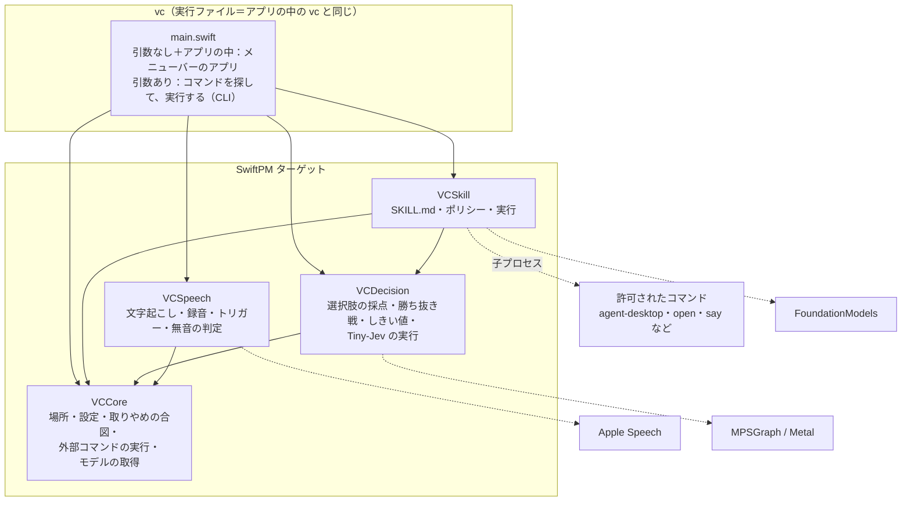
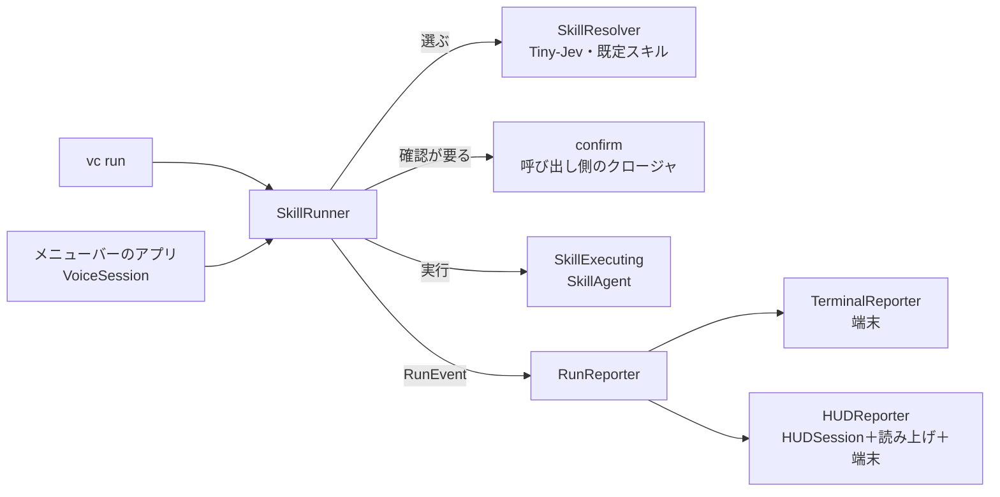

# 構成説明

Module の責務・依存の向き・状態の所有・時間と並行・失敗の扱い。製品要件の正本は [SPEC](../SPEC.md)、設計原則の選択は [参考にした設計原則](references.md)、コードの書き方は [コーディング指針](coding-guidelines.md)。**ここは構造と理由を説明する文書**で、確定 API・動作の保証・測定の結果（[検証手順と記録](verification.md)）は書かない。

## 全体

流れは、スキルの 1 つ：Tiny-Jev がスキルを選び、Apple の言語モデルがコマンドを実行する（入口は `vc skills`・`vc run`・声の入力（メニューバーのアプリ）。[スキル](skills.md)）。PC 操作は、2026-11-04 に廃止し、既定スキルに一本化した（[SPEC](../SPEC.md)）。agent-desktop は、Swift のコードからは呼ばず、スキルが許可したコマンドとして、言語モデルが呼ぶ。

## Module の責務

依存は**下向きだけ**：`vc` → `VCSkill`・`VCSpeech`（互いには依存しない）。`VCSkill` → `VCDecision`。`VCCore`（場所・設定・取りやめの合図・外部コマンドの実行）は、どのターゲットも使ってよい（`VCDecision` も使う。`ModelStore` が `VoiceControlHome` を使う）。向きは `Package.swift` の `dependencies` で宣言し、**コンパイラが強制する**：宣言していないターゲットの `import` は、ビルドが通らない（まっさらなビルドでは（文言はビルドシステムで違う。以下は例）`unable to resolve module dependency`。差分ビルドでは、`--explicit-target-dependency-import-check=error` を付けると `missing a dependency` で失敗する。付けないと警告だけ。`scripts/test.sh`・`scripts/package.sh`・`just build`・リリースのワークフローは付けている）。以前の `scripts/check-deps.sh`（型名の `grep`）は、なくした。

| Module（`Sources/` のターゲット） | 責務 | 持たないもの |
|---|---|---|
| `VCCore` | **どの層も使う小さな部品**：`VoiceControlHome`（`~/.voice-control` の場所）、`ScreenshotStore`（いまのスクリーンショット 1 枚：0700・0600・180 秒で古い・消す）、`Settings`（設定の読み書き。ホットキーは文字列のまま）、`CancelToken`（取りやめの合図）、`RealPath`（場所の、実際の形：リンク・`..`・これから作る場所。許可の判定・表示が使う）、`ProcessRunner`・`ProcessResult`（外部コマンドの実行：シェルなし・出力を読み切ってから待つ・時間の上限・取りやめで止める）、`ModelStore`（Tiny-Jev・音声認識モデルの置き場所・取得・SHA-256 の検証） | 層に固有の判断 |
| `VCDecision`（`Decision/`） | Tiny-Jev（Qwen3 の decoder ＋判断の頭）を、MPSGraph で動かす。トークナイザ・重みの読込。`TinyJev`（公開の入口）。**meeting-analyzer からの複製**（`BPETokenizer`・`Safetensors`・`QwenDecision`・`OptionMarkerPrompt`・`DecisionError`〔`DecisionError.swift`。型は `DecisionModelError`〕の 5 ファイル。`QwenShape` は抜粋） | 選択肢の作り方・用途 |
| `VCDecision`（`Choice/`） | `OptionScorer`（選択肢に確率を返す口）、`Chooser`（32 個を超える候補の勝ち抜き戦）、`Gate`（確信度のしきい値：選ぶ下限・確認なしで実行してよい下限・取り消しにくさの下限。`SkillResolver` が使う）、`Confirmation`（声の返事が「はい」か。確信度 0.8 以上の「はい」だけ true。スキルの声の流れが使う） | 選択肢の中身 |
| `VCDecision`（`Model/`） | `TinyJevModel`（Tiny-Jev のモデルの取得先・置き場所。取得と検証の仕組みは、`VCCore` の `ModelStore`） | 選択・実行 |
| `VCSkill` | `SkillStore`・`Skill`・`FrontMatter`（SKILL.md の読込・検証）、`Engine`（`parse`：`--engine` の書き方の**入口**）・`ModelServerKind`（**Ollama と OpenAI 互換で違う部分を、1 か所に**：接頭辞・表示名・既定の場所・API の経路・一覧の読み方・サーバーの組み立て〔APIキーつき〕。アダプター・一覧・画像が、経路や鍵の取り出しを書かない）・`ChatModel`（モデルとの通信のアダプター：`OllamaChat`・`OpenAICompatibleChat`）・`ServerAddress`（場所：ホスト・ポート・経路。**ホストは、私的な IPv4 アドレスと `<名前>.local` だけ**。`.local` は、通信の直前に引いて、答えがすべて私的か確かめ、引いた IP へつなぐ。許可の判断 `isApproved(by:)` も、ここ）・`EndpointText`（エンドポイントの**文字の形**：`--engine` と設定ウィンドウが、同じ分け方を使う）・`LocalServer`（場所＋APIキー＋送信。リダイレクトを追わない）・`LocalHTTP`（Network.framework の HTTP/1.1。`URLSession` は、ATS が、LAN・Tailscale の HTTP を断る）・`ModelServerCatalog`（モデルの一覧。質問は送らない）・`EngineKeyStore`（VCCore：APIキーの保管庫。0600）・`ToolLoopAgent`（道具を呼ぶ流れ。どのアダプターでも同じ）・`SkillAgent`（Apple のモデル。`FoundationModels` が流れを持つ）。**スクリーンショット**：`ImageOps`（切り抜き・サイズ変更・回転・変換。ImageIO・CoreGraphics）・`ImageEditing`（`vc image`：引数の検査と保存先の固定）・`VisionModel`（`vc see`：Apple の `fm respond --image` か Ollama の `images`。**Mac の中だけ**）・`ScreenText`（Vision の文字認識）。`vc see`・`vc image` は、`InternalCommands` が処理し、`vc see` の答えは `CommandSession.producedDocument` を通って、`SkillRunner` がウィンドウに出す。**複数ステップ**：`LLMPlanner`（言語モデルが、依頼を、切り出した文の並びに分ける。`RequestPlanning`：差し替え口）・`PlanValidator`（出力の検査：**言語モデルの出力を、型にする 1 か所**）・`PlanRunner`（分け方を受けて、ステップごとに `SkillRunner` を通す。最初の失敗で止まる）・`PreviousResult`（前の結果の囲み）。許可の照合・実行・整形は、`CommandSession` が共有、`FileSearch`（`vc find`：Spotlight とフォルダをたどる探し方）・`Picker`（`vc pick`：Tiny-Jev で候補から選ぶ）・`InternalCommands`（スキルの中の `vc find`・`vc pick`：`vc` 自身が処理する。直前の候補の記憶）・`RemoteSkills`（GitHub からスキルを取得）、`SkillInstaller`（取得したスキルを、グローバルへ置く）、`ResultNote`（`result: markdown-note` の保存）、`CommandPolicy`（許可の照合）、`CommandRunner`（許可済みのコマンドの実行。`ProcessRunner` の上）、`OutputCompactor`・`RefAliases`（出力の整形）、`SkillRouter`・`SkillResolver`・`DefaultSkill`（Tiny-Jev で選ぶ・既定スキル）、`AppleIntelligence`（言語モデルが使えるかと、使えない理由・直す手順）、`SkillRunner`（選ぶ → 確認 → 実行 → 結果の流れと、その判断。経過を `RunEvent` にして `RunReporter` へ送る）、`SkillExecuting`（実行者の口）・`SkillAgent`（その実装：言語モデルと `run_command`） | 表示・終了コード・声の読み上げ。**`Tidy/`**（整理モード。F79）：`TidyPrompt`（固定の約束＋利用者の整え方）・`TidyGuard`（出力の取り出し・数字と否定と長さの検査：純粋）・`Tidier`（`Engine` で整える・時間切れ・通らなければ元の文字）。`vc` の `DictationFlow` が、つなぎ言葉の除去のあとに呼ぶ |
| `VCSpeech` | **音声認識のアダプター**：差し込み口 `Transcribing` の実装 `FileTranscriber`（Apple の文字起こし）と `LocalTranscriber`（ダウンロードしたモデル。transcribe.cpp）、選ぶ口 `SpeechChoice`・`SpeechModelCatalog`（モデルの一覧。版・SHA-256 を固定）・`SpeechEngine`（選んだものを開き、**`GatedTranscriber` で包む**）、`ClipboardPaste`（音声入力：前面のアプリへ、クリップボード＋⌘V で入力し、元のクリップボードへ戻す）、`SpeechPresence`（声があるか。無音・一定の雑音を認識に渡さない）、`MicRecorder`・`RecordingSession`、`HotKey`・`ModifierHold`・`HotKeySpec`（押している間だけ聞く入口と、その書き方）、`EscapeKey`（Esc の受け付け）、`VoiceLoop`（声の流れの**調整**：トリガー・録音・Esc・認識の待ち行列・発話ごとの `Task`。`VoiceActivity`・`VoiceInputQueue` は、その内部の状態と列）、差し替え口（`Transcribing`・`Recording`・`EscapeSource`）と出来事（`VoiceLoopEvent`）、`Settings+HotKey`（設定の書き方の解釈） | 操作の判断・スキル・画面の表示（`VoiceLoop` は、発話の処理を `UtteranceHandler` として外から受ける） |
| `vc` | 引数の解釈（`Arguments`・`CommonOptions`）、コマンド（`Command`・`Commands.all`・`Commands/`）と、その共有物（`CommandContext`）、流れの組み立て（声の入力・会話：メニューバーのアプリの `VoiceSession`・`VoiceHandlers`・`ChatMode` が、`VoiceLoop` に、`SkillRunner`＋`HUDReporter` による発話の処理と、出来事の表示を渡す。`Commands/Run.swift` の `run`：引数の解釈と表示だけ）、スキルの実行の表示（`TerminalReporter`・`HUDReporter`。`SkillSupport.swift` の `LoadedSkills`：スキルを読み、問題を標準エラーへ出す）、ヘルプ（`Help.swift`）、表示の整形（`Output.swift`：色・表・見出し・エラー）、終了コード | 規則・判断（各ターゲットに置く）。Markdown のウィンドウ（`MarkdownRenderer`・`MarkdownWindow`・`DocumentWindow`＝別のプロセスで開く・`vc show`）と、パネルと共有する見た目（`HUDStyle`）、確認のボタンと声の競合（`ConfirmationRace`） |
| `Fixture` | 検証用の自作ウィンドウ（ボタン・入力欄・スクロール領域・状態を持つ部品）。製品の一部ではない | — |
| `TestSupport`（`Tests/TestSupport/`。テスト専用） | 複数のテストターゲットが使う偽物：`OptionScorer` の偽物（`TargetScorer`・`OptionSpy`・`SkillScorer`）、集める道具（`Collected`・`plain`）。`VCDecision` に依存し、公開 API だけで作る。`@testable` が要る偽物は、そのテストターゲットに置く | 本番のターゲット・成果物（`vc`）には入らない。テストターゲットだけが依存する |

- `VCDecision` の `Decision/` は、トークナイザ・重みの読込・`QwenDecision`・`OptionMarkerPrompt`（複製の部分）を、ターゲットの外へ出さない（`internal`）。外へ出る（`public`）のは、入口の `TinyJev`・エラーの `DecisionModelError`・`QwenShape` で、`Choice/`・`Model/` の型（`OptionScorer`・`Chooser`・`Gate`・`TinyJevModel` など）も同じターゲットから `public` で出る。`OptionScorer` が、`TinyJev` と、テストの偽物を、同じ形で受ける。
- **差し替えが実際に要る箇所だけ**を protocol にしている（[参考にした設計原則](references.md)）：`OptionScorer`（`TinyJev` と、テストの偽物）・`SkillExecuting`（`SkillAgent` と、`SkillRunner` のテストの偽の実行者。`VCSkill` の内側）・`RunReporter`（`vc` の 2 つの表示と、テストの記録）。`vc` の `Command` は、差し替えではなく、`Commands.all` のコマンドを、同じ形で一覧に持ち、名前で呼ぶための protocol。

### `vc` のコマンドの構造

- **`Arguments`**（値型）：`CommandLine.arguments` の 2 番目以降を、起動のとき 1 回だけ読む。グローバルの状態はない。`option("--x")`（`--x` と次の 1 語を取り除いて、その語を返す）・`flag("--x")`（最初の 1 つを取り除く）は、取り除く形で、取り除いた順番が、残りの語（位置引数 `positionals`。コマンド名を除く）を変える。`--x=値` の形は扱わない。知らないオプションは取り除かず、位置引数になる。細部は、`Arguments` の doc コメントと `Tests/vcTests`。
- **`CommonOptions`**：どのコマンドにも効く共通のオプション（`--model`・`--length`・`--floor`・`--yes`・`--dry-run`）。起動の最初に、決まった順番で取り除く（引数の読み方のテストが、この順番を固定する）。
- **`Command`**：`static let info`（名前・グループ・使い方・説明・オプション・例）と、`run(_:_:)`。`Commands.all`（`Command.swift`）が一覧で、`vc --help`・`vc <コマンド> --help` は、各コマンドの `info` から作る（並びも、この一覧の並び。`help` は、コマンドではなく、`Help` が、コマンドを探す前に処理する）。`Commands/` に、コマンドを 1 つ 1 ファイルで置く（一覧は `Commands.all`。件数は、書かない）。`main.swift` は、起動の流れだけ。
- **`CommandContext`**：1 回の起動で共有するものを、1 つにまとめる。`CommonOptions`・ゲート（`--floor` を反映）、モデルの場所（`resolveModelDir`）・Tiny-Jev の読み込み（`loadJev`）・設定の読み取り（`currentSettings`。壊れていれば警告を 1 回だけ）・スキルの読み込み（`loadSkills`：読んだスキルと設定。有効なスキル・読めなかった理由の表示）・トリガーの解決（`resolveHotKey`）。`main.swift` が作って、コマンドへ渡す。終了（`fail`＝終了コード 1・`usageError`＝2）は、状態を持たない関数のまま、`Output.swift` に置く。**設定の書き間違い（`engine`・`stt`・会話のエージェント・4 つのキー）の検査は、`CommandChoices.swift`**：`resolveEngine`・`resolveSpeechChoice`・`resolveChatAgent`・`resolveKeys` が、`StartupProblem`（理由と、直せる設定のページ）を投げる。端末の `vc` は、使うときに検査して `fail` で終わる。**メニューバーのアプリは、`resolvingChoices` で、設定を 1 回だけ読んで検査した文脈（`ResolvedChoices`）を使い、書き間違いは、ダイアログとメニューに出す（アプリは、終わらない）**。

### 言語（表示言語・音声認識の言語）

- **`VCCore` の `L10n`・`tr`・`AppLanguage`・`LanguageProfile`**：`tr("日本語の文")`（補間は `%@`。`%1$@` で語順を替えられる）は、日本語のときは、そのまま。ほかの言語のときは、**その言語の表 → 英語の表 → 日本語の文**の順に引く（値が空の項目は、未訳：次へ。欠けても読める）。**言語ごとのデータは、`LanguageProfile` の 1 か所**（名前・`Locale`・Whisper の符号・モデルへの指示の名前・NaturalLanguage の符号・全角か・声の「はい」・つなぎ言葉・「会話を終わる」の言い方。後の 3 つは、登録した全言語を合わせて使う）。`AppLanguage` の `switch` は、全部の case が要る：**言語を足すと、足りない場所が、コンパイルで分かる**。翻訳の表は、`Sources/vc/L10n/<言語>/`・登録は `L10nTables`。言語の選択肢（表示言語・音声認識の言語）は、登録した言語から作る（`SpeechLanguage` は、登録した言語＋自動）。足し方は、[開発手順](development.md#言語を足す)。**呼び出すたびに引く**：`static let` に入れた `tr` は、最初の言語に固まるので、使わない（表示の文は、計算プロパティか関数に）。
- **対象は、画面の言葉すべて**（設定ウィンドウ・ダイアログ・メニュー・HUD・スクリーンショット・画像のパネル・会話・Markdown のウィンドウ・読み上げる文・端末の `vc`）。**対象外**：開発用のコマンド・`Fixture`・スキルの名前と説明・エージェントとモデルの答え・モデルへの指示（日本語の言葉の一致の規則を含む。`// l10n-skip`）。**モデルへの指示の「答えの言語」は、`L10n.shared.inAnswerLanguage`**（指示の `Japanese` を、認識する言語の名前にする。`ChatConversation`・`CommandSession`・`VisionModel`・`AppleChatTools`。利用者のスキルの本文は、触らない）。英語の表は `Sources/vc/L10n/English*.swift`（`EnglishTables.all` が束ねる。`AppLocalization.bootstrap` が、起動の最初〔アプリ：`applicationDidFinishLaunching`・端末：`main`〕に、表を入れる。**言語の決め方は、`AppLocalization.apply` の 1 か所**（表示言語・答えの言語。設定を変えたときも、`SettingsModel.update` が、これを呼ぶ）。実行時に決まる文（組み込みのスキルの説明など）は、`tr(verbatim:)`（表の行に `// l10n-dynamic`）。鍵（日本語の文）が、同じ文で別の訳が要る所は、`tr` を使わず、言語で分ける（例：サイドバーの「モデル」→ Models）。
- **音声認識の言語**（設定 `sttLanguage`）は、`ResolvedChoices.sttLanguage`（書き間違いは `StartupProblem`）→ `SpeechEngine.make(_, language:)`（Apple は `Locale`、ダウンロードしたモデルは言語の符号）・`LiveCaption`・`SaySpeaker`（その言語の声）。`AppRuntime` は、言語が変わったら、認識を開き直す。
- **確認**：`scripts/check-l10n.py`（`just l10n`・CI）が、`tr` の鍵が表にあるか・置き換えの数・表の重複（Swift の辞書は、重複で、実行時に落ちる）・包まれていない日本語の文字列を調べる。`LanguageTablesTests`・`LanguageProfileTests` が、表と言語の登録の整合を確かめる。**英語の表は、抜けなく保つ**（すべての言語の引き先。ほかの言語の未訳は、問題にしない：件数と `--status` で見る）。**`--uncovered` の範囲は、`Sources/vc` の全部と、`tr(` を使っているほかのターゲットのファイル**（足すときに、スクリプトへ書かなくてよい）。**同じ日本語の鍵に、別の訳が要る所**（例：サイドバーの「モデル」＝ Models・行の「モデル」＝ Model）は、鍵を分けるか、言語で分ける。

### 音声入力の周辺（`DictationFlow`・`DictationActions`）

- **入れる前**：認識した文字を、`DictationActions.record`（直近の入力＋履歴）に渡し、`SmartSpacing.adjusted`（前の 1 文字は、`CaretContext`＝アクセシビリティ。**読んだら捨てる**）で、空白を足すかを決めてから、`ClipboardPaste.insert` に渡す。履歴・直近の入力には、空白を足す前の文を置く。
- **入れた後**：`DictateSendModes.current`（いまの候補）が、キーを持てば、従来の 0.8 秒（Esc で取りやめ）のあと、送る。読めないキーは、送らずに理由を出す（Enter に替えない）。
- **操作のショートカット**（直前の貼り直し・送るキーの切り替え）は、`DictationActions.install` が、`ScreenFlow` と同じ `makeTrigger` で登録する。キーの重なりは、`KeyConflicts`（`actions:`）が、起動時と設定ウィンドウで、同じ規則で調べる。メニューバーの項目も、同じ `DictationActions` を呼ぶ。
- **言語の「自動」**：`SpeechLanguage.auto`。ダウンロードしたモデル（`LocalTranscriber`）は `language` を渡さず、音声から判定。Apple（`FileTranscriber`・`LiveCaption`）は `resolved`（この Mac の言語）。読み上げ（`SaySpeaker`）は、読む文字から日本語・英語を決める。

### 会話の順番待ち（`ChatWindow`・`ChatQueue`）

- **所有者は `ChatWindow`**（メインアクター）：`ChatQueue`（純粋な値。文字は、続けて待っていたらまとめる・声は 1 件ずつ・今すぐ送る＝その 1 件を先頭へ）と、考えている印（`hasPending`＋始める予約 `starting`）。質問を始める処理（`ChatVoice.handle`）が `begin` を呼ぶまでの間も、予約で、ほかの質問を割り込ませない。
- **文字**：入力欄 → `submitTyped`。考えていなければ `startTyped`（`VoiceSession` が組む）で始め、考えていれば、順番待ちに入れる。答え・失敗・取って代わられたとき（`turnEnded`）に、次を始める。**利用者の取りやめ（Esc・停止）**は、順番待ちを捨てて、「送られませんでした」として記録に残す。
- **声**（**声の流れを、塞がない**：発話の処理は、順番待ちに入れて、すぐ戻る）：(1) 声の処理が始まるとき、`ChatVoice.handle` が `ChatWindow.claimTurn` を呼ぶ。考えていなければ、始める予約を持って進む。考えていれば、順番待ちに入れて、戻る。(2) **会話の発話に会話の発話が続いた**（声の流れが、1 つずつ処理していて、いまの処理が会話）：`VoiceActivity.disposition` が、いまの処理の段階で、扱いを決める。発話の処理に入っている（`recognizeNow`）：実行中の処理を取りやめず（`keepsRunning`）、続けた発話を、その場で**先に認識**して（`DeferredRecognizer`。メインアクターで、出来事を出す・1 つずつ）、`onDeferred` → `ChatWindow.enqueueSpoken` で順番待ちに並べる。**まだ認識中**（`queueBehind`）：先に認識すると、順番が入れ替わり、塞がるので、列で、順番を待つ。(3) 順番が来たら、`injectSpoken` → `VoiceLoop.inject`（認識済みの文字を、列へ戻す。止まっていれば false）で、同じ流れの処理（確認の返事・読み上げ）に戻る。戻した発話は、`injectedText` で、自分の `claimTurn` を、待たずに通る。質問にならずに終わる発話（「会話を終わりにして」）は、`dropInjection` で、予約を外す。(4) **始める予約は、`begin` なしに、残り続けない**（`reservationTimeout`＝15 秒で外れて、次へ進む）。Esc は、まだの先の認識をやめ（`cancelAll`）、考えている質問を止めて、順番待ちを捨てる。ほかの流れの発話は、従来どおり、取って代わる（F36）。
- **今すぐ送る**：文字の質問は、記録の手続き（`cancel`）で、声の質問は、`VoiceLoop.interruptRunning` で止める。止まったあと、先頭（その 1 件）が始まる。

### 会話の停止・少しずつ届く答え・子プロセス

- **ストップワード**：`ChatStopCommand`（`VCSkill`。純粋）が、発話の**全体**を、`LanguageProfile.chatStopPhrases`（登録した全言語の合わせ）と照合する。会話のキーの発話だけ：声の流れの処理（`ChatVoice.handle`）と、先に認識した発話（`onDeferred`）の、**どちらも**、順番待ちに入れる前に、見る（`ChatVoice.stopByVoice` → `ChatWindow.stopAll`）。
- **少しずつ届く答え**：ACP の `agent_message_chunk` → `ChatCallOptions.onText`（届いた順の、続きの文字）→ `OrderedMainForwarder`（別スレッドから、順番を保って、メインへ）→ `AnswerStream`：カードへ（`ChatWindow.appendPartial`。0.12 秒ごとにまとめて描く）・読み上げが on なら `SpokenStream`（文の区切りで、読む塊にする。純粋）→ `SaySpeaker`。最終的な答えは、`respond` の戻り値（正）。少しずつ届かなければ、従来どおり、決まってから全文。
- **子プロセス**：`ProcessTree`（`VCCore`）：子孫の一覧を先に集め、SIGTERM → 猶予のあと、SIGKILL（起動時刻が、同じものだけ）。`ProcessRunner` の取りやめ・時間切れ、`ACPConnection` の `close`・終了時が、使う。

### スキルの実行の流れ（`SkillRunner`）

「スキルを選ぶ → 確認 → 実行 → 結果」は、`VCSkill` の `SkillRunner` が 1 か所で持つ。`vc run`（端末）・声の入力（メニューバーのアプリ）（Enter で録音する通常モード。端末）・声の流れ（声の入力（メニューバーのアプリ）。画面の上の表示と声の確認）は、同じ `SkillRunner` を呼び、**きっかけと、表示・確認の取り方だけ**が違う。

- **入力**：依頼文、選び方（`Selection.resolve`：有効なスキル・`OptionScorer`・`Gate`／`Selection.forced`：`--skill` の指定）、`dryRun`、`CancelToken`、確認の問い合わせ（`confirm: (理由) async throws -> Bool`）。**出力**：`RunEvent` の列（`RunReporter` へ、起きた順に）と、結果の `RunOutcome`（`completed`・`declined`・`notConfirmed`・`failed`・`cancelled`）。表示・終了コード・声の読み上げは持たない。
- **`RunEvent`**：`forced`・`matched`（選ばれた。確率）・`fellBack`（既定スキルへ回した。操作の依頼の確率・取り消しにくさ）・`declined`（実行しない。理由・既定スキルが使えるか）・`confirmRequired`（確認が要る。理由）・`confirmationDeclined`・`confirmed`・`started`・`command`・`result`・`denied`（拒否）・`reply`（返事・実行したコマンドの数・所要）・`failed`・`cancelled`。かかった時間は、出来事が持つ（表示の書式は、受け手が決める）。
- **投げるものと、出来事にするもの**：実行者の失敗・取りやめは、`failed`・`cancelled` の出来事。スキルを選ぶ段の失敗と、`confirm` の失敗（声の確認の文字起こしの失敗など）は、`run` が投げる（呼び出し側が、従来どおり扱う）。
- **2 つの表示の違いは、受け手の側に置く**（利用者に見える出力を変えないため）：`TerminalReporter` は、`vc run` では見出し（`▶ 実行`・`▶ 結果`）と説明を出し、実行者の失敗は標準エラーへ出す（終了コードは `vc run` が `RunOutcome` で決める。最初の見出し `▶ スキルの選択` は、モデルの読み込みの前に出すので、`Run.swift` が出す）。声の流れ（`--hotkey`）では、見出しなしで、失敗は標準出力へ出す。当てはまるスキルがなく、既定スキルも使えないときも、`→ 実行しない（理由）` を出す（ほかの流れへは回さない）。`HUDReporter` は、声の流れ用の `TerminalReporter` を内に持ち、各出来事で `HUDSession` を更新する（確認が要るときは、先に問いかけを読み上げる。実行しないときは、画面の上に、既定スキルが使えるなら「操作の依頼ではありませんでした」、使えないなら「どのスキルでもありません」を出す）。Enter で録音する通常モードは、`vc run` と同じ表示（`TerminalReporter` の `.command`）を使う。
- **確認の問い合わせは、呼び出し側が持つ**：`vc run`・声の入力（メニューバーのアプリ） は、端末で `[y/N]` を読む（`--yes` なら、聞かない。`askOnTerminal`）。声の入力（メニューバーのアプリ） は、次の発話を待って、Tiny-Jev で「はい」かを判定する（`Confirmation`）。
- 実行者は `SkillExecuting`（実装は `SkillAgent`＝Apple のモデルと、`ToolLoopAgent`＝ローカルのサーバーのモデル〔`ChatModel` のアダプター〕の 2 つ。どちらも `VCSkill` の内側の型で、`vc` は `SkillRunner` だけを呼ぶ）。`SkillRunner` のテストは、`@testable` で偽の実行者を渡し、偽の `OptionScorer`（`TestSupport` の `SkillScorer`）と合わせて、判断（一致・既定スキル・会話・確認・dry-run・取りやめ・失敗）を確かめる。表示との対応は、`Tests/vcTests/TerminalReporterTests.swift`・`HUDReporterTests.swift`。

## アプリ・会話・設定の構成（`vc` と `VCSkill` の、新しい部分）

メニューバーのアプリ（`VoiceControl.app`）・会話・設定ウィンドウが増えたので、**どこに何があるか**を、ここに書く（責務の表の補足）。

### `vc/App/`（アプリ本体）
- `AppRuntime`（起動・設定の反映・停止）→ `VoiceSession`（トリガー・Esc・録音・認識・発話の処理の 1 式。`stop()` が、キーの受け付けを**いますぐ**外す：`deinit` 任せにしない。設定を変えて作り直すとき、同じキーを登録し直すため）。`StatusMenu`（メニュー）・`AppActions`（メニューと設定が呼ぶ操作）・`CommandLineTool`（`/usr/local/bin/vc`）。
- `Settings/`：`SettingsWindow`（枠とサイドバー）／`SettingsComponents`（カード・行・札・スイッチなどの部品）／ページごとに 1 ファイル（`SettingsGeneralPage`・`…KeysPage`・`…VoicePage`・`…ModelsPage`・`…SkillsPage`・`SettingsChatPage`・`ModelSearchView`〔モデルの検索一覧〕・`KeyRecorder`）／`SettingsModel`（設定ファイルの読み書き・反映の状態と、設定画面が起こす操作〔キーの記録・モデルの取得・アダプターの導入・確認のダイアログ〕）／`SkillCatalog`（インストールできるスキルの一覧と、インストール。`SettingsModel` から分けた：状態が別）／`EngineDraft`（エンジンの入力の、**状態と規則**：種類ごとの入力・許可していない LAN は保存しない。設定ファイルへ書かずに、テストできる。`SettingsModel` から分けた）／`EditMenu`（編集メニュー：メニューバーのアプリで、⌘V などを入力欄へ届ける）／`SettingsRules`（検査の規則：画面なしでテストできる）。

### 会話（`vc` 側と `VCSkill/Chat/`）
- `vc`：`ChatMode`（会話の状態の所有者：会話の設定〔`ChatSetup`：エージェント・道具の段階・フォルダ・ACP・サンドボックス・モデル・自動モード。答える側を作る場所は、`rebuildBackend` の 1 か所〕と、いま答えているエージェント〔`agent`〕・`ChatConversation`。**添付の規則〔コピーした文章は外のエージェントへ渡さない・同じものは重ねない・画像や文章がある間は Apple の会話で Web を外す〕と「会話を終わる」の言い方は、`VCSkill` の `ChatAttachments`（`textPlan`・`suppressesWeb`）・`ChatEndCommand`：画面なしでテストできる**。**質問のたびに `settleAgent()` が、選んだエージェントの CLI が見つかるか確かめ、なければ Apple のモデルへ、答える側だけを替える**〔設定は変えない。記録は続く〕）／`ChatVoice`（声の流れの 1 発話：パネル・ウィンドウ・読み上げ・確認）／`ChatWindow`（記録の状態と、ウィンドウの出し入れ）／`ChatView`（SwiftUI の見た目）／`SpokenText`（答えを、**声で読む文**にする：記号・コード・URL を除き、全文を塊にする）／`SaySpeaker`（読み上げ。**種類（`SpeechChannel`）つきで覚える**：会話のウィンドウは、会話の答えの読み上げだけに反応する。スキルの結果・確認の問いかけには、反応しない）。
- `VCSkill/Chat/`（画面を持たない）：`ChatConversation`（要約つきの会話）・`ChatBackend`（答える側の口）→ `AppleChatBackend`（Apple のモデル＋道具）・`ExternalChatBackend`（外のエージェントの CLI）・`ModelServerChatBackend`（設定 > モデル の Ollama・OpenAI 互換。道具なし。`ChatAgent.server`・`makeBackend(engine:)`。行き先は `Engine`〔F73 と同じ場所・キー・許可〕。`ChatSetup.engine`・`sendsOverLAN` が、LAN への送信の表示を決める）。`ChatAgent`・`ChatToolLevel`（段階）。`ChatFile`・`ChatFileRules`（会話に添えるファイルの、**コードの歯止め**：秘密の名前と場所の拒否・件数と大きさの上限・文字の判定・渡し方〔埋め込み／リンク／道具が足りない〕。F72）・`ChatFileHandOff`（渡す準備と後始末：埋め込む内容の読み取り・作業フォルダの一時の場所へのコピーと、終わったときの削除。ACP と CLI が共有）。`ACPChatBackend`（`agy`・`opencode`・`grok` を、常駐の ACP で話す。**`pi` は、ACP を話さないので、自身の RPC モード（`pi --mode rpc`）を、`ACPConnection` の継ぎ目〔`ACPWireDialect`〕で、ACP に訳す**〔`PiRPCDialect`〕：`ACPChatBackend` が、そのまま使える。段階は `PiGateExtension`・起動の引数で、道具そのものを無くす。`PiGateExtension` は、こちらが書く拡張〔`~/.voice-control/pi/vc-gate.ts`〕で、**いつも**読み込み、読む組み込み〔read・grep・find・ls〕**以外のすべての道具**〔利用者の拡張・MCP の道具も〕の前に、確認を求める〔題は `vc-gate:`。判断は `ACPPermission`：「すべて」以外は断り、「すべて」は確認〕。利用者の pi の拡張・MCP・スキル・文脈ファイルは、そのまま使う〔ACP のエージェントと同じ〕。第三者のアダプター〔`pi-acp`〕は、使わない）：`ACPAgentProfile`〔**エージェントごとの違い**：起動する実行ファイル〔CLI 本体か、利用者が入れたアダプター〕・環境・自身の置き場〔ディレクトリとファイル〕・聞いてくるモード・モデルの選び方・モードが決められないとき使わないか。足すときは、ここだけ〕・`ACPConnection`〔子プロセスと JSON-RPC。終わるとき `atexit` で、子プロセスを止める〕・`ACPTurnState`〔1 回の質問の受け取り：通知・許可の要求・確認の待ちと取りやめ〕・`ACPToolCall`〔エージェントのツールを、**境界で一度だけ**型にする〕・`ACPAdapter`・`ACPAdapterLock`・`ACPAdapterInstaller`〔アダプターの固定した版・同梱ファイルの検査〔**純粋**〕・入れる／消す〕・`ACPModels`〔セッション作成の応答から、モデルの一覧〔`models`・設定の選択肢の `model`〕を読み、選ぶ要求を作る：**純粋**〕・`ACPModelCatalog`〔一覧を取るために、エージェントを一時的に起動：質問は送らない〕・`ACPToolOutput`〔ツールの結果〔`tool_call_update` の `content`〕を、画面に出す形に：コマンドの出力・書き込みの差分。**純粋**〕・`ACPPermission`〔段階ごとの許可の答え。純粋〕・`ACPPermissionText`〔確認の文：実際の場所・コマンド・見えない文字の可視化。純粋〕・`ACPCommandPolicy`〔コマンドの規則：取り返しのつかないものを断り、見るだけのものを確認なしで通す。純粋〕・`ACPSandbox`〔Seatbelt の設定を作り、`sandbox-exec` で包む。純粋〕・`JSONValue`。**`ExternalChatBackend` と同じ口**で、使えないときは、それへ戻る。会話の記録〔`ChatConversation`〕が、正のまま：記録の長さが、続きでなければ、新しいセッションで、過去の往復を渡す）。`ChatWebNeed`（最新の情報〔Web〕が要る質問かの判定。`ToolUseGuard.judgedWeb`：判定だけの「要る」は、促すだけで、失敗にしない）・`ImageSourceChoice`／`ImageSourceJudge`（スクリーンショットとコピーした画像が両方あるとき、依頼が、どちらについてか。`ImageSource.resolve` の `judge`。`CommandContext.tryLoadJev` が、Tiny-Jev を入れる）・`ChatImageUse`（撮ったスクリーンショットを、この質問に使うかの判定：Tiny-Jev に、2 つの言い方から選ばせる。`ChatAttachments.imagePlan` が、添えた画像・コピーした画像・判定・言葉の代わりを、純粋な関数で振り分ける）。`AgentLocator`（外のエージェントの CLI が入っているかの判断と、選択肢・子プロセスの `PATH`。**アプリは、シェルの `PATH` を受け取らない**ので、`PATH` に加えて、よくある置き場所を探す。純粋：探す場所と「実行できるか」を渡せる）。**実行中の操作は型つき**（`ChatActivity`：種類＋中身。表示のアイコンと「何かを変えたか」の判定を、文字の先頭の読み取りでしない）。`AgentStream`（6 つの CLI の出力の読み取り。純粋）。
- **ACP の許可と、コマンドの規則**（`VCSkill/Chat/ACP/`。**判断は、コードが先**）：`ACPPermission.decide`（段階・作業フォルダ・自動モードから、許可・確認・断り・Jev に聞く、を決める。純粋）。コマンドの文字は、`ShellWords`（切り分け）→ `ACPCommandPolicy`（**取り返しのつかないものを断る**・段階が読むまでのとき見るだけのものを通す）→ `ACPAutoPolicy`（**自動モード**〔`chatAuto`〕：①危ない名前・場所・語＝確認／②基本のコマンドだけ＝確認なし／③ほか＝Jev）。③は `CommandSafetyJudge`（Tiny-Jev の多択。**確認を省く側にだけ働き、規則が決めた確認・断りを取り消さない**。判定できない・長い・届かないときは確認）で、`ACPTurnState.handleRequest` が呼ぶ。確認の見出しは `ACPCommandSummary`（見出し＋抜粋。純粋）。OS の制限は `ACPSandbox`（Seatbelt。自動モードは、これが効くときだけ）。`ACPAdapter`（`claude`・`codex` のアダプターの、カタログ・保管・検査・導入。`vc adapter`・設定画面が使う）。
- **文字の大きさ（`vc` の `UIScale`）**：設定 `fontSize`（標準 13・10〜24）を、標準に対する倍率にして、`vcFont`（SwiftUI の `.font(.system(size:…))` の代わり。`userScaled()` が、画面の根で、倍率を環境へ入れる）と `MarkdownRenderer`（本文・見出し・等幅）が使う。`UIScale.shared` が変わると、開いている画面が描き直され、会話の答えは、組み直す（`ChatWindow.rerenderAnswers`）。高さの記憶〔`TextHeightCache`〕の鍵に、大きさを入れる。`maxScale` で、札・ボタンの文字の上限を決める。設定ウィンドウは、対象外。
- **更新（`vc` の `Update/`）**：`AppVersion`・`ReleaseFeed`（GitHub の `releases/latest` の読み・取得先の検査・確認の間隔・`ChecksumFile`）・`InstallPlan`（入れてよい場所・入れ替えの置き場の名前）・`UpdateSwap`（入れ替えのシェル：パスは引数で渡す・失敗したら元に戻す）は、**純粋**（通信・画面なし）。`UpdatePipeline`（通信・SHA-256・ディスクイメージ・署名の確認：**いまのアプリは、触らない**）→ `UpdateModel`（状態と操作。メニュー〔`StatusMenu`〕・設定の一般ページが見る）。**入れ替えは、アプリが終わるのを待って、別のシェルが行う**（アプリは、自分を置き換えられない）。開発用の `vc update` は、確認と取得・検証まで（入れ替えない）。
- **Markdown の表示（`vc`）**：`MarkdownRenderer`（解析結果を、`NSAttributedString` に：`imageBase` は、呼び出し側が渡す〔会話の作業フォルダ〕）／`MarkdownPreprocess`（解析の前：数式〔`LaTeXText`〕・`
`・脚注・文字のない画像。コードブロックの柵の判定〔`isFence`〕は、ここ 1 か所）／`CodeHighlighter`（色づけ・差分）／`MarkdownImage`（画像のファイル：**読んでよい場所だけ**〔`readable`：`RealPath` で実際の場所に直して比べる〕・ネットワークは取りに行かない）／`MarkdownLink`（リンクの解決：読んでよい場所のファイルだけ。文書・画像は開き、ほかは Finder で示す。`http`・`https`・`mailto` は標準のまま）／`Mermaid/`（`MermaidImage`：**BeautifulMermaid と elk-swift**〔外部の Swift パッケージ。`vc` だけが依存〕で、図を画像に・円グラフだけ自前〔`Mermaid/MermaidPie.swift` の `PieChart`〕）／`DiagramTextView`・`DiagramAttachment`（文章の中の図・画像：幅に合わせて縮み、クリックで拡大）／`ImageZoomWindow`（拡大の窓：ガラスのカード。ピンチ・ダブルクリック・⌘＋スクロール・＋−・ドラッグ・矢印、倍率の表示、「元に戻す」「等倍」「画像をコピー」。倍率の計算は、純粋な `ZoomMath`）。`VCCore` の `RealPath`（実際の場所：許可の判定・表示・画像の置き場の判定が、共有）。
- Apple の道具の部品：`AppleChatTools`（道具そのものと、指示の文）／`WebText`・`URLGuard`（検索結果・ページの文字の取り出しと、取ってよい URL）／`FolderReader`（作業フォルダの中だけ）／`CommandGate`（コマンドを、実行・確認・拒否に分ける）／`ToolUseGuard`（**道具を呼ばなかった答え**〔作り話〕を、返さない判断。状態遷移で書いた純粋な関数：モデルなしでテストできる）。

## 状態の所有

| 状態 | 所有者 | 寿命・保存 |
|---|---|---|
| スキル定義 | グローバル：`~/.voice-control/skills/<name>/SKILL.md`。プロジェクト：`<vc を起動した場所>/.voice-control/skills/<name>/SKILL.md`（利用者・リポジトリのファイル）。`SkillStore.loadAll` が読む（同名はプロジェクトが勝つ） | ファイル。コードは書き換えない |
| スキルの有効・無効・信頼したプロジェクト | `Settings`（`~/.voice-control/settings.json`） | ファイル。`vc skills enable/disable/trust/untrust` だけが書く。有効・無効は既定が有効（無効だけを記録する）。信頼は既定が未信頼（信頼したものだけを記録する。読めないファイルは、信頼なしとして扱う） |
| Tiny-Jev の重み・GPU のグラフ | `TinyJev`（`QwenDecision`） | プロセスの間。起動のたびに、数秒かけて読む |
| 録音 | `RecordingSession` の一時ファイル | 文字起こしのあと、削除 |
| 範囲選択の画面・画像のパネル | `ScreenSelector`（ディスプレイごとの全面のパネル・`SelectorView`・`ChromeView`。メインアクター。選び終わると、画像だけを返す）・`ScreenGeometry`（幾何：純粋な計算）・`ScreenGrab`（`ScreenCaptureKit` の静止画・ウィンドウの一覧）。`ImageWindow`・`ImageCard`（別のプロセス `vc preview`。`ImagePanel` が起こし、PNG を標準入力で渡す。起こし方は `DetachedChild`〔`DocumentWindow` と共通〕）。結果の見せ先（ウィンドウ・パネル）は `ResultPresenters` で、`HUDReporter`・`TerminalReporter` に差し込む。声のトリガーの組み立ては `VoiceTriggers`（手放しで包む・`ModeTrigger` にまとめる）・キーどうしの重なりの検査は `KeyConflicts`。手放しの録音（ちょっと押すと、黙るまで）：`HandsFreeTrigger`（キーのトリガーを包む。離しを遅らせるだけ：`VoiceLoop` は、知らない）・`DoubleTapGesture`（押す・離す・もう一度、の見分け：純粋）・`SilenceEndpoint`（黙ったかの判定：純粋） | 画面ごとの静止画（選び終わると、解放）・前回の範囲（声の入力（メニューバーのアプリ） のプロセスの中だけ）。パネルの画像は、パネルのプロセスの中だけ |
| いまのスクリーンショット | `ScreenshotStore`（`~/.voice-control/shot/current.png`）。置くのは、`ScreenCapture`（`vc`。`ScreenSelector` が選び、`ScreenGrab` が静止画を撮る）と、`vc image`（加工の結果で置き換える）。読むのは、`vc see`・`vc image` | 1 枚だけ・自分だけが読める・**180 秒で使えない**・声の入力（メニューバーのアプリ） の終了（シグナルを含む）で削除。`vc ocr` の画像は、読み取ったらすぐ削除。ログ・文書に残さない |
| モデルのファイル | `~/.voice-control/models/tiny-jev-0.6b`（`ModelStore`。設定ウィンドウ > モデル が置く）。開発用に `./models/` も探す | リポジトリ外・Git 対象外。SHA-256 で検証して取得。取得中は `.part` に書き、一致したものだけを正式な名前にする |
| 直近の入力（最大 5 件） | `RecentDictations.shared`（`VCCore`。ロックで守る） | メモリだけ。アプリを終えると消える。履歴がオフでも持つ（貼り直し・コピー用） |
| 音声入力の履歴 | `DictationHistory`（`VCCore`。ファイルは `~/.voice-control/history.jsonl`・0600／フォルダ 0700）。書くのは、`DictationActions.record`（設定 `history` がオンのときだけ）。読む・消すのは、設定ウィンドウ > 履歴（`HistoryList`） | 利用者がオンにしたときだけ。残す日数（既定 7）・2000 件で、古いものから消える。文字と時刻だけ（アプリ名・画面・音声は持たない）。SPEC F64 |
| 入力のあとに送るキーの候補・いまの候補 | `Settings`（`dictateKeys`〔利用者が、設定ウィンドウ > 音声入力 で、足し引きする一覧。なければ古い `dictateKey`〕・`dictateMode`）。解釈は `DictateSendModes`（`VCSpeech`。純粋）。切り替えは `DictationActions.setSendMode`（設定を保存→`settingsChanged` で、開いている設定ウィンドウが読み直す） | 設定ファイル。入力のたびに、`DictationFlow` が設定を読むので、切り替えに再起動は要らない |
| ホットキーの設定 | `~/.voice-control/settings.json` の `hotkey`（`Settings`） | 利用者の設定。設定ウィンドウ > キー が書く |
| 録音中・実行の経過・結果の表示 | `HUD`（`NSPanel`。1 つを使い回す。**窓の管理〔位置・フェード・Space・キー・クリックを通すか〕は AppKit、中身は SwiftUI**〔`HUDSwiftUI.swift`：Liquid Glass のカード。状態は参照型の `HUDModel`：この環境には SwiftUI の `@State` のマクロのプラグインがない〕。**トリガーのキー監視を入れる前に、`warmUp()` で 1 回出しておく**：先に監視を入れると、確認のボタンが、クリックを受けられない〔実測〕）と、中身を持つ `HUDSession`（更新はロックで守る）。声の流れでは、`HUDReporter` が、1 回の発話ごとに 1 つ持つ | プロセスの間だけ。クリックを通し、フォーカスを奪わない。聞こえた文・コマンド・出力の先頭 1 行・返事は、画面に出すだけで、保存しない |

## 時間と並行

- **Tiny-Jev の採点は直列**。`TinyJev` が `NSLock` で守る（1 つの GPU グラフは、同時に 1 つの呼び出しだけ）。1 問 0.1 秒前後、グラフのコンパイルで起動時に数秒。
- **言語モデル（FoundationModels）は `async`**。道具の呼び出し（`run_command`）は、同期の `ProcessRunner` の実行を、そのまま待つ（1 コマンド 30 秒まで）。
- **外部コマンドの実行は、`ProcessRunner`（VCCore）が 1 か所で持つ**：シェルなし（`/usr/bin/env` で PATH から探す。見つからなければ env が 127 で終わる）・出力は別のスレッドで読み切りながら終了を待つ（パイプが詰まらない）・`timeout`（出力が終わるまでの秒数。超えたら `terminate`。`nil` は上限なし）・`CancelToken` で `terminate`（取りやめ済みなら起動しない）・`env` を起動できなければ終了コード 127。呼び出したスレッドは、終わるまで止まる。標準入力は、空（/dev/null）。上限と標準エラーの扱いは、呼び出し側が決める：`CommandRunner` は 30 秒・標準エラーをまとめる。
- **テストが使う OS の機能は、CI の VM で動くか確かめる**：CI の macOS の VM には、GPU・Neural Engine がない。Vision の文字認識と HEIC の書き出しを使うテストは、VM で戻らず、**全部のテストが、37 分、止まった**（手元では、動く）。これらのテストは、`RunEnvironment.isCI` で、CI では動かさない（手元でだけ）。テストの手順にも、15 分の上限を付け、止まったときに、すぐ失敗にする。原因は、戻らない呼び出しが、テストの実行に使うスレッドを塞ぐこと（共有のスレッドの枯渇）と**推定**している（直接の証拠は、取っていない。動かさないことにして、CI は通った）。
- **`ProcessRunner` の出力の読み取りは、専用のスレッド（`Thread.detachNewThread`）で行う**。GCD の共有のスレッドは使わない。CI は、全ターゲットのテストを 1 つのプロセスで並行に動かす。読み取りを GCD の共有のスレッドで行っていた版は、CI の単体テストで、`ProcessRunner` のテストが、出力が終わらず時間の上限に達して失敗した。専用のスレッドに変えたあと、CI は通った。原因は、呼び出し側が同じ共有のスレッドを塞いで、読む側が動けなくなったこと（共有のスレッドの枯渇）と**推定**している。**直接の証拠は、取っていない**。
- **声の流れ（声の入力（メニューバーのアプリ））の調整は、`VoiceLoop`（VCSpeech）が 1 か所で持つ**：トリガー（押した・離した）・録音・Esc・認識の待ち行列（`VoiceInputQueue`）・状態（`VoiceActivity`）・発話ごとの `Task`。スキル・画面の表示は知らず、外から受ける：処理は `UtteranceHandler`（`(発話, CancelToken, 次の発話を待つ関数) async -> Void`）、表示は `VoiceLoopEvent`（録音中・取りやめ・認識中・聞こえた…）。実機でしか動かないもの（録音・文字起こし・Esc）は、口（`Recording`・`Transcribing`・`EscapeSource`。実装は `RecordingSession`・`FileTranscriber`・`EscapeKey`）で差し替えられ、トリガーは `PushToTalkTrigger`。偽物をつないだ単体テストが、下の不変条件と、Esc の場面（録音中・認識中・実行中・確認の待ち・古い取りやめの合図・たまった音声）を固定する（`Tests/VCSpeechTests/VoiceLoopTests.swift`）。`vc` 側は `Commands/Listen.swift`：`SkillRunner`＋`HUDReporter` による発話の処理を `UtteranceHandler` にして渡し、出来事を画面の上と端末に出す（当てはまるスキルがなく、既定スキルも使えないときは、実行せず、そう示す）。
- **ホットキーのイベントは、メインスレッド**（`NSApplication.run()` のイベントループ）。録音の開始・停止だけをそこで行い、文字起こし・計画・実行は、メインアクターの別の `Task` で、1 つずつ処理する（`VoiceInputQueue` で受ける。1 つの発話の処理と、確認の返事の待ちは、同じ列を読む）。**処理中に新しい発話が来たら、実行中の処理を取りやめて（`CancelToken.supersede()`：理由は「新しい依頼」。表示は「取りやめました」を出さない）、新しい発話を、そのあとに処理する**。同時には動かない（前の処理が終わってから）。確認の返事を待っている間（`VoiceActivity` の `awaitingReply`）は、中断せず、返事として列から取り出す。
- **`NSApplication.run()` の前に、`await` を挟まない**（実際に起きた不具合。不変条件 1）。`await` のあとの処理は、メインキューのブロックの中で動き、そこから `run()` を呼ぶと、`DispatchQueue.main` に回した処理（画面の表示・長押しの判定の遅延）が、一切動かない（長押しも、画面の表示も、無反応になる）。そのため、マイクの許可は同期（`MicRecorder.authorize()`）で、`run()` の前に済ませる。`VoiceLoop.run(onReady:)` は同期の関数で（`async` にするとテストがコンパイルできない）、配線 → 準備の表示 → `run()` の順を、1 か所で持つ。
- **トリガーと Esc は、`run()` の間、手放さない**（不変条件 2）：`VoiceLoop` が持ち、`run()` を `withExtendedLifetime` で包む（最適化で、最後の使用のあとに解放され、ホットキーが死ぬのを防ぐ）。
- **Esc で取りやめ**（`EscapeKey`・`VoiceActivity`・`CancelToken`）：Esc は、録音中・認識待ち・実行中の**間だけ**受ける（`VoiceActivity.isActive`）。録音中は録音を捨て（`RecordingSession.discard`。離しても進まない）、そうでなければ、`CancelToken` と実行中の `Task` を取りやめる。`CancelToken` は、実行中のコマンドを止め（`CommandRunner` が渡し、`ProcessRunner` が止める）、言語モデルの次のコマンドを止める（`SkillAgent`）。待機中の処理（次の発話・確認の返事）は、列（`VoiceInputQueue`）に `.cancel` を入れて起こす。取りやめられていない処理が列で読んだ `.cancel`（前の処理の取りやめの合図）は、読み捨てる。
- **修飾キーを押している間は、Esc の Carbon ホットキーを登録しない**（不変条件 3。実測：登録すると、そのあとの Esc が届かない）。`EscapeKey.setActive(true)` が、修飾キーが押されていれば、グローバルのキー監視（アクセシビリティの許可）だけを足して、登録を見送る。見送った登録は、**離したあとに、`VoiceLoop` が `setActive(true)` を呼び直して**行う（修飾キーが離れるまでの間、0.05・0.3・0.8・1.5 秒後の 4 回。活動が終わっていれば、登録し直さない）。
- **共有する可変状態は、ロックで守る**：`RefAliases`・`SkillAgent` の実行記録・`RecordingSession`・`OutputMuter`（消す・戻すの状態）・`MicRecorder` の書き込み（音声のスレッドと共有）・`ChunkDownload`（ダウンロードのコールバックと共有）・`HUDReporter` の `HUDSession`。ほか、`CancelToken`・`ProcessRunner` の出力の受け皿・`VoiceInputQueue`・`VoiceActivity`・`SettingsWarning`・`SaySpeaker` も、同じ規則。`RunReporter` は、実行中のコマンドの出来事が、言語モデルの呼び出しのスレッドから届くので、どのスレッドからも呼べる。
- **主スレッド専用の型は `@MainActor`**：`HotKey`・`ModifierHold`・`EscapeKey`（と、その口 `PushToTalkTrigger`・`EscapeSource`）、`HUD`（`show`・`hide` だけ `nonisolated`：どのスレッドからでも、メインキューへ回す）。Carbon・`NSEvent` のコールバックと、メインキューのブロックは、`MainActor.assumeIsolated` で入る（`VoiceLoop.Scheduler` が回すものも、メインアクターの上で動く）。`nonisolated(unsafe)` は、使わない方針（`HotKey` の番号は `OSAllocatedUnfairLock`）。**例外が 3 か所に残っている**（`ConfirmImagePanel` の `shown`・`ImagePanel` の `current`・`Output.swift` の `FailurePresenter.show`。見直しの対象：下の負債）。
- 言語モードは Swift 5（`swiftLanguageModes: [.v5]`）。Swift 6 モードで通らないのは `vc` と `Fixture` で、ライブラリの 4 ターゲット（複製した `Decision/` を含む）は通る（下の負債）。`@unchecked Sendable` を使う型は、`Decision/` の型（複製の `QwenDecision` と、それを包む `TinyJev`）を除き、内部をすべてロックで守り、理由を型のコメントに書く（[コーディング指針](coding-guidelines.md#並行)）。`QwenDecision` は自分ではロックを持たず、`TinyJev` の `lock` で呼び出しが直列になる前提で使う。

## 失敗の扱い

- **境界で、一度だけ型にする**：SKILL.md → `Skill`（`SkillStore.parse`）、コマンド行 → トークン列と許可（`CommandPolicy`）、設定 → `Settings`。内側では、再検証しない。
- 回復できる失敗は `Result`・`throws` と小さな `enum` で返す。**見せ方（終了コード・メッセージ）を決めるのは、`vc`（境界）だけ**。
- 握りつぶさない。意図して続けるときは、理由と通知を残す：読めないスキル・壊れた設定は、警告を出して続ける（下の 2 項目）。
- 不正なスキルは、読み込まず、理由を返す（他のスキルは使える）。
- **壊れた設定ファイルを、黙って空にしない**：`Settings.load` は、あるのに読めない `settings.json` を `Settings.Unreadable` として投げる。読み取りだけのコマンドは、`Settings.loadOrDefault`（空の設定と、読めなかった理由を返す）で、警告を 1 回出して、空の設定（信頼したプロジェクトは、なし＝安全側）で続ける。書き込み（`save`）は、壊れた既存のファイルを**上書きせず**、失敗する（信頼・無効化の設定が、気づかれず消えるのを防ぐ）。
- `try?` は、失敗しても意味が変わらない所（片付け・なくてよいファイル・任意の値）だけ。新しく使うときは、理由を 1 行のコメントで残す（`grep -rn "try?" Sources`）。**理由のない所が、残っている**（更新の経路〔`UpdatePipeline`・`UpdateModel`〕・会話の確認〔`ChatVoice`〕・ACP の一部：見直しの対象）。

## 信頼の境界

| 入力 | 扱い |
|---|---|
| 文字起こし・依頼文 | 非信頼のデータ。Tiny-Jev は選ぶだけ。入れる文字は、話した文字だけを使う。**整理モード（F79）がオンのときは、言語モデルが整えた文字を入れる**：ただし、元の文字の書き換えだけ（数字・否定・長さの検査に通らなければ、元の文字）。整理の固定の指示は、利用者の指示で、変えられない |
| 画面の内容（要素の名前など） | 非信頼のデータ。言語モデルの入力に入るため、命令として実行しない前提（`allowed-commands` が、実行の上限） |
| 言語モデルの出力（コマンド） | 非信頼。`CommandPolicy` が、毎回、検査する。シェルを使わない |
| 会話のエージェントのコマンド・書き込み（ACP） | 非信頼。`ACPPermission` が、毎回、決める：取り返しのつかないものは断る・段階を超えるものは断る・確認の見出しは、エージェントの文字を、見える形にして出す。**自動モード（既定オフ）**でも、規則（コード）→ 基本のコマンド → Tiny-Jev の順で、Jev は確認を省く側にだけ働く。OS の制限（Seatbelt）が、書き込みを作業フォルダに限る |
| スキルのファイル（グローバル） | 利用者が置いたもの。信頼するが、読み込み時に検証する |
| スキルのファイル（プロジェクト） | **外から来うる**（クローンしたリポジトリなど）。`allowed-commands` が、実行の上限になるので、**`vc skills trust` したプロジェクトだけ**読み込む。信頼したあとの変更は、再確認しない |
| 既定スキル（組み込み） | コードに書いた、許可の控えめなスキル。Tiny-Jev の選択肢には入らない。実行の前に、Tiny-Jev が「操作の依頼か」「取り消しにくいか」を見る。許可を広げるのは、利用者が置く `default` スキル（グローバル・信頼したプロジェクト） |
| システム音声 | **文字起こし専用モード（F80）の入力にだけ使う**。スキル・会話・コマンドへは、回さない（相手の声を、命令として実行しない）。音声は、メモリだけ（残さない） |

## 外部との接点

| 相手 | 方法 | 注意 |
|---|---|---|
| agent-desktop | 子プロセス。Swift のコードからは呼ばない。スキルの `allowed-commands`（既定スキルは `agent-desktop`・`open`・`say`・`ls`・`pwd`・`date`）で許可されたコマンドとして、言語モデルが `run_command` で呼ぶ（`snapshot`・`click`・`type` など） | アプリ一覧に壊れた記録があると、`snapshot`・`launch` などが TIMEOUT する（実測）。`launch` は使わない |
| GitHub（`api.github.com`・`github.com`） | HTTPS。スキルの一覧・新しい版の確認と取得（F57）。利用者のデータは、送らない。入れ替えるのは、利用者が選んだときだけ | 取得先を `ReleaseFeed` が検査する。SHA-256・署名を確かめる |
| npm の公式のレジストリ | `npm ci --ignore-scripts`（ACP アダプターの導入。F59）。**利用者が押したときだけ**。版は、`adapters/` の lock で固定 | `Node.js` が要る。入れなくても、従来の方式で話せる |
| モデルのサーバー（Ollama・OpenAI 互換） | この Mac の `127.0.0.1`。**利用者が許可した、同じ LAN のサーバーにも**（`ServerAddress`・設定 `engineApproved`。暗号化されない HTTP。F73）。クラウドのモデルは、拒否する。APIキーは `EngineKeyStore`（0600） | HTTPS は未対応（SPEC §7） |
| Apple FoundationModels | `LanguageModelSession`＋動的スキーマ（`DynamicGenerationSchema`）。`@Generable` は、マクロのプラグインが Command Line Tools に無く、使えない | 道具の呼び出しは、**英語の指示**のほうが確実（測定） |
| Apple Speech | `SpeechTranscriber`（オンデバイス）。言語のモデルが未取得なら OS が取得（初回、Apple のサーバーから） | |
| transcribe.cpp（`CTranscribe`） | ダウンロードした音声認識のモデル（Whisper）の推論。C++（ggml・Metal）の静的ライブラリ。固定した commit を `scripts/build-native.sh` でビルド。モデルの取得は、`VCCore` の `ModelStore`（SHA-256 検証・再開）。**開いたまま `exit` すると、ggml の後始末が abort する**ので、`SpeechEngine.close()` を、終わる前に呼ぶ（声の入力（メニューバーのアプリ） の終了・シグナル） | モデルのファイルが壊れていれば、開くときに失敗（使うときではなく）。取得していなければ、黙って Apple に切り替えず、止まる |
| AppKit / Carbon | `RegisterEventHotKey`（修飾キー＋キー）、`NSEvent` のグローバルモニタ（修飾キーだけの長押し。アクセシビリティの許可が要る）、`NSPanel`（画面の上の表示） | 画面の表示には、許可が要らない |
| Tiny-Jev のモデル | Hugging Face（`lostargon/Tiny-Jev`・版を固定）。設定ウィンドウ > モデル（`URLSession`）が、SHA-256 を検証して取得する。**これが、取得時の唯一の外部通信** | ライセンスの条件は未確認 |

## 既知の構造上の負債

見直しの候補。優先順位や実施の約束ではない（[リファクタリングの観点](refactoring.md)）。ファイルの分割・設定の失敗の扱い・ターゲットの分割と依存の向き・`vc` の薄型化・`SkillRunner`・`VoiceLoop`・`ProcessRunner`・名前の整理・並行性の監査・テストの置き場所で解消したものは、ここから消してある。残っているのは、次のとおり。

- `ProcessRunner` に載せていない `Process` の呼び出しが、残っている（意図した対象外。理由は、コードのコメント）：アプリの `AppActions`（終了後に、`sleep` してから、自分を開き直す `sh -c`）・`AppLaunch`（`open` でアプリを開く。終わりを待たない）。`ACPConnection`（会話のエージェントの、**常駐の子プロセス**：標準入出力で話し続け、終わりまで待つ前提の `ProcessRunner` には、載らない。`atexit` で止める）。`Update/InstallPlan.swift` の `UpdateSwap.launch`（入れ替えのシェルを起こして、起動だけ待つ。`UpdateModel.install`〔`@MainActor`〕から呼ぶ。入れ替え本体は待たない）。`DetachedChild`（`vc show --wait`・`vc preview --wait` を別のプロセスで起こして、標準入力で本文・PNG を渡す。`DocumentWindow`・`ImagePanel` が使う）は、呼び出し元の終了後も、ウィンドウが残るので、待たない。いまの `ProcessRunner` に載せると、挙動が変わる。
- `Decision/` の 5 ファイルは、meeting-analyzer からの複製で、変えない決まり。`QwenDecision` は、自前のロックを持たず、`TinyJev` の `lock` が呼び出しを直列にする前提で動く（`QwenDecision` を使うのは `TinyJev` だけで、`internal`）。この前提は、複製の側では、型で守れない（直すなら、元の側で直して、複製し直す）。
- Swift 6 の言語モードに上げられない（言語モードは Swift 5 のまま）。`-Xswiftc -strict-concurrency=complete` を付けた `swift build`（ローカルの Swift 6.4）で、診断が出るのは、`vc` の 4 か所（`confirm` クロージャを渡す `Commands/Run.swift`・`Commands/Listen.swift`〔2 か所。この記録は、`Listen` を、`VoiceSession` へ移す前のもの：いまの数は、未確認〕の `sending`。`Command.swift` の `Commands.all`：`[any Command.Type]` が Sendable でない）と、`Fixture` の `main.swift`（`@MainActor` でない `Fixture` クラス〔`NSApplicationDelegate`〕が、主アクターの AppKit の API を使う。20 か所。検証用の部品で、直していない）。ライブラリの 4 ターゲットは 0 件。`swiftLanguageModes` を `[.v6]` にした作業コピーで、4 ターゲット（`Decision/` の複製を含む）と、そのテストは、ビルドできた（`vc`・`Fixture` は通らない。`vcTests` は、`vc` に依存するので、未確認）。通常のビルドの警告は、CI（Xcode 26.6・Swift 6.3.3）で 0。
