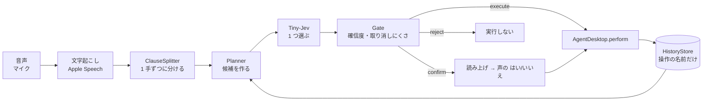

# PC 操作の流れ（試作）

`vc plan`・`act`・`listen`・`eval` が使う、「画面・アプリ・キーの候補から、Tiny-Jev が 1 手を選び、agent-desktop で実行する」流れの設計。**試作**であり、実測で外れが多い（[検証手順と記録](verification.md)）。主な流れは [スキル](skills.md)。要件は [SPEC](../SPEC.md) の F7・F8。

## 流れ

`Planner.plan(発話, history)`：

1. 前面アプリの snapshot（要素・位置・ウィンドウ）を取る。読めなければ、要素なしで続ける（注意を残す）。
2. **具体的な操作を全部、1 つの選択肢の一覧にする**（「操作の種類」を先に選ぶ段は置かない：2 段にすると、種類を選ぶ段が最も外れた）。
3. Tiny-Jev が、「どれでもない」を含めて、1 つ選ぶ（32 個を超えれば、`Chooser` の勝ち抜き戦）。
4. ゲートが、確信度と取り消しにくさで、`execute`・`confirm`・`reject` を決める。

## コードの構造

- **`PCRunner`**（`VCPCControl`）が、「発話を 1 手ずつに分ける → 計画 → 門 → 確認 → 実行 → 履歴」の流れと、その規則（実行してよいか・確認が要るか・取りやめ）を持つ。`HistoryStore` も、`PCRunner` が持つ。表示・読み上げ・終了コードは持たず、起きたことを `PCEvent` の列として `PCReporter` へ送るだけ。
- `vc` 側は、引数の解釈と表示だけ：`Commands/PCControl.swift`（`plan`・`act`。表示は `TerminalPCReporter`）、`Commands/Eval.swift`（`eval`。手の文字列化・コーパスの読み取り・当たりの集計は `PCEval`）、`Commands/Listen.swift` の、声の流れの退避先（スキルが選ばれなかったとき。表示と確認の読み上げは `HUDPCReporter`、確認の返事は次の発話の「はい」）。
- 端末（`plan`・`act`）と声の流れで、振る舞いが違う所は、`PCRunner` を分けずに、`PCReporter` と `confirm`（端末は `--yes`、声は次の発話の判定）で表す。構造の説明は [構成説明](architecture.md#pc-操作の実行の流れpcrunner)。

## 候補の作り方

選択肢は、日本語の 1 行（モデルが読む）。**キーワード（正規表現）は、候補を入れるかの門番**で、選ぶのは Tiny-Jev。

| 候補 | 入れる条件 | 実行 |
|---|---|---|
| ボタンを押す: 名前（位置） | snapshot の押せる要素。名前のない要素は、位置を指す言い方のときだけ | `click <ref>` |
| 状態を変える（チェック・開閉・空にする・カーソル） | **その操作を持つ要素にだけ**（`available_actions` による）。`clear` は必ず確認 | `check`・`uncheck`・`toggle`・`expand`・`collapse`・`clear`・`focus` |
| キー操作 | 組み込み 26 件＋ JSON の定義（`app`・`when` の条件つき）。要素の名前・「ボタン」などの語が発話にあるとき、矢印キーは外す | `press <キー>` |
| スクロール | 画面にスクロール領域があるとき（4 方向） | `scroll <ref> --direction` |
| ウィンドウ | 前面のアプリが分かるとき（最大化・最小化・元に戻す） | `maximize`・`minimize`・`restore --app` |
| 文字を入力する: 文字 | 話した文字が取り出せ（`TextExtractor`）、入力欄があるとき | `type <ref> <文字>` |
| 検索する: 文字 | 「…を検索して」の形のとき | ブラウザは cmd+L、他は cmd+F を押し、フォーカスされた欄へ入れて return |
| アプリを開く: 名前 | 「開く・起動・アクティブ・切り替え・前面・出して・見たい…」の言い方のとき | `open -a`（開いたあと、ウィンドウがなければ AppleScript の `activate`） |
| アプリを終了する: 名前 | 「終了・落と・閉じ」の言い方のとき。**必ず確認** | `close-app` |
| 直前の操作をもう一度する・逆にする | 「もう一回・同じ・さっき・逆・戻して…」の言い方のとき | 記録した手を、画面の要素に結び直して実行 |

コマンドを全部、平らな選択肢にはしない。要素 × 全コマンドにすると、候補が数百になり、確率が薄まる。agent-desktop の対応状況：

| agent-desktop | 候補 |
|---|---|
| `click`・`type`・`press`・`scroll`・`maximize`・`minimize`・`restore`・`close-app` | ○ |
| `check`・`uncheck`・`toggle`（チェックボックス・ラジオ）・`expand`・`collapse`・`clear`・`focus` | ○（スイッチは、agent-desktop が `toggle` を拒否するので、`click`） |
| `launch` | `open -a` に置き換え（`launch` は、アプリ一覧に壊れた記録があると TIMEOUT する） |
| `set-value`・`select`・`scroll-to`・`right-click`・`double-click`・`triple-click`・`hover`・`drag`・`mouse-*`（物理入力は `--headed`） | ✕ |
| `--surface menubar/menu/sheet/popover/alert`（メニューバー・ダイアログ・ポップオーバーの中） | ✕ **一番大きな穴**（いまの snapshot に出ない） |
| 通知・クリップボード・スクリーンショット・`get`・`is`・`wait`・`resize-window`・`move-window` | ✕ |

## 位置情報

`snapshot --include-bounds` で、要素の位置・ウィンドウの矩形を取り、**ウィンドウの中のおおまかな位置（3 × 3：左上・上・右上・左・中央・右・左下・下・右下）を、選択肢の文に添える**（「ボタンを押す: Open（右）」）。生の座標は渡さない（数値は、言葉より、モデルに読ませにくい）。大きさのない要素は除く。`--no-location` で外せる（比較用）。

## ゲート

`Gate.verdict`：

- どれかの段の確率が下限（0.40）未満、または「どれでもない」→ `reject`。
- 取り消しにくい確率（はい／いいえの選択肢）が 0.5 以上、または確認が必須の手 → `confirm`。
- 確率が 0.70 以上 → `execute`。0.40〜0.70 → `confirm`。

**確信度だけでは、誤りを防げない**（誤りにも 95〜99% が付く）。だから、確認と、必ず確認する手の指定を残す。閾値は仮で、測定では決めていない。下限を 0.55 → 0.40 に下げたのは、正しい選択が 52% で捨てられたため（0.70 未満は確認になるので、黙って実行は増えない）。

## 複数の手と文脈

- **分け方**（`ClauseSplitter`）：句点・「…て、」・「そのあと」・「…てから」・「…て」の直後に文が続く形。かぎ括弧の中は分けない。「…してください」は「…して」にし、文頭の「まず」「そこで」「で、」を外す。「ついて」「として」「してほしい」などは分けない。`--llm-split` で、Apple の言語モデルに書き直させる（聞き違いのある長い文には効くが、きれいな文では手を足すことがある。既定はルール）。
- 前の手を実行したあとの画面で、次の手を計画する（`plan`・dry-run は、実行しないので、いまの画面で各手を計画して見せるだけ）。どれかの手が「実行しない」なら、残りも中止。確認が要る手は、その場で確認し、承認されなければ、その手と残りを中止する。
- **前の指示を文脈に使う**：実行した手（最大 3 件・180 秒以内。発話の文字は持たない）から、「もう一度する」「逆にする」を候補に足す。**前の指示に触れる言い方のときだけ**、候補と文脈の文を添える（常に添えると、あらゆる発話が「繰り返し」に引きずられた）。`--no-context` で外せる。

## 音声入力（スキルを先に、なければ PC 操作）

`vc listen --hotkey` は、文字にした発話を、まず**スキル**（Tiny-Jev が選び、Apple の言語モデルが実行する。[スキル](skills.md)）に渡す。**当てはまるスキルがなければ、既定スキル**（`default`。`agent-desktop` と基本のコマンドで実行する組み込みのスキル。会話・独り言は実行せず、取り消しにくい依頼は確認する。[スキル](skills.md#既定スキルdefault)）。既定スキルを無効にしている（`vc skills disable default`）か、スキルが 1 つもなければ、下の PC 操作の流れ（Tiny-Jev が候補から 1 手を選ぶ）に回す。**実行の既定**：スキルは、`vc run` と同じく**実行する**（`--dry-run` を付けたときだけ、表示だけ。画面の上にも「実行していません」と出す）。PC 操作は、**`--execute` を付けたときだけ**実行する（なければ、計画の表示だけ）。起動したときに、ターミナルへ、どちらの設定かを出す。

- **トリガー**：既定は Shift の単独の長押し（0.35 秒以上。他のキーが押されたら取りやめ。アクセシビリティの許可が要る）。`vc hotkey set <キー>` で変えられる（`~/.voice-control/settings.json`）。修飾キーだけ（`shift`・`ctrl+opt`）は長押し、修飾キー＋キー（`ctrl+opt+space`・`cmd+shift+r`・`f5`）は組み合わせ（許可不要）。その回だけなら `--trigger <キー>`。押している間だけ録音する。書き方の詳細は `vc hotkey --help`。
- **Esc で取りやめ**：録音中は、録音を捨てる（認識しない）。認識中・実行中・確認の待ちは、処理を止める（実行中のコマンドも止める）。Esc を受けるのは、これらの間だけで、ふだんの Esc には触れない。**録音中（Shift などを押している間）の Esc には、アクセシビリティの許可が要る**（許可がなければ、押している間の Esc は、届かない。離したあとの Esc は、許可なしでも届く）。録音中の Esc は、ほかのアプリにも届く（横取りしない）。
- **画面の表示（HUD）**：ターミナルが見えていなくても結果が分かるように、画面の上の中央に、小さなパネルを出す（暗いガラス調・角丸・フェード）。段階ごとに、アイコンの色と文言が変わる：**録音中**（赤いマイク・押している間）→ **認識中…** → **実行中**（選んだスキルのバッジ・聞こえた文・実行したコマンドごとの ▸／✓／✗／⊘ と出力の先頭 1 行）→ **完了**（言語モデルの返事。読む時間は、長さに応じて 4〜12 秒）／**失敗**（理由）／**実行しませんでした**（拒否の理由）。確認が要る手は、**実行しますか？** と問いかけて、次の発話を待つ。右上のチップに、トリガーの名前を出す。クリックを通し、フォーカスを奪わないので、操作の対象のアプリは前面のまま。見た目は `vc hud-preview` で、トリガーの届き方は `vc hotkey-check`（録音しない）で、確かめられる。
- 文字起こしは Apple のオンデバイス（`SpeechTranscriber`）。文末の句読点は外す。
- 確認が要る手は、`say` で問いかけを読み上げ、**次の発話**の「はい／いいえ」を Tiny-Jev で判定する（確信度 0.8 以上の「はい」だけ実行）。
- 入力はマイクだけ。システム音声からは、実行しない。
- **構造**：聞く・録る・Esc・認識の待ち行列の調整は `VoiceLoop`（VCSpeech。スキル・PC 操作・画面の表示は知らない）。`vc` 側の `Commands/Listen.swift` が、スキル（`SkillRunner`＋`HUDReporter`）と PC 操作（`PCRunner`＋`HUDPCReporter`）への振り分けを、発話の処理として渡し、出来事（録音中・認識中・取りやめ…）を画面の上と端末に出す。時間と並行の決まり事は [構成説明](architecture.md#時間と並行)。

## 既知の限界

- 一覧にないアプリ名は、別の操作（たとえば新しいタブ）に化ける。アプリの終了は、似た名前の別のアプリを選ぶことがある（確認の問いかけが、選んだ名前を読み上げるのが唯一の防御）。
- 「元の大きさに戻して」が、ウィンドウを戻す操作ではなく、cmd+Z を選ぶ。「戻して」だけは、本当に曖昧。
- 文字起こしの聞き違い・文の途中の句点で、手の分け方が崩れる。1 回の発話は、短い 1〜2 手にする。
- 取り消しにくさの判定（はい／いいえ）は、当たり率を測っていない。
- 一部のアプリ（Electron 系）は、画面を読めない（`WINDOW_NOT_FOUND`）。そのときは、キー操作が代わりになる。
- 「選ぶ」役を Apple の言語モデルにすると、当たりが約半分に落ちた（[検証手順と記録](verification.md)）。選ぶ役は Tiny-Jev のまま。
