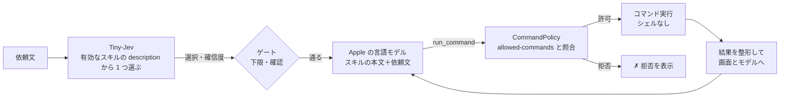

# スキル

`vc run "<依頼>"`・`vc listen` が使う、スキルの書き方と、動き方。要件の正本は [SPEC](../SPEC.md)（F1〜F6）、構成は [構成説明](architecture.md)、測定は [検証手順と記録](verification.md)。

## しくみ



- **選ぶのは Tiny-Jev**（`description` だけを読む。0.1 秒）。**実行するのは Apple の言語モデル**（本文と依頼文を読み、`run_command` という道具 1 つで、コマンドを実行する）。
- 実行してよいコマンドは、スキルの `allowed-commands` だけ。言語モデルの出力を、そのまま信用しない（[構成説明の信頼の境界](architecture.md#信頼の境界)）。
- 実行するコマンドと結果は、すべて画面に出る。
- この流れ（選ぶ → 確認 → 実行 → 結果）は、`VCSkill` の `SkillRunner` が持つ。`vc run`（端末へ表示）・`vc listen`（Enter で録音する通常モード。端末へ表示）・`vc listen --hotkey`（画面の上の表示と、声の確認）は、同じものを呼び、きっかけと表示・確認の取り方だけが違う（[構成説明](architecture.md#スキルの実行の流れskillrunner)）。

## 置き場所

スキルは、2 か所に置ける。**グローバル**（どこで起動しても使う）と、**プロジェクト**（そのプロジェクトで起動したときだけ使う）。

| 種類 | 場所 | 使われるとき |
|---|---|---|
| グローバル | `~/.voice-control/skills/<name>/SKILL.md`（`VC_HOME` で `~/.voice-control` を変えられる。検証用） | いつも |
| プロジェクト | `<プロジェクトのルート>/.voice-control/skills/<name>/SKILL.md` | **信頼したプロジェクト**で起動したとき |

- **プロジェクトのルートは、`vc` を起動した場所**（カレントディレクトリ）。親のディレクトリへは、さかのぼらない。プロジェクトのルートで起動する。
- **同じ名前なら、プロジェクトが、グローバルを上書きする**（`vc skills` に、上書きを表示する）。
- ホームで起動したときは、`~/.voice-control/skills` が、グローバルと同じ場所になるので、二重には読まない。
- **スクリプトを同梱するスキルは、`${SKILL_DIR}`（そのスキルのディレクトリ）で書く**：`allowed-commands` と本文の `${SKILL_DIR}` は、`vc` が読み込むとき、SKILL.md のある場所の絶対パスに置き換える（空白などを含むパスは、`"…"` で囲む）。同じ SKILL.md が、**グローバル（`~/.voice-control/skills/`）に置いても、プロジェクトに置いても**動く（相対パスで書くと、置き場所と起動した場所が違うとき、スクリプトが見つからず失敗する）。個人のパスを、リポジトリに入れずに済む。例：このリポジトリの `.voice-control/skills/spotify/`（`osascript ${SKILL_DIR}/spotify.applescript`。AppleScript の許可リスト方式。`osascript` に、任意の `-e` を渡させず、決まったスクリプトの、決まった action だけを実行させる）。プロジェクトのスキルとして使うには、このリポジトリで `vc skills trust`。置き換えるのは `${SKILL_DIR}` だけで、ほかの `$` は、そのまま。
- 設定（有効・無効・ホットキー・信頼したプロジェクト）は、グローバルの `~/.voice-control/settings.json` だけ。有効・無効は、**名前ごと**（同じ名前のスキルは、まとめて）。

### プロジェクトのスキルの信頼

プロジェクトのスキルは、リポジトリなど、**外から来るもの**になりうる。`allowed-commands` に書かれたコマンドは、言語モデルが実行できる。そこで、**利用者が確認して信頼したプロジェクトだけ**、読み込む（既定は、未信頼）。

```sh
cd ~/work/my-project          # ここが、プロジェクトのルート
vc skills                     # 未信頼：N 件を読み込んでいない、と出る
vc skills trust               # 許可するコマンドを表示して、信頼する
vc skills untrust             # やめる
```

- 信頼は、プロジェクトの場所（実体のパス）ごとに、`settings.json` の `trustedProjects` に記録する。場所を変えたら、もう一度信頼する。
- 未信頼のプロジェクトでは、`vc run`・`vc listen` が、「読み込んでいない」と警告する。
- **信頼したあとに、スキルの中身が変わっても、再確認はしない**（`git pull` などで、許可するコマンドが増えることがある）。信頼したプロジェクトの `allowed-commands` の変更は、自分で見る。

## 既定スキル（default）

**どのスキルにも当てはまらない依頼**を、Apple の言語モデルが、`agent-desktop` と基本のコマンドで実行する、**組み込みのスキル**（`vc skills` に「組み込み」と出る）。「基本は何でも実行できる」ための、受け皿。

| 項目 | 内容 |
|---|---|
| 使われるとき | Tiny-Jev が、有効なスキルのどれも選ばなかったとき（`vc run`・`vc listen`）。**Tiny-Jev の選択肢には、入らない**（説明が広く、すべての依頼を吸うため） |
| 実行の前の判定 | ① Tiny-Jev が、**操作の依頼か**を見る（会話・独り言・質問・あいづちは、実行しない）。② Tiny-Jev が、**取り消しにくい依頼か**（削除・送信・購入・終了など）を見る。そうなら、実行の前に確認する（`vc run`・Enter で録音する `vc listen` は `[y/N]`、`vc listen --hotkey` は声の「はい」） |
| 既定の許可 | `agent-desktop`・`open`・`say`・`ls`・`pwd`・`date`。**控えめ**（削除・移動・通信・任意のスクリプトは、含まない） |
| 許可を広げる・狭める | 同じ名前 `default` のスキルを置く（グローバルでも、プロジェクトでも）。それが、組み込みに代わる。**シェル・`sudo`・`env` などは、どのスキルでも許可できない**ので、「bash を何でも」は、できない。コマンドを 1 つずつ、`allowed-commands` に書く |
| 使わない | `vc skills disable default`。当てはまるスキルがなければ、`vc run`・`vc listen`（`--hotkey` も）は、何も実行しない |

- 「操作の依頼か」の判定は、自作の 40 文（`corpus/gate.tsv`）で、言い方を比べて決めた。**操作の依頼 18/20 を通し、会話 20/20 を止めた**（`vc eval-gate corpus/gate.tsv`。コーパスを見たあとに、言い方としきい値を決めたので、楽観側。取りこぼしは「音量を下げて」「ごみ箱を空にして」）。「はい／いいえ」の形では、操作の依頼を 5/20 しか通せなかった。
- 「取り消しにくいか」の判定は、**当たり率を測っていない**（「電卓を開いて」が 44% と出るなど、粗い）。確認が要るかは、この確率が 0.5 以上かで決める。
- 言語モデルへの指示（本文）は、`DefaultSkill.body`。道具の呼び出しは、スキルと同じ `run_command` で、許可の判断は、コードが毎回行う。

## SKILL.md の形式

```markdown
---
name: open-app
description: アプリを開く・起動する・前面に出す
allowed-commands:
  - open
---
Open the application the user named.
1. Run: open -a "<App name>"
Then reply done.
```

| フロントマター | 必須 | 内容 |
|---|---|---|
| `name` | ○ | ディレクトリ名と同じ。英小文字・数字・ハイフン（40 文字まで） |
| `description` | ○ | **Tiny-Jev が選ぶための説明**。日本語・短く（200 文字まで） |
| `allowed-commands` | ○ | 実行してよいコマンド（下記）。書かなければ、そのスキルは読み込まれない |
| `confirm` | | `true` なら、実行の前に、必ず確認する |
| `result` | | `markdown-note` なら、**最後の返事（Markdown）を、`$TMPDIR/voice-control-notes/note-<日時>.md`（ディレクトリ 700・ファイル 600。消さない）に保存して、`open` で開く**。モデルは、本文だけを返す（「done:」を付けない）。保存先と名前は `vc` が決める。ほかの値は、読み込めない。例：`.voice-control/skills/clipboard-note` |

本文は、実行を担当する言語モデルへの指示。**英語**で、番号つきの手順と、実際のコマンドを書く。書き方（測定で分かったこと）は、[スキルを作るスキル](../skills/voice-control-skill-author/SKILL.md)。

フロントマターは最小の YAML だけを解釈する：`key: 値`、`key:` の次の行から `- 項目`、`key: [a, b]`。値の引用符（`'` `"`）は外す。`#` で始まる行は無視する。

## allowed-commands の仕様

**書き方**

```yaml
allowed-commands:                      # リスト
  - open
  - agent-desktop click @a*
  - Bash(open -a *)                    # Claude Code の権限ルールの形も読める
allowed-commands: [open, say]          # インライン
allowed-commands: open                 # 1 つだけ
```

**照合**：項目は、シェルと同じ規則（空白区切り・引用符・`\`）でトークンに分ける。言語モデルが実行を頼んだコマンドも同じ規則で分け、**先頭のトークン列が、項目のトークンに一致**したときだけ実行する（**前方一致**。大文字小文字を区別する）。

| 項目 | 通る | 通らない |
|---|---|---|
| `open` | `open -a Safari` | `say hi` |
| `agent-desktop click` | `agent-desktop click @a1:e3` | `agent-desktop type …` |
| `open -a Spotify` | `open -a Spotify` | `open -a Safari`、`open Spotify` |
| `agent-desktop click @a*` | `agent-desktop click @a1:e3` | `agent-desktop click @s1:e3` |
| `open -a *.app` | `open -a Safari.app` | `open -a Safari` |
| `agent-desktop * @a1:e1` | `agent-desktop click @a1:e1` | `agent-desktop @a1:e1`、`agent-desktop click @a1:e2` |

- **`*`（ワイルドカード）**：トークンの中の `*` は、**そのトークンの中で**、任意の文字列（空を含む）に一致する。トークンをまたがない。`*` だけのトークンは、任意の 1 トークンに一致する。**コマンド名（先頭のトークン）には使えない**（どのコマンドにも一致してしまうため）。
- 項目の**後ろ**の引数は、何でも通る（前方一致）。末尾の `*`（`open *`・`open:*`）は、あってもなくても同じ。絞りたいときは、項目に引数まで書く。
- `Bash(…)` の包みは外して読む（`Bash(open -a *)` ＝ `open -a`）。`Bash` 以外のツール名（`Read(…)`）は不可。
- オプションの位置が、一致に影響する（`agent-desktop --headed click …` は、`agent-desktop click` に一致しない）。

**読み込み時の検査**（違反するとスキル全体を読み込まない。理由は `vc skills` に出る）

- 先頭のトークンは、`A-Za-z0-9._+-` だけのコマンド名。`*` とパス（`/bin/rm`）は不可。
- 次のコマンドは不可：`sh bash zsh dash fish ksh csh tcsh env xargs sudo su doas eval exec nohup command builtin`（許可の意味を失わせる）。
- 空・引用符の閉じ忘れ・末尾が `\` の項目、`Bash` 以外のツール名は不可。

**実行時の検査**（許可されていても、毎回かける）

- 先頭のトークンにパスを含むもの、禁止コマンド、引数の NUL 文字、`agent-desktop` の `--force` は拒否。
- 拒否したときは、`✗ 拒否: …` と理由を表示し、モデルにもエラーを返す。

**実行の方式**：シェルなし。`; | && $() > <` は、ただの文字として引数に渡る。コマンドは PATH から探す。1 回の実行で最大 15 コマンド・1 コマンド 30 秒。

**できないこと**：完全一致の指定（前方一致のみ）、複数のトークンをまたぐ `*`、正規表現・否定の指定、環境変数の指定。

**責任の範囲**：`allowed-commands` は、言語モデルの暴走への歯止め。許可したコマンドの中身は守らない（`rm` を許可すれば、`rm` が実行される）。`osascript`・`python`・`node` のような、任意のコードを実行できるコマンドを許可するかは、スキルの作者の責任（読み込みは止めない）。

### Claude Code の `allowed-tools` との違い

[Claude Code のスキル](https://code.claude.com/docs/en/skills.md)・[権限ルール](https://code.claude.com/docs/en/permissions.md)（2026-11-03 に確認）と比べる。

| | Claude Code（`allowed-tools`） | このツール（`allowed-commands`） |
|---|---|---|
| 意味 | **事前承認**（そのターンだけ、確認なしで使える）。制限ではない。制限は `disallowed-tools`・deny ルール | **許可リスト**（書いていないコマンドは、実行できない） |
| 項目の形 | `Bash(git add *)` など、ツール名つき（`Read`・`Grep` なども） | コマンドだけ。`Bash(…)` の形も読める（`Bash` のみ） |
| `*` | 任意の位置・複数トークンをまたぐ。`ls *` は `ls` 単体にも一致 | トークンの中だけ。後ろの引数は、もともと何でも通る |
| `*` のない項目 | **完全一致** | **前方一致**（逆）。`open` は `open -a Safari` にも一致する |
| 実行 | シェル経由。`&&` `;` `\|` を理解して、サブコマンドごとに照合。`timeout` `nice` `xargs` などを外して照合 | **シェルなし**。`;` `&&` は、ただの引数。ラッパーは外さない（`timeout 30 open` は、`open` の許可に含まれない） |
| 名前 | 標準（Agent Skills）にあるフィールド | 標準にない。claude.ai へのアップロードでは、許可外のキーとして拒否される |

- Claude Code の Bash の deny ルールは、`/usr/bin/curl`・`sh -c '…'`・`git -C . push` のような別の形をすり抜ける（公式にも「境界ではない」とある）。このツールは、許可リスト・シェルなし・パス指定の拒否・ラッパーの不許可で、その経路を作らない。
- **`allowed-commands` を持たない Claude Code のスキルは、`vc` では読み込まれない**（必須のため）。`name`・`description`・本文は、同じ形で共有できる。
- 名前を `allowed-tools` にしないのは、意味が違う（制限か、承認か）ため。

## コマンド

| コマンド | 内容 |
|---|---|
| `vc skills [list]` | 一覧：有効／無効・name・置き場所（グローバル／プロジェクト）・description。読み込めなかったスキルは、理由つきで下に出る |
| `vc skills show <name>` | 許可するコマンド・確認の要否・置き場所・ファイルの場所 |
| `vc skills install [<name>…] [--force] [--ref <版>]` | **GitHub の公開リポジトリ（`takemo101/voice-control`）のスキルを、スクリプトごとグローバルへインストールする**（名前なしは、一覧）。リポジトリが手元になくてよい。版は、入っている vc と同じタグ（なければ main）。同名は、`--force` で置き換える。取得元と許可するコマンドを表示する。取得するのは、スキルのファイルだけ（音声・画面の内容は、送らない） |
| `vc skills trust` / `untrust` | 起動した場所のプロジェクトのスキルを、読み込んでよいか（trust は、許可するコマンドを表示してから信頼する） |
| `vc skills enable <name>` / `disable <name>` | Tiny-Jev の選択肢にするか。**既定は有効**。設定は `settings.json` |
| `vc run "<依頼>" [--skill <name>] [--dry-run] [--yes]` | 選んで、実行する |
| `vc listen [--hotkey] [--trigger <キー>] [--dry-run] [--yes] [--no-mute]` | マイクから聞いて、同じ流れで実行する（下の「声の入力」） |

`vc run` の動き：

1. 有効なスキルから、Tiny-Jev が選ぶ（「どれでもない」を含む）。確信度が下限（0.40）未満なら、実行しない。
2. 確信度が 0.70 未満、または `confirm: true` なら、`[y/N]` で確認する（`--yes` で省略）。
3. スキルの本文と依頼文を、言語モデルへ渡し、`run_command` を実行させる。
4. 最後に、モデルの返事（`done: …`／`failed: …`）と、実行したコマンドの件数を出す。

`--skill` は、選ぶ段を飛ばして指定する（無効なスキルは実行しない）。`--dry-run` は、コマンドを実行せず、実行しようとするコマンドだけを出す。**モデルは出力を見られないので、途中の手順は推測になる**（本番とは違う）。

## 声の入力（vc listen）

`vc listen` は、マイクから聞いて、文字にした発話を、`vc run` と同じスキルの流れ（`SkillRunner`）で実行する。**当てはまるスキルがなければ、既定スキル**（上の[既定スキル](#既定スキルdefault)）。既定スキルを無効にしている（`vc skills disable default`）と、当てはまるスキルがない依頼は、**何も実行しない**（ターミナルに `（どのスキルでもない）` と `→ 実行しない（理由）`、`--hotkey` では画面の上にも「どのスキルでもありません」を出す）。ほかの流れへは回さない。**実行の既定**：`vc run` と同じく**実行する**（`--dry-run` を付けたときだけ、表示だけ。`--hotkey` では、画面の上にも「実行していません」と出す）。

- **2 つの起動の仕方**：
  - `vc listen`（既定）：Enter で録音を始め、もう一度 Enter で止める（`q` で終了）。文字にして、スキルの流れで実行する。表示は `vc run` と同じ `TerminalReporter`（`▶ 実行`・`▶ 結果` の見出し・説明つき。失敗は標準エラー）。違いは、見出し `▶ スキルの選択` を出さない（`vc run` の `Run.swift` が出す）ことと、失敗しても終了せず、次の録音へ進むこと。端末だけで、画面の上の表示・トリガー・Esc での取りやめは、ない。確認が要るときは、端末で `[y/N]` を聞く（`--yes` で省略）。
  - `vc listen --hotkey`：トリガーを押している間だけ録音する。画面の上に出す・Esc で取りやめる・声で確認する、は、こちらだけ。起動したときに、ターミナルへ、スキルを実行するかどうか（`--dry-run`）を出す。
- **録音中は、ほかの音を消す**（両方の起動の仕方。`--no-mute` で消さない）：録音の間だけ、出力（スピーカー・ヘッドホン）を消音にし、マイクが再生中の音楽・通話を拾うのを防ぐ。開始の合図（Pop）が聞こえるよう、0.3 秒ほど遅れて消し、離したら（認識の合図 Tink の前に）・Esc で取りやめたら・録音に失敗したら、戻す。**もともと消音の出力には触らない**。消音のスイッチがない出力は、音量を 0 にして、元の音量へ戻す。**消音のスイッチも音量もない出力（HDMI・DisplayPort・複数出力デバイスなどの一部）は、消せない**（知らせない）。消すのは、既定の出力デバイスだけで、左右（チャンネル 1・2）が対象。Ctrl+C などで終わるときも戻す。強制終了（SIGKILL）・クラッシュでは、戻せず、消音のままになる（システム設定のサウンドで戻す）。
- **トリガー**（`--hotkey`）：既定は Shift の単独の長押し（0.35 秒以上。他のキーが押されたら取りやめ。アクセシビリティの許可が要る）。`vc hotkey set <キー>` で変えられる（`~/.voice-control/settings.json`）。修飾キーだけ（`shift`・`ctrl+opt`）は長押し、修飾キー＋キー（`ctrl+opt+space`・`cmd+shift+r`・`f5`）は組み合わせ（許可不要）。その回だけなら `--trigger <キー>`。押している間だけ録音する。書き方の詳細は `vc hotkey --help`。
- **Esc で取りやめ**（`--hotkey`）：録音中は、録音を捨てる（認識しない）。認識中・実行中・確認の待ちは、処理を止める（実行中のコマンドも止める）。Esc を受けるのは、これらの間だけで、ふだんの Esc には触れない。**録音中（Shift などを押している間）の Esc には、アクセシビリティの許可が要る**（許可がなければ、押している間の Esc は、届かない。離したあとの Esc は、許可なしでも届く）。録音中の Esc は、ほかのアプリにも届く（横取りしない）。
- **認識には、時間の上限がある**：言語モデルの用意（初回だけ長い）は 300 秒（その実行の中で 1 回成功したら、以後は省く）、録音 1 回分の認識は、**録音の長さの 3 倍 + 5 秒（短くても 10 秒）**。認識が上限に達したら、新しい認識器で **1 回だけやり直し**、それも止まれば、止まった処理を放置して「音声の認識が 14 秒以内に終わらなかったので、やめました」のように示し、次の発話を受け付ける（上限がないと、認識が止まったとき、そのあとの発話が、すべて待たされる）。Esc は、処理が応えなくても、すぐ効く。言語モデルの応答（実行中）には、時間の上限は、まだない（Esc で取りやめる。コマンドの実行は 30 秒）。
- **画面の表示（HUD。`--hotkey`）**：ターミナルが見えていなくても結果が分かるように、画面の上の中央に、小さなパネルを出す（暗いガラス調・角丸・フェード）。段階ごとに、アイコンの色と文言が変わる：**録音中**（赤いマイク・押している間）→ **認識中…** → **実行中**（選んだスキルのバッジ・聞こえた文・実行したコマンドごとの ▸／✓／✗／⊘ と出力の先頭 1 行）→ **完了**（言語モデルの返事。読む時間は、長さに応じて 4〜12 秒）／**失敗**（理由）／**実行していません**（`--dry-run`）／**操作の依頼ではありませんでした**（会話・独り言）／**どのスキルでもありません**（当てはまるスキルがなく、既定スキルも使えない）。確認が要るときは、**実行しますか？** と問いかけて、次の発話を待つ。右上のチップに、トリガーの名前を出す。クリックを通し、フォーカスを奪わないので、操作の対象のアプリは前面のまま。見た目は `vc hud-preview` で、トリガーの届き方は `vc hotkey-check`（録音しない）で、確かめられる。
- 文字起こしは Apple のオンデバイス（`SpeechTranscriber`）。文末の句読点は外す。
- 確認が要る依頼は、`--hotkey` では、`say` で問いかけを読み上げ、**次の発話**の「はい／いいえ」を Tiny-Jev で判定する（確信度 0.8 以上の「はい」だけ実行。`Confirmation`）。
- 入力はマイクだけ。システム音声からは、実行しない。
- **構造**：聞く・録る・Esc・認識の待ち行列の調整は `VoiceLoop`（VCSpeech。スキル・画面の表示は知らない）。`vc` 側の `Commands/Listen.swift` が、スキル（`SkillRunner`＋`HUDReporter`）の実行を、発話の処理として渡し、出来事（録音中・認識中・取りやめ…）を画面の上と端末に出す。時間と並行の決まり事は [構成説明](architecture.md#時間と並行)。

## 画面の表示

`echo` だけを許可した使い捨てのスキル（`echo-test`。説明は「テストを実行する」）を、一時の `VC_HOME` に置いて、`NO_COLOR=1 vc run テスト --yes` を実行した出力（実際の出力。返事の文言・秒数・確率は、実行のたびに変わる）。

```text
model loaded 4.3s (length 1024)

▶ スキルの選択
  Tiny-Jev  echo-test   98.6%（0.1 秒）
  説明      テストを実行する
  許可      echo

▶ 実行
  $ echo test
    ✓ exit 0
    │ test
    │ 

▶ 結果
  返事      done: テストを完了しました。
  所要      1.2 秒・実行したコマンド 1 件
```

| 場面 | 表示 |
|---|---|
| モデルの読み込み | `model loaded <秒>s (length <入力長>)`（標準エラー。`vc skills` など、モデルを使わないコマンドには出ない） |
| 選択 | 見出し `▶ スキルの選択`、`Tiny-Jev  <name>  <確率>（秒）`（`--skill` のときは `指定  <name>`）、`説明`、`許可`。既定スキルへ回すときは `どのスキルでもない → 既定スキル default（…）`。実行しないときは `（どのスキルでもない）` と `→ 実行しない（理由）` |
| 実行の直前 | 見出し `▶ 実行`（`--dry-run` では `▶ 実行（dry-run：コマンドは実行しない）`）、続けて `  $ <コマンド>` |
| 実行後 | `    ✓ exit 0`／`    ✗ exit <終了コード>`、続けて出力を、行頭に `    │ ` を付けて、最大 8 行（超えた分は `    … 他 N 行`） |
| 許可外 | `  ✗ 拒否: <コマンド>  — <理由>`（実行しない） |
| 最後 | 見出し `▶ 結果`、`返事  …`、`所要  <秒>・実行したコマンド N 件`（実際に実行した数。拒否・dry-run は含まない。dry-run では `（dry-run）` を添える） |

- agent-desktop を使うスキルで表示される参照（`@a1:e20`）は、モデルが使う短い別名。実行の直前に、本物の参照へ戻す（下記）。
- モデルへ返す出力は最大 1800 文字。画面には 8 行まで。タイムアウト（30 秒）は、モデルには `(timed out)` と伝えるが、画面には付けない（終了コードと出力だけ）。声の流れ（`vc listen --hotkey`）では、見出しを出さず、結果は画面の上にも出る（[声の入力](#声の入力vc-listen)）。
- 画面の表示は、ファイルに残さない（画面の内容を含むため）。

## コピーした文章を解説・返信案にするスキル（clipboard-note）

`.voice-control/skills/clipboard-note`：返信したい（意味を知りたい）文章を **Cmd+C でコピー**してから、「コピーした文章を解説して」「コピーしたメッセージの返信を考えて」。`pbpaste`（クリップボードを文字で出す macOS のコマンド）で読み、解説・返信案を Markdown で書き、`result: markdown-note` で、ファイルにして開く。許可は、**`pbpaste` だけ**（読み取りだけ。入力・送信・ほかのコマンドはしない）。コピーした文章は、他人の文章（非信頼のデータ）なので、本文で、命令に従わないと明記してある。

- **画面全体を読む方式をやめた理由**：画面の文字（メニュー・ボタン・件数・サイドバーを含む）から、本文を選ぶのは、オンデバイスのモデル（約 3B）には難しく、メモが、画面の機能の説明になった。画像で渡す方式も、本文は選べたが、文字を読み違えた（測定。検証記録）。**利用者がコピーして、対象を決める**方式なら、本文だけが、正確に渡る。Slack など、画面を読めないアプリでも、使える。
- **残る**：メモには、コピーした文章から作った文章が入る。`$TMPDIR/voice-control-notes/` に、**消さずに残る**（OS の一時領域の掃除に任せる）。ディレクトリ 700・ファイル 600。クリップボードに、ほかのもの（パスワードなど）が入っていると、それが渡る：「コピーした〜」と言ったときだけ使う。
- **質**：解説は、文の内容どおりに書けた。**返信案は、質が低い**（文を繰り返す・立場を取り違える）。たたき台として使う。モデルへ返る出力は 1800 文字まで（長い文章は、先頭の部分）。
- 使うには：`vc skills install clipboard-note`（リポジトリは、手元になくてよい。GitHub から取得して、`~/.voice-control/skills` に置く）。

## agent-desktop を使うスキルの要点

- `agent-desktop snapshot` の JSON は、モデルの入力に収まらない。`OutputCompactor` が、操作できる要素だけの行（`@参照 [役割] 名前`）にして返す。エラーは、種類と文だけにする。agent-desktop の警告（stderr）が、結果の JSON の前に混ざっても、`{` で始まる最後の行を読む。
- agent-desktop の参照（`@s17tb038elj2nz:e13`）は、長いランダムな文字列で、モデルが写し間違える（測定）。**モデルには短い別名（`@a1:e13`）を見せ、実行の直前に、本物へ戻す**（`RefAliases`）。
- 本文に、`click @a1:e7` の形の**例**が要る。例がないと、モデルは名前を渡して失敗した（測定）。
- アプリを開くのは、`agent-desktop launch` ではなく、`open -a`（`launch` は、アプリ一覧に壊れた記録があると TIMEOUT する）。
