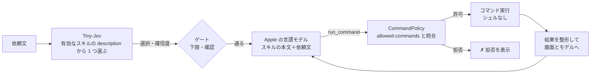

# スキル

`vc run "<依頼>"` が使う、スキルの書き方と、動き方。要件の正本は [SPEC](../SPEC.md)（F1〜F6）、構成は [構成説明](architecture.md)、測定は [検証手順と記録](verification.md)。

## しくみ



- **選ぶのは Tiny-Jev**（`description` だけを読む。0.1 秒）。**実行するのは Apple の言語モデル**（本文と依頼文を読み、`run_command` という道具 1 つで、コマンドを実行する）。
- 実行してよいコマンドは、スキルの `allowed-commands` だけ。言語モデルの出力を、そのまま信用しない（[構成説明の信頼の境界](architecture.md#信頼の境界)）。
- 実行するコマンドと結果は、すべて画面に出る。

## 置き場所

`~/.voice-control/skills/<name>/SKILL.md`。`VC_HOME` で `~/.voice-control` を変えられる（検証用）。設定（有効・無効）は `~/.voice-control/settings.json`。

## SKILL.md の形式

```markdown
---
name: open-app
description: アプリを開く・起動する・前面に出す
allowed-commands:
  - open
---
Open the application the user named.
1. Run: open -a "<App name>"
Then reply done.
```

| フロントマター | 必須 | 内容 |
|---|---|---|
| `name` | ○ | ディレクトリ名と同じ。英小文字・数字・ハイフン（40 文字まで） |
| `description` | ○ | **Tiny-Jev が選ぶための説明**。日本語・短く（200 文字まで） |
| `allowed-commands` | ○ | 実行してよいコマンド（下記）。書かなければ、そのスキルは読み込まれない |
| `confirm` | | `true` なら、実行の前に、必ず確認する |

本文は、実行を担当する言語モデルへの指示。**英語**で、番号つきの手順と、実際のコマンドを書く。書き方（測定で分かったこと）は、[スキルを作るスキル](../skills/voice-control-skill-author/SKILL.md)。

フロントマターは最小の YAML だけを解釈する：`key: 値`、`key:` の次の行から `- 項目`、`key: [a, b]`。値の引用符（`'` `"`）は外す。`#` で始まる行は無視する。

## allowed-commands の仕様

**書き方**

```yaml
allowed-commands:                      # リスト
  - open
  - agent-desktop click @a*
  - Bash(open -a *)                    # Claude Code の権限ルールの形も読める
allowed-commands: [open, say]          # インライン
allowed-commands: open                 # 1 つだけ
```

**照合**：項目は、シェルと同じ規則（空白区切り・引用符・`\`）でトークンに分ける。言語モデルが実行を頼んだコマンドも同じ規則で分け、**先頭のトークン列が、項目のトークンに一致**したときだけ実行する（**前方一致**。大文字小文字を区別する）。

| 項目 | 通る | 通らない |
|---|---|---|
| `open` | `open -a Safari` | `say hi` |
| `agent-desktop click` | `agent-desktop click @a1:e3` | `agent-desktop type …` |
| `open -a Spotify` | `open -a Spotify` | `open -a Safari`、`open Spotify` |
| `agent-desktop click @a*` | `agent-desktop click @a1:e3` | `agent-desktop click @s1:e3` |
| `open -a *.app` | `open -a Safari.app` | `open -a Safari` |
| `agent-desktop * @a1:e1` | `agent-desktop click @a1:e1` | `agent-desktop @a1:e1`、`agent-desktop click @a1:e2` |

- **`*`（ワイルドカード）**：トークンの中の `*` は、**そのトークンの中で**、任意の文字列（空を含む）に一致する。トークンをまたがない。`*` だけのトークンは、任意の 1 トークンに一致する。**コマンド名（先頭のトークン）には使えない**（どのコマンドにも一致してしまうため）。
- 項目の**後ろ**の引数は、何でも通る（前方一致）。末尾の `*`（`open *`・`open:*`）は、あってもなくても同じ。絞りたいときは、項目に引数まで書く。
- `Bash(…)` の包みは外して読む（`Bash(open -a *)` ＝ `open -a`）。`Bash` 以外のツール名（`Read(…)`）は不可。
- オプションの位置が、一致に影響する（`agent-desktop --headed click …` は、`agent-desktop click` に一致しない）。

**読み込み時の検査**（違反するとスキル全体を読み込まない。理由は `vc skills` に出る）

- 先頭のトークンは、`A-Za-z0-9._+-` だけのコマンド名。`*` とパス（`/bin/rm`）は不可。
- 次のコマンドは不可：`sh bash zsh dash fish ksh csh tcsh env xargs sudo su doas eval exec nohup command builtin`（許可の意味を失わせる）。
- 空・引用符の閉じ忘れ・末尾が `\` の項目、`Bash` 以外のツール名は不可。

**実行時の検査**（許可されていても、毎回かける）

- 先頭のトークンにパスを含むもの、禁止コマンド、引数の NUL 文字、`agent-desktop` の `--force` は拒否。
- 拒否したときは、`✗ 拒否: …` と理由を表示し、モデルにもエラーを返す。

**実行の方式**：シェルなし。`; | && $() > <` は、ただの文字として引数に渡る。コマンドは PATH から探す。1 回の実行で最大 15 コマンド・1 コマンド 30 秒。

**できないこと**：完全一致の指定（前方一致のみ）、複数のトークンをまたぐ `*`、正規表現・否定の指定、環境変数の指定。

**責任の範囲**：`allowed-commands` は、言語モデルの暴走への歯止め。許可したコマンドの中身は守らない（`rm` を許可すれば、`rm` が実行される）。`osascript`・`python`・`node` のような、任意のコードを実行できるコマンドを許可するかは、スキルの作者の責任（読み込みは止めない）。

### Claude Code の `allowed-tools` との違い

[Claude Code のスキル](https://code.claude.com/docs/en/skills.md)・[権限ルール](https://code.claude.com/docs/en/permissions.md)（2026-11-03 に確認）と比べる。

| | Claude Code（`allowed-tools`） | このツール（`allowed-commands`） |
|---|---|---|
| 意味 | **事前承認**（そのターンだけ、確認なしで使える）。制限ではない。制限は `disallowed-tools`・deny ルール | **許可リスト**（書いていないコマンドは、実行できない） |
| 項目の形 | `Bash(git add *)` など、ツール名つき（`Read`・`Grep` なども） | コマンドだけ。`Bash(…)` の形も読める（`Bash` のみ） |
| `*` | 任意の位置・複数トークンをまたぐ。`ls *` は `ls` 単体にも一致 | トークンの中だけ。後ろの引数は、もともと何でも通る |
| `*` のない項目 | **完全一致** | **前方一致**（逆）。`open` は `open -a Safari` にも一致する |
| 実行 | シェル経由。`&&` `;` `\|` を理解して、サブコマンドごとに照合。`timeout` `nice` `xargs` などを外して照合 | **シェルなし**。`;` `&&` は、ただの引数。ラッパーは外さない（`timeout 30 open` は、`open` の許可に含まれない） |
| 名前 | 標準（Agent Skills）にあるフィールド | 標準にない。claude.ai へのアップロードでは、許可外のキーとして拒否される |

- Claude Code の Bash の deny ルールは、`/usr/bin/curl`・`sh -c '…'`・`git -C . push` のような別の形をすり抜ける（公式にも「境界ではない」とある）。このツールは、許可リスト・シェルなし・パス指定の拒否・ラッパーの不許可で、その経路を作らない。
- **`allowed-commands` を持たない Claude Code のスキルは、`vc` では読み込まれない**（必須のため）。`name`・`description`・本文は、同じ形で共有できる。
- 名前を `allowed-tools` にしないのは、意味が違う（制限か、承認か）ため。

## コマンド

| コマンド | 内容 |
|---|---|
| `vc skills [list]` | 一覧：`[有効]`／`[無効]`・name・description。読み込めなかったスキルは、理由つきで下に出る |
| `vc skills show <name>` | 許可するコマンド・確認の要否・ファイルの場所 |
| `vc skills enable <name>` / `disable <name>` | Tiny-Jev の選択肢にするか。**既定は有効**。設定は `settings.json` |
| `vc run "<依頼>" [--skill <name>] [--dry-run] [--yes]` | 選んで、実行する |

`vc run` の動き：

1. 有効なスキルから、Tiny-Jev が選ぶ（「どれでもない」を含む）。確信度が下限（0.40）未満なら、実行しない。
2. 確信度が 0.70 未満、または `confirm: true` なら、`[y/N]` で確認する（`--yes` で省略）。
3. スキルの本文と依頼文を、言語モデルへ渡し、`run_command` を実行させる。
4. 最後に、モデルの返事（`done: …`／`failed: …`）と、実行したコマンドの件数を出す。

`--skill` は、選ぶ段を飛ばして指定する（無効なスキルは実行しない）。`--dry-run` は、コマンドを実行せず、実行しようとするコマンドだけを出す。**モデルは出力を見られないので、途中の手順は推測になる**（本番とは違う）。

## 画面の表示

```text
Tiny-Jev の選択（0.11 秒）: fixture-press  95.8%
  自作ウィンドウ（Fixture）のボタンを押す（保存・送信・ヘルプ・設定など）
  許可するコマンド: agent-desktop snapshot、agent-desktop click
$ agent-desktop snapshot -i --app Fixture
  exit 0
  │ app: Fixture
  │ @a1:e20 [button] Settings
$ agent-desktop click @a1:e20
  exit 0
返事（5.3 秒）: done: 設定ボタンを押しました。
実行したコマンド: 2 件
```

| 場面 | 表示 |
|---|---|
| 実行の直前 | `$ <コマンド>`（dry-run では、`（dry-run：実行しない）` を添える） |
| 実行後 | `  exit <終了コード>`、続けて出力を、行頭に `  │ ` を付けて、最大 8 行 |
| 許可外 | `✗ 拒否: <コマンド>  — <理由>`（実行しない） |
| 最後 | `返事（秒数）: …`、`実行したコマンド: N 件`（実際に実行した数。拒否・dry-run は含まない） |

- 表示される参照（`@a1:e20`）は、モデルが使う短い別名。実行の直前に、本物の参照へ戻す（下記）。
- モデルへ返す出力は最大 1800 文字。画面には 8 行まで。タイムアウト（30 秒）は、モデルには `(timed out)` と伝えるが、画面は終了コードだけ。
- 画面の表示は、ファイルに残さない（画面の内容を含むため）。

## agent-desktop を使うスキルの要点

- `agent-desktop snapshot` の JSON は、モデルの入力に収まらない。`OutputCompactor` が、操作できる要素だけの行（`@参照 [役割] 名前`）にして返す。エラーは、種類と文だけにする。
- agent-desktop の参照（`@s17tb038elj2nz:e13`）は、長いランダムな文字列で、モデルが写し間違える（測定）。**モデルには短い別名（`@a1:e13`）を見せ、実行の直前に、本物へ戻す**（`RefAliases`）。
- 本文に、`click @a1:e7` の形の**例**が要る。例がないと、モデルは名前を渡して失敗した（測定）。
- アプリを開くのは、`agent-desktop launch` ではなく、`open -a`（`launch` は、アプリ一覧に壊れた記録があると TIMEOUT する）。
